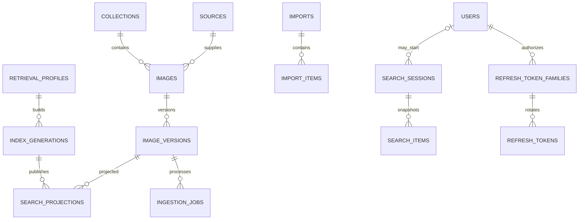

# Mô hình dữ liệu

Trạng thái: schema logic cập nhật ngày 05/11/2026, chưa phải migration SQL. DB quan hệ giữ dữ liệu nghiệp vụ; Qdrant giữ vector và search metadata. UUID dùng cho định danh; thời gian lưu UTC. Payload và đồng bộ được mô tả ở [thiết kế Qdrant](qdrant-design.md).

## 1. Quan hệ

Mỗi image thuộc một collection trong MVP. Collection chỉ tổ chức dữ liệu; mọi người tìm/xem cùng toàn kho đã công bố. Ảnh giống byte trong collections khác nhau vẫn có danh tính riêng. Đa collection cho cùng một image là thay đổi schema cần ADR mới.

## 2. Tài khoản và catalog

| Bảng | Trường chính và ràng buộc |
| --- | --- |
| collections | id, name, status, created_at; status active/disabled |
| users | id, email_normalized unique, password_hash, display_name, role, status, revision, auth_version, created_at, updated_at; role chỉ nhận user/admin, mặc định user; visitor là khách không có bản ghi tài khoản. Status active/disabled; revision tăng khi admin sửa tài khoản, auth_version tăng khi đổi role/status/password |
| refresh_token_families | id, user_id, auth_version, created_at, expires_at, revoked_at, revoke_reason; một family mỗi lần login, deadline tuyệt đối không trượt |
| refresh_tokens | id, family_id, token_hash unique, parent_token_id nullable, replaced_by_token_id nullable, created_at, expires_at, consumed_at, revoked_at; không lưu token thô |
| sources | id, collection_id, type=private trong MVP, name, connector_config_ref, provenance, created_at; không lưu secret trực tiếp |
| images | id, collection_id, source_id, source_item_key, latest_input_revision, lifecycle, current_version, desired_version, metadata_revision, created_at, updated_at, deleted_at |
| image_versions | image_id, version, input_revision, input_payload_hash, source_object_version, object_key, thumbnail_key, metadata_snapshot_key, metadata_snapshot_hash, sha256, byte_size, processing_status, created_at |

Unique images(source_id, source_item_key) định danh ổn định qua các lần import. Không dùng checksum làm image_id vì cùng nội dung có thể là hai bản ghi nguồn khác nhau. source.collection_id phải trùng image.collection_id. object_key được backend sinh, không đưa ra như URL công khai.

lifecycle: active/deleted. current_version có thể null trước khi nhập thành công; desired_version là số version mới nhất được yêu cầu. image_versions unique(image_id, version), version tăng đơn điệu; byte_size và kích thước ảnh trong payload phải dương khi đã validate.

Title/tags/license/width/height/mime_type và provenance hiển thị nằm trong payload Qdrant, không lặp thành bảng search metadata SQL. Snapshot JSON bất biến trong object storage lưu nguồn khôi phục của payload; DB quan hệ chỉ giữ key/hash và các trường nghiệp vụ cần cho identity, version và trạng thái; tài khoản/role nằm trong SQL. Source provenance ở sources chỉ mô tả nguồn, không thay payload từng ảnh. Khi sửa metadata, tạo version dùng lại object/embedding nếu tương thích. metadata_revision trên images phục vụ khóa lạc quan và audit. Không cập nhật mù nếu phiên bản client đã cũ.

Refresh tokens dùng hash của opaque token đủ entropy; access JWT không cần lưu từng token vào SQL. Token đã consumed phải giữ tối thiểu tới family expiry cộng access TTL/clock skew để phát hiện reuse. Rotation khóa theo thứ tự user → family → token, consumed chỉ một lần; parent/replacement phải cùng family. Logout-all/password/role/status thay đổi cập nhật auth_version và revoke families nguyên tử. Không cache revocation theo cách làm mất cam kết hiệu lực sau commit.

## 3. Model và vector

| Bảng | Trường chính và ràng buộc |
| --- | --- |
| retrieval_profiles | id, model_id, model_revision, processor_revision, dimension, normalization, distance_metric, ranking_version, keyword_config, created_at; bất biến sau khi dùng |
| index_generations | id, profile_id, physical_location, status, source_watermark, created_at, activated_at |
| active_search_config | config_key, generation_id, revision; một cấu hình đọc active cho MVP |
| search_projections | generation_id, image_id, content_version, projection_revision, point_id, payload_hash, state, applied_at; không chứa vector hoặc search payload |
| published_projections | generation_id, image_id, point_id, content_version; unique(generation_id, image_id), tham chiếu projection đã kiểm chứng |

Generation states: building → validating → active → retired; failed có thể kết thúc build lỗi. Khi chuyển active, cập nhật pointer và trạng thái trong một transaction hoặc thao tác điều phối tương đương; chỉ có một pointer đang phục vụ.

Model và số chiều phải khớp profile trước upsert Qdrant. Vector không được có NaN/Inf. Index metric và query metric phải trùng. search_projections unique(generation_id, image_id, content_version, projection_revision) và unique(generation_id, point_id). Point ID bất biến cho một projection; published_projections là con trỏ kiểm chứng, không phải kho metadata. Nếu tái sử dụng embedding, vẫn cần xác minh hash/model/processor và tạo projection đúng version mới.

## 4. Imports và jobs

| Bảng | Trường chính và ràng buộc |
| --- | --- |
| imports | id, collection_id, source_id, manifest_key, idempotency_key, request_hash, status, counters, created_by, created_at |
| import_items | id, import_id, source_item_key, input_revision, image_id, content_version, status, error_code, safe_error_detail |
| ingestion_jobs | id, import_item_id, image_id, content_version, generation_id, pipeline_version, status, attempts, next_attempt_at, lease_token, lease_until, last_error |
| catalog_changes | event_id, image_id, content_version, metadata_revision, event_type, created_at; ghi cùng transaction đổi catalog để catch-up/reconcile |
| generation_change_deliveries | generation_id, event_id, status, applied_at; unique(generation_id, event_id), retry an toàn |

Idempotency key được scope theo principal và thao tác; key trùng nhưng request_hash khác trả conflict. Một import_item có thể sinh nhiều job khi phải ghi hai generation trong giai đoạn reindex. Unique job theo (image_id, content_version, generation_id, pipeline_version); không enqueue lặp nếu job đã thành công.

Counters import có thể cập nhật tăng dần nhưng phải đối soát từ trạng thái import_items trước khi báo completed. Item chỉ succeeded khi thỏa điều kiện phục vụ đã định nghĩa; skipped/superseded/cancelled được đếm riêng, không coi là thành công xử lý mới.

catalog_changes là transactional outbox bắt buộc để đồng bộ Qdrant và reindex; event tham chiếu snapshot/artifact bền vững, không chứa vector lớn. Không coi sequence ID là thứ tự commit tuyệt đối: event có ID nhỏ có thể commit muộn. Consumer theo dõi delivery chưa xử lý và có barrier/đối soát trước cutover, không chỉ lưu max(event_id) rồi bỏ mọi ID nhỏ hơn. Event cũ không được công bố đè version/tombstone mới. Retention events phải dài hơn cửa sổ backfill/catch-up và rollback đang hoạt động.

## 5. Phiên tìm kiếm và audit

| Bảng | Trường chính và ràng buộc |
| --- | --- |
| search_sessions | id, user_id nullable, owner_key_hash, query_hash, query_text theo retention, filters, generation_id, ranking_version, expires_at, created_at; snapshot phân trang, không phải cơ chế login |
| search_items | session_id, position, image_id, content_version, point_id; unique(session_id, position) và unique(session_id, image_id) |
| audit_events | id, actor_id, action, resource_type, resource_id, safe_context, timestamp |

Không có bảng feedback hoặc collection_grants trong MVP. Search/thumbnail public; detail/download kiểm tra JWT access token hợp lệ và trạng thái thu hồi, không ACL theo ảnh. Audit ghi thay đổi dữ liệu, tài khoản/role/status và cấu hình; không ghi mật khẩu/token. refresh_token_families/refresh_tokens phục vụ rotation/revocation, không có bảng auth_sessions. search_sessions chỉ phục vụ phân trang; owner_key ngẫu nhiên từ X-Search-Owner chống dùng nhầm cursor, không giới hạn ảnh được tìm. Định dạng access/refresh, cookie transport và thu hồi token ở [auth-design.md](auth-design.md).

## 6. Index và concurrency

- B-tree trên source identity; image collection/lifecycle; version image_id/version.
- Partial index jobs(status, next_attempt_at) cho pending/retry_wait; index lease_until cho tác vụ đang chạy hết lease.
- HNSW và payload indexes nằm ở Qdrant theo generation. collection_id chỉ lọc khi người dùng chọn; không suy từ role/user. Sau retrieval, batch-check trạng thái catalog và pointer trước response. DB quan hệ không có vector index.
- Index expires_at cho search session cleanup; refresh_token_families có user_id/revoked_at/expires_at indexes; refresh_tokens có unique token_hash và index family_id; users có unique email_normalized. Tránh index mọi trường JSON tùy ý.
- Claim jobs bằng transaction ngắn với khóa bỏ qua row đã lock hoặc cơ chế tương đương; lease_token được so khi gia hạn/commit.
- Cập nhật current_version bằng compare-and-set desired_version/lifecycle; stale worker chỉ có thể lưu artifact chưa công bố để dọn sau.

## 7. Xóa, retention và đối soát

Delete tạo tombstone trong images ngay; tăng metadata_revision và vô hiệu hóa job chờ. Purge vật lý chạy nền, xóa vector ở mọi generation rồi object khi không còn tham chiếu cần giữ. Quy trình giữ audit theo retention đã chốt và kiểm tra object dùng chung trước khi xóa.

Session TTL đề xuất 15 phút; raw query log đề xuất 7 ngày cho pilot, tắt lưu query nếu chưa được chốt. Refresh token records và audit retention chờ Q09; feedback không nằm trong MVP. Query/session hết TTL được dọn theo batch. Backup có thời hạn riêng; xóa trong hệ live không đồng nghĩa đã xóa ngay khỏi backup.

Reconciliation định kỳ phát hiện ready thiếu vector/object, job lease hết hạn, artifact mồ côi, counters lệch và vector của ảnh deleted. Không tự công bố artifact chỉ dựa trên việc nó tồn tại trong storage.
