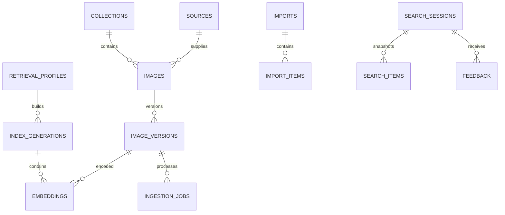

# Mô hình dữ liệu

Trạng thái: schema logic đề xuất, chưa phải migration SQL. UUID dùng cho định danh; thời gian lưu UTC. Các enum và giới hạn dưới đây là hợp đồng thiết kế cần được đưa vào migration khi triển khai.

## 1. Quan hệ

Mỗi image thuộc một collection trong MVP. Ảnh giống byte trong collections khác nhau vẫn có danh tính và quyền riêng. Đa collection cho cùng một image là thay đổi schema cần ADR mới.

## 2. Catalog và quyền

| Bảng | Trường chính và ràng buộc |
| --- | --- |
| collections | id, name, status, created_at; status active/disabled |
| collection_grants | principal_id, collection_id, role; unique trên bộ ba; role viewer/editor ánh xạ quyền tại backend |
| sources | id, collection_id, type=private trong MVP, name, connector_config_ref, provenance, created_at; không lưu secret trực tiếp |
| images | id, collection_id, source_id, source_item_key, latest_input_revision, lifecycle, current_version, desired_version, metadata_revision, created_at, updated_at, deleted_at |
| image_versions | image_id, version, input_revision, input_payload_hash, source_object_version, object_key, thumbnail_key, sha256, mime_type, width, height, byte_size, title, tags, license, provenance, processing_status, created_at |

Unique images(source_id, source_item_key) định danh ổn định qua các lần import. Không dùng checksum làm image_id vì cùng nội dung có thể có quyền khác nhau. source.collection_id phải trùng image.collection_id. object_key được backend sinh, không đưa ra như URL công khai.

lifecycle: active/deleted. current_version có thể null trước khi nhập thành công; desired_version là số version mới nhất được yêu cầu. image_versions unique(image_id, version), version tăng đơn điệu; width/height/byte_size phải dương khi đã validate.

Title/tags/license gắn với version nội dung; khi sửa chỉ metadata có thể tạo version dùng lại object và embedding nếu processor/profile không đổi. metadata_revision trên images phục vụ khóa lạc quan và audit thay đổi quyền/trạng thái. Không cập nhật mù nếu phiên bản client đã cũ.

## 3. Model và vector

| Bảng | Trường chính và ràng buộc |
| --- | --- |
| retrieval_profiles | id, model_id, model_revision, processor_revision, dimension, normalization, distance_metric, ranking_version, keyword_config, created_at; bất biến sau khi dùng |
| index_generations | id, profile_id, physical_location, status, source_watermark, created_at, activated_at |
| active_search_config | config_key, generation_id, revision; một cấu hình đọc active cho MVP |
| embeddings theo generation | image_id, content_version, vector, created_at; unique(image_id, content_version) trong generation; dimension cố định |

Generation states: building → validating → active → retired; failed có thể kết thúc build lỗi. Khi chuyển active, cập nhật pointer và trạng thái trong một transaction hoặc thao tác điều phối tương đương; chỉ có một pointer đang phục vụ.

Model và số chiều phải khớp profile trước insert. Vector không được có NaN/Inf. Index metric và query metric phải trùng. Nếu tái sử dụng embedding cho version mới có cùng byte nội dung, vẫn cần tham chiếu version mới và xác minh processor/model không đổi.

## 4. Imports và jobs

| Bảng | Trường chính và ràng buộc |
| --- | --- |
| imports | id, collection_id, source_id, manifest_key, idempotency_key, request_hash, status, counters, created_by, created_at |
| import_items | id, import_id, source_item_key, input_revision, image_id, content_version, status, error_code, safe_error_detail |
| ingestion_jobs | id, import_item_id, image_id, content_version, generation_id, pipeline_version, status, attempts, next_attempt_at, lease_token, lease_until, last_error |
| catalog_changes | event_id, image_id, content_version, metadata_revision, event_type, created_at; ghi cùng transaction đổi catalog để catch-up/reconcile |
| generation_change_deliveries | generation_id, event_id, status, applied_at; unique(generation_id, event_id), retry an toàn |

Idempotency key được scope theo principal và thao tác; key trùng nhưng request_hash khác trả conflict. Một import_item có thể sinh nhiều job khi phải ghi hai generation trong giai đoạn reindex. Unique job theo (image_id, content_version, generation_id, pipeline_version); không enqueue lặp nếu job đã thành công.

Counters import có thể cập nhật tăng dần nhưng phải đối soát từ trạng thái import_items trước khi báo completed. Item chỉ succeeded khi thỏa điều kiện phục vụ đã định nghĩa; skipped/superseded/cancelled được đếm riêng, không coi là thành công xử lý mới.

Change events dùng cho reindex và có thể làm outbox nếu chuyển sang Qdrant. Không coi sequence ID là thứ tự commit tuyệt đối: event có ID nhỏ có thể commit muộn. Consumer theo dõi delivery chưa xử lý và có barrier/đối soát trước cutover, không chỉ lưu max(event_id) rồi bỏ mọi ID nhỏ hơn. Event cũ không được ghi đè content_version hoặc tombstone mới hơn. Retention events phải dài hơn cửa sổ backfill/catch-up và rollback đang hoạt động.

## 5. Phiên tìm kiếm và phản hồi

| Bảng | Trường chính và ràng buộc |
| --- | --- |
| search_sessions | id, principal_id, query_hash, query_text theo retention, filters, generation_id, ranking_version, expires_at, created_at |
| search_items | session_id, position, image_id, content_version; unique(session_id, position) và unique(session_id, image_id); displayed_at nullable |
| feedback | session_id, principal_id, image_id, relevance, updated_at; unique(session_id, principal_id, image_id) |
| audit_events | id, actor_id, action, resource_type, resource_id, safe_context, timestamp |

Feedback chỉ được ghi nếu search_item đã hiển thị cho principal đó và chưa hết thời hạn tiếp nhận; cần kiểm tra quyền hiện tại. Không dùng click làm nhãn liên quan mặc định. Audit phục vụ thay đổi dữ liệu/quyền/cấu hình, tách khỏi query logs có thời hạn ngắn.

## 6. Index và concurrency

- B-tree trên source identity; image collection/lifecycle; version image_id/version.
- Partial index jobs(status, next_attempt_at) cho pending/retry_wait; index lease_until cho tác vụ đang chạy hết lease.
- HNSW theo metric của generation và indexes cho filter metadata. Query plan phải được kiểm chứng bằng benchmark; không giả định relational filter luôn được đẩy trước ANN.
- Index expires_at cho session cleanup; tránh index mọi trường JSON tùy ý.
- Claim jobs bằng transaction ngắn với khóa bỏ qua row đã lock hoặc cơ chế tương đương; lease_token được so khi gia hạn/commit.
- Cập nhật current_version bằng compare-and-set desired_version/lifecycle; stale worker chỉ có thể lưu artifact chưa công bố để dọn sau.

## 7. Xóa, retention và đối soát

Delete tạo tombstone trong images ngay; tăng metadata_revision và vô hiệu hóa job chờ. Purge vật lý chạy nền, xóa vector ở mọi generation rồi object khi không còn tham chiếu cần giữ. Quy trình giữ audit theo retention đã chốt và kiểm tra object dùng chung trước khi xóa.

Session TTL đề xuất 15 phút; raw query log đề xuất 7 ngày cho pilot, tắt lưu query nếu chưa được chốt. Feedback và audit retention chờ Q09. Query/session hết TTL được dọn theo batch. Backup có thời hạn riêng; xóa trong hệ live không đồng nghĩa đã xóa ngay khỏi backup.

Reconciliation định kỳ phát hiện ready thiếu vector/object, job lease hết hạn, artifact mồ côi, counters lệch và vector của ảnh deleted. Không tự công bố artifact chỉ dựa trên việc nó tồn tại trong storage.
