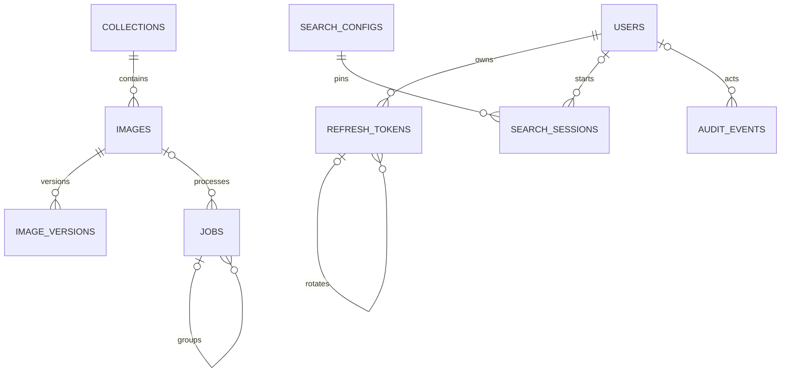

# Mô hình dữ liệu — 9 bảng SQL

Cập nhật 06/11/2026 theo C13: thay schema 24 bảng bằng 9 bảng dưới đây. Đây là schema logic, chưa có migration hoặc ứng dụng. UUID dùng cho định danh; thời gian UTC. Vector/search metadata nằm ở Qdrant, entity/relations ở graph store, ảnh và artifacts ở object storage. Không tính các cấu trúc ngoài SQL vào số bảng này.

## 1. Danh sách và quan hệ

| Bảng | Trách nhiệm |
| --- | --- |
| users | Tài khoản, role, trạng thái và auth_version |
| refresh_tokens | Token hash, chuỗi rotation và thu hồi theo lần login |
| collections | Phân loại/bộ lọc ảnh, không ACL |
| images | Danh tính, source identity, lifecycle và con trỏ version |
| image_versions | Object/artifact references, hashes và trạng thái chỉ mục theo version |
| jobs | Import, xử lý, outbox đồng bộ từng target, retry, purge và rebuild |
| search_configs | Cấu hình versioned của encoder, vector/graph, fusion và VLM; cấu hình active |
| search_sessions | Snapshot thứ tự kết quả hữu hạn và phân trang |
| audit_events | Lịch sử thao tác quản trị và thay đổi cấu hình |



Không có bảng riêng cho source, refresh family, import/item, projection/published pointer, generation registry hoặc search items. Các khái niệm cần thiết vẫn tồn tại dưới dạng trường, job type hoặc artifact; không bỏ bảo đảm chỉ để giảm số bảng.

## 2. Tài khoản và refresh token

`users`: id, email_normalized unique, password_hash, display_name, role=user/admin, status=active/disabled, revision, auth_version, created_at, updated_at. Visitor không có users record. Không lưu raw password/token.

`refresh_tokens`: id, user_id, family_id, parent_id nullable, token_hash unique, auth_version, expires_at, consumed_at nullable, revoked_at nullable, revoke_reason nullable, created_at.

- Mỗi login tạo một root row: family_id=id, parent_id=null. Root giữ auth_version tại login, deadline tuyệt đối (đề xuất 7 ngày) và trạng thái thu hồi chung qua revoked_at/revoke_reason.
- Mỗi rotation thêm một row cùng user_id/family_id/auth_version/deadline; parent_id trỏ token trước đó. Root FK tự tham chiếu được kiểm tra trong transaction insert. Unique parent_id khi khác null bảo đảm mỗi token chỉ có một hậu duệ trực tiếp.
- Root có thể đã consumed sau refresh đầu tiên nhưng nhóm vẫn active nếu root chưa revoked/chưa hết hạn. Protected request kiểm tra root theo JWT family_id, không từ chối chỉ vì root consumed.
- Login/refresh/logout và thay đổi account cùng khóa user trước; refresh tiếp tục khóa root rồi token được trình (không khóa lặp khi token chính là root). Kiểm tra consumed và tạo successor trong cùng transaction. Reuse thu hồi root; mọi hậu duệ bị chặn bởi root check, không cần cập nhật từng row.
- Logout thu hồi root; logout-all/password/role/status đổi tăng users.auth_version và thu hồi mọi root của user cùng transaction. Access JWT luôn kiểm tra user/version/root hiện hành để giữ cam kết thu hồi sau commit.
- Giữ cả root và token đã consumed đến deadline nhóm cộng access TTL/clock skew; cleanup cả nhóm khi đủ điều kiện, không xóa root trước hậu duệ. Hash không ghi đè khi rotate vì cần nhận diện token cũ.

Chi tiết cookie, access/refresh transport và races ở [auth-design.md](auth-design.md).

## 3. Collections, images và image_versions

`collections`: id, name, status, created_at. Mỗi image thuộc một collection; mọi người tìm cùng toàn kho. Không tự gộp ảnh khác source identity chỉ vì cùng checksum.

`images`: id, collection_id, source_id, source_item_key, latest_input_revision, lifecycle=active/deleted, current_version nullable, desired_version, metadata_revision, created_at, updated_at, deleted_at nullable. Unique(source_id, source_item_key); version references phải thuộc đúng image. current_version chỉ đổi bằng compare-and-set sau khi đủ điều kiện publish.

Source definitions nằm trong manifest cấu hình nguồn versioned ở object storage/config deployment: source_id ổn định, collection_id, allowed prefix, connector_config_ref, provenance và revision/hash. Không có bảng nguồn; images giữ identity, image_versions/jobs pin source_config_ref/hash để replay. Không thay nghĩa source_id hoặc tái sử dụng ID cho nguồn khác; secret chỉ là reference.

`image_versions`: image_id, version, input_revision, input_payload_hash, source_config_ref/hash, source_object_version, object_key, thumbnail_key, metadata_snapshot_key/hash, sha256, byte_size, processing_status, index_state JSON, created_at. Unique(image_id, version); version tăng đơn điệu; metadata-only update cũng tạo version mới nhưng có thể tái sử dụng embedding đúng byte/model/processor hash.

Index_state có schema versioned, chỉ chứa references/hashes/trạng thái, không vector hoặc toàn bộ metadata/graph:

```json
{
  "schema_version": 1,
  "vector": {
    "vg001": {
      "projection_revision": 1,
      "point_id": "point-example",
      "payload_hash": "sha256:example",
      "embedding_artifact_key": "artifacts/image-1/v1/embedding",
      "state": "ready"
    }
  },
  "graph": {
    "gg001": {
      "projection_revision": 1,
      "artifact_key": "artifacts/image-1/v1/graph.json",
      "artifact_hash": "sha256:example",
      "state": "ready"
    }
  }
}
```

Keys là generation ID nội bộ lấy từ search_configs; mỗi entry đi từ pending/applying tới ready/failed và giữ ID/hash bất biến sau khi enqueue. Entry ready của version đang current không được sửa refs/hashes; thay nội dung projection trong cùng generation phải tạo content version mới, kể cả dùng lại ảnh/embedding. Rebuild dùng generation mới. Không ghi đè point đã công bố. Schema validation, CAS revision và khóa row ngắn ngăn worker sửa mất entry của target khác. JSON nhỏ và giới hạn active/build/retained generations theo retention, không nhét lịch sử vô hạn.

Con trỏ công bố được suy từ images.current_version + index_state của version đó + generation của active search_configs. Ready entry của desired_version chưa current vẫn là staging. Publish kiểm tra cả vector và graph đúng generation ready, desired_version/lifecycle/lease còn hợp lệ, rồi đổi current_version cùng tăng graph_revision của config active trong transaction. Graph rỗng đã xác minh là ready; graph lỗi không phải rỗng. Final check theo các trường này thay cho bảng published pointers.

Title/tags/license/kích thước và metadata hiển thị đọc từ đúng Qdrant point; snapshot object storage dùng rebuild/audit. Tombstone chặn response mới ngay; purge mọi target/generation và artifacts không còn tham chiếu theo retention, không xóa shared entity còn được dùng.

## 4. jobs — hàng đợi bền vững và transactional outbox

`jobs`: id, parent_id nullable, type, status, image_id nullable, content_version nullable, config_id nullable, target_type nullable, target_generation nullable, dedupe_key unique, idempotency_key nullable, request_hash nullable, payload JSON, depends_on JSON, result JSON, attempts, next_attempt_at, lease_token, lease_until, created_by nullable, created_at, updated_at, last_error nullable.

| Job type | Vai trò |
| --- | --- |
| crawl / crawl_item / fetch_media | Thu thập nguồn cấu hình/metadata/facts, validate/download có checkpoint, xuất manifest rồi chuyển import pipeline |
| import | Job cha: manifest/source refs, request idempotency, tổng tiến độ |
| import_item | Một dòng manifest, line_number/source key/input revision, lỗi hoặc kết quả riêng |
| prepare_image | Validate/decode, thumbnail, immutable snapshots/artifacts và encoder |
| sync_vector / sync_graph | Một target/generation cụ thể; chính là outbox delivery |
| publish_image | Chờ hai target ready, CAS current_version và hoàn tất item |
| sync_facts | Stage shared graph facts/manifest và công bố revision |
| purge / reconcile / rebuild | Xóa, kiểm tra integrity hoặc dựng chỉ mục trong maintenance |

Import root ID chính là import_id; import_item job ID chính là item_id trên API. Child processing jobs tham chiếu import_item; không tạo riêng bảng imports/items. Item invalid có thể failed mà chưa có image_id. Parser streaming dùng dedupe_key(root_id, line_number), payload hash và checkpoint để replay không nhân đôi dòng; trùng source key/revision trong manifest được phân loại theo quy tắc ingestion. Counts tính từ import_item children, không đếm các job sync; chỉ kết thúc import sau khi đối soát parser và item states.

Khi catalog đổi desired_version/tombstone hoặc khi artifact refs được chốt, tạo các jobs xử lý/sync/purge tương ứng trong cùng transaction SQL. Không ghi DB rồi enqueue bằng một bước rời; jobs thay cả queue và outbox. Unique dedupe_key gồm type/identity/version/target generation/projection revision hoặc source fact revision. Parent/depends_on phải tồn tại, không chu trình; worker chỉ claim khi dependencies succeeded. Payload/result có schema theo type, không chứa vector, raw secret hoặc ảnh lớn.

Claim dùng transaction ngắn, lease/fencing; I/O ngoài transaction. Worker chỉ cập nhật target state khi lease/desired_version còn đúng; write ngoài SQL đã bay đi được bảo vệ bằng identity bất biến và final catalog check. Retry target graph lỗi không chạy lại vector đã ready. Failed dependency phải làm item failed hoặc bị superseded/cancelled theo catalog; không để import treo vô hạn. Admin retry item reset/enqueue đúng các bước lỗi có thể retry cùng transaction, giữ ID/hash của projection không đổi và không đánh dấu thành công bước chưa chạy.

## 5. search_configs — cấu hình và vòng đời chỉ mục

`search_configs`: id, revision, status=building/validating/active/retired/failed, encoder_config JSON, vector_index JSON, keyword_config JSON, graph_config JSON, fusion_config JSON, reranker_config JSON, failure_policy JSON, source_config_ref/hash, graph_revision, graph_manifest_key/hash, maintenance JSON, created_at, activated_at nullable.

Vector_index chứa generation ID, physical collection, dimension/normalization/metric. Graph_config chứa generation/location, schema/linker revisions, traversal templates/budgets và graph scoring. Reranker_config pin VLM/model/processor/prompt/schema/decoding, rendition và window. Active row là nguồn cấu hình đọc duy nhất, lấy bằng status=active; unique constraint phù hợp engine bảo đảm tối đa một active. Không nhận collection/graph endpoint từ client.

Các trường định nghĩa model/index/ranking bất biến khi dùng; runtime fields status, graph_revision, manifest pointer, maintenance có thể cập nhật bằng CAS/transaction và audit. Đổi định nghĩa tạo row mới. Config VLM/prompt mới có thể tái sử dụng vector/graph generation tương thích; khi activation phải mang theo graph_manifest và graph_revision hiện hành dưới khóa điều phối, không phục hồi manifest cũ của bản config đã retired.

Shared facts có immutable source revision/provenance trong graph store và artifacts. sync_facts stage dữ liệu rồi publish manifest key/hash + tăng graph_revision trong active config; adapter chỉ traversal tập fact revisions thuộc manifest đã công bố. Graph không hỗ trợ view này phải dùng maintenance để thay snapshot, không đọc staging. Không có registry facts SQL riêng.

Activation mới vô hiệu hóa mọi snapshot config cũ; active config và maintenance gates không được cache làm mất kiểm tra sau commit. MVP hỗ trợ một cấu hình active và tối đa một bản build tại một thời điểm. Đổi encoder/graph schema dùng maintenance: chặn mới các ghi catalog/fact/import/delete, drain writers/jobs, dựng index trên dữ liệu đứng yên, đối soát và chuyển active nguyên tử. Search có thể tiếp tục trên bản cũ trong build nếu tài nguyên đủ; cutover tạm dừng/drain search và vô hiệu hóa snapshot cũ. Tạm dừng ghi do bảo trì được lưu bền trong runtime config, kiểm tra cả API và worker. Không hứa dual-write/catch-up hoặc rollback online tự động. Runbook đầy đủ ở [operations.md](operations.md).

## 6. Search snapshots và audit

`search_sessions`: id, user_id nullable, owner_key_hash, query_hash, query_text nullable theo retention, filters JSON, config_id, graph_revision, hard_graph_constraints JSON, query_plan JSON, items JSON, degraded, degradation_reason, expires_at, created_at.

C18 query_plan giữ mode/targets/counts/statuses và evidence refs; target_ids trong items giữ grouping, dedup top-level image ID nhưng cho phép nhiều nhóm tham chiếu. Không thêm bảng target/result riêng. Items là mảng có thứ tự tối đa 200 phần tử `{image_id, content_version, point_id, target_ids}`; validate không trùng ID và đúng version/point. Chỉ chứa shortlist đã rerank hoặc fusion shortlist khi fallback tường minh; ví dụ window=50 thì tối đa 50. Không có bảng item riêng. Mỗi trang duyệt theo vị trí, final-check current_version/index_state/lifecycle, không rerank lại. Cursor pin owner/config/position; config active đổi hoặc graph revision đổi với hard constraint trả SEARCH_EXPIRED. X-Search-Owner không phải login hoặc ACL.

`audit_events`: id, actor_id nullable cho tác vụ hệ thống, action, resource_type, resource_id, safe_context JSON, created_at. Thay đổi quản trị tài khoản/catalog/config và maintenance phải có audit trong cùng transaction thích hợp. Không lưu password/token/signed URL/ảnh hoặc tùy tiện ghi raw query.

## 7. Index, retention và kiểm chứng

- Unique email_normalized; token_hash; parent_id khác null. Index refresh_tokens(user_id), family_id, expires_at; FK parent/root cùng user/family được validate trong transaction.
- Unique images(source_id, source_item_key), image_versions(image_id, version). Index lifecycle, collection_id, jobs(parent_id, type, status), jobs(status, next_attempt_at), lease_until và dedupe_key. Không index mọi JSON field.
- Unique active search config; index search_sessions.expires_at và audit timestamp/resource. CAS/row locks bảo vệ index_state, config epoch và publish.
- Snapshot TTL đề xuất 15 phút; query logging mặc định tắt; root/token history, jobs/idempotency, tombstones, artifacts và audit dọn theo Q09. Job root giữ ít nhất cửa sổ idempotency; job/artifact đang cần retry/rebuild không được cleanup.
- Reconcile so catalog/index_state với Qdrant/graph/object hashes, requeue jobs thiếu, dọn orphan sau grace period; không tự publish chỉ vì thấy point/edge. Backup/restore gồm SQL và các artifacts/config nguồn versioned.

Đánh đổi C13: ít bảng hơn nhưng cần validate JSON/job types trong ứng dụng, source administration qua cấu hình, reindex có maintenance window và chưa hỗ trợ nhiều generation ghi song song. Giữ 9 bảng này làm schema hiện hành; sơ đồ chi tiết cũ 24 bảng đã được thay thế, chưa có migration dữ liệu thực tế.

C14–C18: FastAPI/PostgreSQL đã chọn. Source type đề xuất private hoặc web_import theo source config, pin external ID/version, original page/media URLs và attribution vào snapshots/Qdrant payload. Crawl root/result lưu manifest_ref/import_id, items/jobs không chứa toàn bộ HTML hoặc ảnh; external web data được sanitize/validate trước inference/hiển thị. Metadata địa danh và local resource budget ở [MVP địa danh](landmark-mvp-plan.md).
