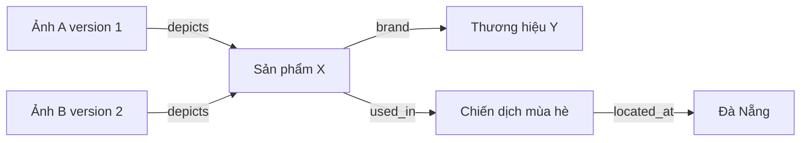
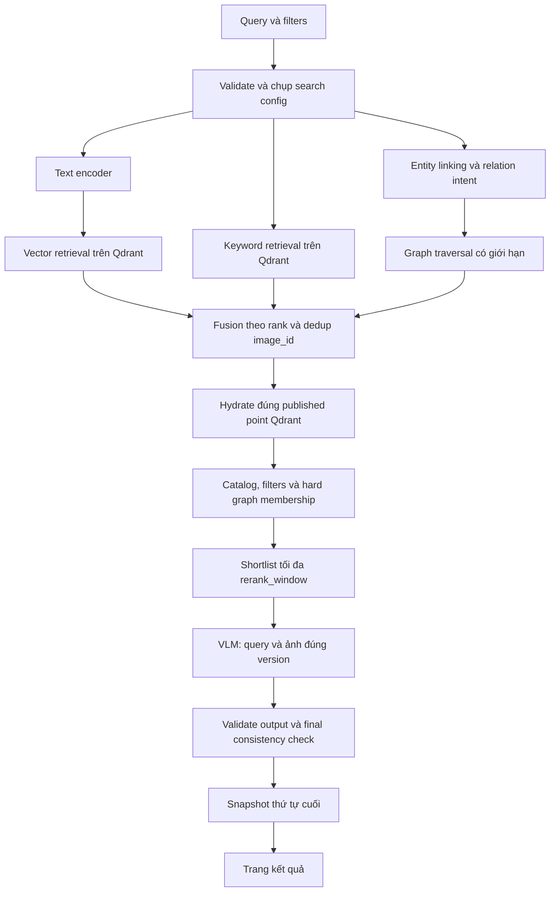
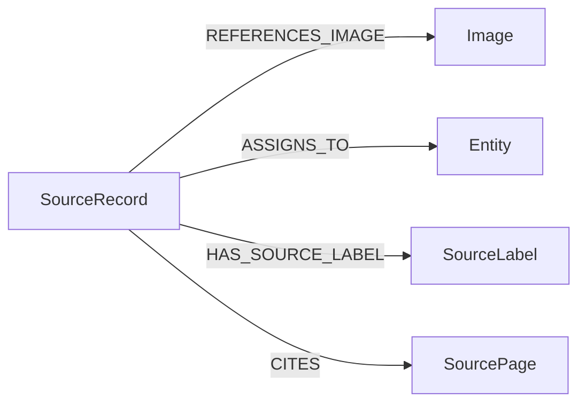

# Graph search và VLM reranking

Cập nhật 24/11/2026: **plan hiện tại ở mục 10**, đã được cho triển khai. Tin metadata `yes`,
bỏ node nguồn, tập trung quan hệ thực thể. Mục 8–9 ghi lại graph nguồn đang chạy,
chưa migration. Các phần kiến trúc/VLM trước đó là hướng dài hạn; rerank tạm hoãn.

## 1. Sơ đồ phân cấp kiến trúc

```mermaid
flowchart TD
    SYS[Hệ thống tìm kiếm ảnh]
    SYS --> ING[1. Nhập và xử lý dữ liệu]
    SYS --> DATA[2. Lưu trữ và chỉ mục]
    SYS --> RET[3. Retrieval]
    SYS --> RANK[4. Xếp hạng và trả kết quả]
    ING --> ENC[CLIP hoặc SigLIP 2: image encoder]
    ING --> BUILD[Chuẩn hóa entity và relation từ nguồn chuẩn]
    DATA --> OBJ[Object storage: ảnh, thumbnail, artifacts]
    DATA --> QD[Qdrant: vector và search metadata]
    DATA --> GRAPH[Graph projection: entity và relation]
    DATA --> DB[DB quan hệ: catalog, jobs, pointers, tài khoản]
    RET --> V[Vector search: ngữ nghĩa thị giác]
    RET --> K[Keyword search: tên, tag, mã]
    RET --> G[Graph search: quan hệ thực thể]
    RANK --> F[Fusion và dedup]
    RANK --> C[Kiểm chứng catalog, filters và graph constraints]
    RANK --> VLM[VLM rerank shortlist]
    RANK --> SNAP[Final check, snapshot và pagination]
```



Graph ở đây là graph thực thể/quan hệ nghiệp vụ, khác với cấu trúc HNSW bên trong vector index. VLM reranker là model riêng với encoder; thay VLM/prompt không bắt buộc tính lại embedding CLIP/SigLIP 2.

## 2. Dữ liệu graph và nguồn chuẩn

Ví dụ minh họa, không giả định lĩnh vực ảnh đã được chốt:



Query “ảnh giày đỏ của thương hiệu Y trong chiến dịch ở Đà Nẵng” có thể dùng vector cho nội dung thị giác, keyword cho tên, graph cho đường quan hệ. Nếu một quan hệ là điều kiện bắt buộc, mọi ảnh cuối cùng phải thỏa đường đi đó; fusion hoặc VLM không được ghi đè điều kiện này.

| Thành phần | Trường logic và quy tắc |
| --- | --- |
| Image node | image_id, content_version, graph_generation_id, projection_revision; liên kết về catalog, không chứa ảnh/vector |
| Entity | entity_id ổn định có namespace nguồn, entity_type, canonical_name, aliases, source_revision; không gộp thực thể chỉ vì trùng tên |
| Relation | relation_id, subject_id, predicate, object_id, source_revision, provenance, confidence nullable, verification_status; nếu gắn ảnh phải giữ content_version và projection_revision |
| Graph artifact | Snapshot bất biến các assertion theo image version hoặc shared entity/relation revision; schema/extractor revision, source references và hash |

Metadata nghiệp vụ có sẵn, manifest hoặc nguồn quản lý đã xác minh là đầu vào chính. Graph lưu tên/alias thực thể cho entity linking; không sao chép toàn bộ title/tags/license của Qdrant. Không suy ra chiến dịch, bản quyền hay thương hiệu chính thức chỉ từ vẻ ngoài ảnh. Trích quan hệ bằng VLM là pipeline enrichment riêng chưa được mặc định đưa vào C12; nếu bổ sung phải có đánh giá, provenance và quy tắc duyệt. Việc có VLM reranker không tự tạo graph.

Không có entity/relation hợp lệ là graph projection rỗng hợp lệ, khác với job graph chưa chạy hoặc bị lỗi. Độ phủ graph được báo riêng, không bịa cạnh để lấp dữ liệu thiếu.

## 3. Query planning và retrieval



Entity linker dùng dictionary/aliases và taxonomy có version làm điểm khởi đầu; không bắt buộc LLM query planner. Query plan chỉ chọn predicate/template cho phép và bind tham số, không thực thi graph query do người dùng/model sinh tùy ý. Ambiguity không giải được trả 422 INVALID_QUERY với hướng làm rõ; điều kiện graph bắt buộc không tìm thấy entity trả không có kết quả trong phạm vi, không bỏ điều kiện để chuyển thành vector-only. Query không có ý định quan hệ có thể skip graph theo routing rule đã version; đây không phải lỗi dependency hay degraded mode.

Graph có hai vai trò được ghi trong query plan:

- **Bổ sung ứng viên/tín hiệu:** traversal trả danh sách image_id/content_version, rank và bằng chứng đường đi; hợp nhất với vector/keyword bằng weighted RRF làm baseline. Graph rank thử theo số quan hệ đã xác minh khớp và độ dài đường đi tăng dần, tie-break image_id; không coi rank này là xác suất.
- **Điều kiện bắt buộc:** kiểm tra membership của từng candidate theo đầy đủ đường quan hệ. Tập ID lấy giới hạn từ graph để fusion không phải toàn bộ tập hợp lệ. Nếu prefilter bằng ID, chỉ dùng tập đầy đủ đã xác minh đủ nhỏ; với tập lớn dùng membership check theo batch và overfetch hữu hạn. Có thể trả ít kết quả khi hết budget, không bỏ constraint hoặc coi ID ngoài graph top-K là chắc chắn không hợp lệ.

Giới hạn ban đầu để thử: tối đa 2 hops facts, 1.000 entity được thăm, 200 graph candidates; pin traversal direction, allowed predicates, fan-out, timeout và ranking rule trong graph_config. Có cycle detection. Vượt giới hạn khi đánh giá hard membership mà chưa xác định được đúng/sai là lỗi có kiểm soát, không coi là false hoặc complete; xử lý theo mục 6. Báo candidate truncation trong telemetry. Các giá trị này cần thay bằng benchmark Q13/Q15.

Mỗi nhánh thử lấy tối đa 200 ứng viên; fusion và kiểm chứng giữ tối đa 200. Graph candidates phải hydrate metadata từ đúng published Qdrant point, sau đó áp dụng orientation/size/collection filters giống các nhánh khác. Loại ảnh deleted, version cũ hoặc graph projection không khớp pointer. Chỉ dùng bằng chứng quan hệ của revision đã công bố.

## 4. Hợp đồng VLM reranker

Ví dụ tổng quát thử rerank_window=50; với chế độ duyệt window tối thiểu bằng limit đã validate, với yêu cầu count hữu hạn window tối thiểu bằng số ảnh cần trả (có thể nhỏ hơn limit trang), tối đa không vượt fusion window=200. Nếu ít hơn thì dùng toàn bộ ảnh hợp lệ. Worker/API đọc rendition dành cho inference từ object storage bằng danh tính nội bộ; rendition có hash và gắn đúng content_version. Không dùng ảnh gốc URL công khai hoặc URL từ client. Kích thước ảnh, processor và quy tắc resize/crop được pin; thumbnail UI có thể thiếu chi tiết để rerank.

Input mỗi cặp gồm query gốc đã chuẩn hóa, candidate_id, content_version, ảnh và metadata/bằng chứng graph được cho phép. Phân biệt metadata xác minh với suy luận; VLM không có quyền thay đổi quan hệ nghiệp vụ. Query, chữ trong ảnh và metadata được coi là dữ liệu, không phải chỉ dẫn thay prompt; reranker không gọi tools hoặc ghi dữ liệu.

Output có schema `candidate_id`, `content_version`, `relevance_score` hữu hạn trong [0, 1]. Đây là score xếp hạng, chưa phải xác suất hiệu chỉnh. Chấm từng cặp độc lập hoặc microbatch rồi gom đủ shortlist; pin prompt, processor, decoding và model revision. Validator yêu cầu đúng tập ID/version đầu vào, không thiếu/trùng/thêm ID, không NaN/Inf hoặc score ngoài miền. Output sai làm cả lần rerank thất bại; không trộn các microbatch đã chấm với score fusion.

Sắp xếp theo relevance_score giảm dần; tie-break bằng fusion rank rồi image_id. Snapshot chỉ chứa shortlist đã rerank (ví dụ tối đa 50), không nối phần đuôi chưa chấm vào cùng danh sách. Giới hạn 200 trong API là trần lưu snapshot, không cam kết mỗi lượt có 200 kết quả. Phân trang dùng lại thứ tự đã lưu, không gọi VLM lại. Reranker không tìm thêm được ảnh ngoài candidate set.

Không cần xuất lời giải thích tự do hoặc chain-of-thought. Chỉ lưu diagnostics tối thiểu theo retention, không log ảnh/query riêng tùy ý. Nếu VLM hosted bên ngoài, phải chốt quyền xử lý ảnh, retention và credential references trong Q14 trước triển khai; không tự chọn nhà cung cấp.

## 5. Versioning, đồng bộ và công bố

Qdrant và graph là hai projection dẫn xuất. DB quan hệ vẫn là nguồn chuẩn image lifecycle; object storage giữ graph artifacts để rebuild. Graph engine chưa chốt; có thể dùng graph database riêng hoặc adapter trên DB phù hợp sau benchmark, không mặc định cài Neo4j. Mọi adapter phải đáp ứng hợp đồng version/read consistency dưới đây.

1. Lưu graph artifact bất biến, metadata snapshot và embedding artifact/reference; transaction catalog ghi desired_version, image_versions.index_state references và jobs type sync_vector/sync_graph riêng theo target/generation; jobs chính là outbox.
2. Worker upsert Qdrant point và graph projection bất biến theo image_id/content_version/projection_revision; retry cùng ID phải cùng hash. Quan hệ shared entity có artifact/source revision riêng, không chỉ phụ thuộc một ảnh.
3. Xác minh đọc được cả hai projection; transaction xác nhận index_state entries đúng generation ready và công bố images.current_version khi desired_version/lifecycle/lease còn đúng. Graph rỗng đã xác minh được tính là ready. Graph job lỗi không được giả thành graph rỗng để publish. Trong lúc chờ, version cũ hợp lệ tiếp tục phục vụ.
4. Mỗi lần publish ảnh tăng graph_revision trong active search_configs. Shared entity/relations giữ revision/provenance trong graph store và artifacts; sync_facts job stage rồi publish immutable manifest key/hash cùng tăng graph_revision trong search_configs bằng transaction. Worker xác minh mọi artifact trước bước này. Đọc graph dùng image current_version/index_state và đúng shared fact revisions trong published manifest, không đọc staging. Adapter không hỗ trợ published view phải dùng maintenance snapshot replacement cho shared facts; không thêm bảng facts SQL.
5. Request chụp graph generation/revision rồi kiểm tra lại sau retrieval và sau VLM; nếu revision thay đổi, retry hữu hạn trong deadline hoặc trả lỗi, không trộn đường đi hai revision. Giải pháp này có thể tăng retry khi ghi liên tục; benchmark trước khi cân nhắc snapshot/MVCC của engine. Final catalog check sau inference chặn ảnh bị xóa/cập nhật giữa chừng.
6. search_sessions.items JSON lưu shortlist có thứ tự, pin config_id; active config đổi thì snapshot hết hiệu lực. Với hard graph constraint, session lưu graph revision; revision đổi trả 410 SEARCH_EXPIRED ở trang sau. Với graph chỉ boost điểm, giữ snapshot thứ tự cũ, tiếp tục recheck lifecycle/pointers từng trang. Không đổi thứ tự ngầm.

Delete commit tombstone ngay; purge mọi Qdrant point và graph image node/cạnh gắn ảnh ở mọi generation, kể cả staging. Không xóa shared entity còn được ảnh khác tham chiếu; giữ provenance nguồn shared relations. Không báo purge complete khi writer cũ còn có thể ghi trễ. Reconcile phát hiện graph orphan, thiếu projection, hash/version lệch, dangling edge và graph pointer chưa publish. Final checks vẫn bắt buộc dù graph payload có cờ active.

search_configs gắn encoder/vector generation, graph generation/schema/linker revision, fusion và VLM thành một row cấu hình đọc. Đổi encoder hoặc graph schema dùng generation mới qua maintenance: chặn/drain ghi, backfill trên dữ liệu đứng yên, kiểm chứng và cutover active config nguyên tử; chưa hỗ trợ dual-write/catch-up online. Đổi riêng VLM/prompt có thể tái sử dụng indices tương thích, nhưng activation phải lấy graph manifest/revision hiện hành và vô hiệu hóa snapshots cũ. Rollback trực tiếp chỉ khi index cũ còn khớp catalog/facts, nếu không phải rebuild trong maintenance. Không có distributed transaction giữa các store. Schema 9 bảng ở [mô hình dữ liệu](data-model.md).

## 6. Lỗi và suy giảm

Mặc định cấu hình đầy đủ là strict: dependency unavailable trả 503 SEARCH_UNAVAILABLE, hết deadline trả 504 SEARCH_TIMEOUT. Chỉ dùng fallback nếu failure_policy trong profile khai báo trước; response có degraded=true và degradation_reason, snapshot giữ nguyên trạng thái này cho mọi trang.

| Tình huống | Hành vi |
| --- | --- |
| Graph không có intent áp dụng | Skip theo routing rule, không degraded |
| Graph traversal hợp lệ không có kết quả | Nhánh graph rỗng; hard condition có thể dẫn đến kết quả rỗng hợp lệ |
| Graph lỗi/vượt budget, chỉ dùng boost | Strict fail; nếu profile cho phép thì dùng vector/keyword, reason=GRAPH_UNAVAILABLE hoặc GRAPH_BUDGET_EXCEEDED |
| Graph lỗi/vượt budget với hard condition | Luôn fail; không bỏ điều kiện bắt buộc |
| Graph revision thay đổi liên tục | Retry hữu hạn; hết budget trả 503 với reason nội bộ GRAPH_REVISION_CHANGED, không trả hỗn hợp revision |
| VLM timeout/invalid output/thiếu ảnh inference | Strict fail; nếu profile cho phép thì bỏ toàn bộ kết quả VLM, dùng thứ tự fusion của shortlist đã kiểm chứng, reason=RERANK_TIMEOUT/RERANK_INVALID_OUTPUT/RERANK_UNAVAILABLE |
| Graph và VLM cùng fallback | degradation_reason=MULTIPLE_COMPONENT_FAILURES; chi tiết từng lỗi lưu server-side theo request_id |
| Catalog hoặc Qdrant không đọc được | Fail; không có đường fallback giữ bảo đảm lifecycle/metadata |

Không fallback khi không thể kiểm chứng hard constraint hoặc image lifecycle. Không dùng lỗi dependency làm kết quả rỗng. Nhánh keyword và vector cũng có required/optional policy tường minh theo [API contract](api-contract.md) và benchmark trong [lộ trình triển khai](../planning/delivery-plan.md).

## 7. Đánh giá và điều kiện triển khai

So sánh trên cùng dataset/filters/query labels: keyword-only, vector-only, vector+keyword, thêm graph, thêm VLM và cấu hình đầy đủ. Ablation tách lợi ích graph khỏi VLM; nhóm query quan hệ phải có ground truth entity/path và nguồn xác minh. Báo candidate Success@K theo pooled labels trước rerank, nDCG@10/Precision@10 sau rerank, entity-linking accuracy, constraint violation rate, graph coverage và stale projection rejection. Không suy diễn recall toàn kho từ pool nhãn hạn chế.

Đo riêng entity linking/traversal, fusion/hydration, ảnh inference fetch, VLM, final checks và tổng API p50/p95/p99 ở tải mục tiêu; đo VRAM, bytes ảnh, inference cost/query, fallback/retry rate và import graph lag. Mục tiêu đề xuất p95 warm < 2 giây vẫn là mục tiêu toàn pipeline, chưa có bằng chứng đáp ứng; shortlist=50 và deadline thử dưới 5 giây cần benchmark rồi điều chỉnh/chốt Q15. Không loại thời gian VLM khỏi báo cáo để tuyên bố đạt SLO.

Integration tests khi triển khai: entity trùng tên/alias, cycle/fan-out budget, hard membership ngoài graph top-K, graph rỗng vs lỗi, lỗi partial write và crash trước publish, shared relation update, stale graph writer sau delete, graph đổi trong lúc VLM chạy/phân trang, output VLM thiếu/trùng/ngoài tập, timeout strict/fallback và snapshot không rerank lần hai. Mock inference cho tests thường xuyên; benchmark model thật tách riêng.


## 8. Kiểm kê dữ liệu hiện tại và schema đề xuất

Đây là kết quả khảo sát toàn snapshot nguồn/Qdrant. Người dùng đã cho triển khai
schema graph nền 5 loại node bằng Neo4j; trạng thái triển khai ở mục 9.
Phần này là lịch sử khảo sát; yêu cầu kiểm chứng nguồn cũ đã được bỏ theo C21.
Không dùng golden queries để quyết định graph phải có quan hệ gì.

### Phạm vi đã kiểm kê

| Tập dữ liệu | Record | Entity | Nhãn nguồn |
|---|---:|---:|---:|
| Toàn CSV nguồn hiện tại | 4.054 | 873 | 73 |
| Chỉ `approve=yes` | 2.062 | 185 | 50 |
| Đã có ảnh trong Qdrant | 1.997 | 183 | 50 |

Kho đang phục vụ có 1.886 ảnh duy nhất và 1.495 trang nguồn. 65 record tải lỗi;
2 entity chưa có ảnh là Elise Aeon Mall Hà Đông và Elise Times City 458 Minh Khai.
Không tự đưa 1.992 dòng `approve=no` vào graph phục vụ tìm kiếm.
Các số liệu này bao phủ CSV được pin của dự án, không đại diện dữ liệu chưa nhập
hoặc toàn bộ nhu cầu người dùng tương lai. Dấu hiệu quan hệ dưới đây được đo trên
1.997 record đang phục vụ; độ đầy đủ trường của cả CSV và tập được duyệt có trong JSON.

### Thuộc tính và vấn đề chất lượng

- Nguồn có ID/tên entity, nhãn, caption, trang/URL ảnh, domain và kích thước ảnh.
  Chưa có cột quan hệ entity–entity, loại entity chuẩn, tọa độ hoặc ID địa giới/thương hiệu.
- Nhãn bao phủ nhiều nhóm: thời trang, nhà thờ, điện máy, sân vận động, đô thị,
  giao thông… Danh sách đủ 50 nhãn đang phục vụ nằm trong `labels.jsonl`.
  Không biến tên địa phương/ví dụ trong nhãn dài thành địa điểm của mọi entity.
- 74 ảnh liên kết nhiều entity. Một ảnh có thể được dùng cho ba chi nhánh GUMAC
  ở các địa chỉ khác nhau; chia sẻ ảnh không chứng minh `SAME_AS` hoặc `NEAR`.
- Tên entity đang lẫn địa điểm, bộ phận và mô tả sự kiện: “Sân vận động Lạch Tray”,
  “Mặt cỏ sân Lạch Tray Hải Phòng”, “Sân Lạch Tray trận trẻ”. Giữ nguyên ID nguồn,
  chưa ép tất cả thành `Place` hoặc tự gộp theo tên/ảnh chung.
- Trong snapshot đang phục vụ, mỗi ID có một tên và một nhãn, không có trùng tên sau
  chuẩn hóa. Điều đó không chứng minh các ID khác nhau luôn là thực thể khác nhau.
- 9 record có từ ngữ chưa chắc chắn; 214 record nhắc phối cảnh/mô phỏng/minh họa;
  5 record thiếu tiêu đề trang. Đây là dấu hiệu cần rà, không phải kết luận ảnh sai.
  Theo C21, tin toàn bộ metadata `approve=yes`; các dấu hiệu này giúp hiểu cách diễn đạt,
  không yêu cầu xác minh nguồn hoặc duyệt lại dữ liệu.

### Schema nền có thể dựng từ liên kết nguồn

Đề xuất 5 loại node, dùng cho snapshot 1.997 record hiện tại:

| Node | Số lượng dự kiến | Định danh |
|---|---:|---|
| `Image` | 1.886 | `image_id` hiện có trong Qdrant |
| `Entity` | 183 | namespace dataset + `entity_id`, chưa gán loại nghiệp vụ |
| `SourceRecord` | 1.997 | phiên bản nguồn + `record_id` |
| `SourceLabel` | 50 | namespace dataset + nhãn nguồn nguyên văn |
| `SourcePage` | 1.495 | URL nguồn nguyên văn, chưa tự hợp nhất URL |



Mỗi liên kết biểu diễn **record nguồn đã gán thông tin**, chưa khẳng định ảnh thực sự
mô tả đúng entity hoặc nội dung bài nguồn đúng. Giữ record riêng để không ghép caption
của entity A với entity B khi dùng cùng một ảnh. Vector, caption đầy đủ và metadata
phục vụ lọc vẫn ở Qdrant; graph giữ định danh/liên kết/provenance cần cho traversal.
Graph nền này chủ yếu giúp truy vết, **chưa tự giải quyết multi-hop quan hệ nghiệp vụ**.

### Gợi ý quan hệ trong lần khảo sát trước

Quét dấu hiệu từ tên/caption/tiêu đề, chưa tạo fact:

| Nhóm gợi ý | Record có từ khóa | Entity | Điều cần kiểm tra |
|---|---:|---:|---|
| Vị trí | 45 | 24 | Chủ thể, địa điểm và ID địa điểm; tiêu đề hỏi “ở đâu” chưa có đáp án |
| Bộ phận/thuộc về | 218 | 60 | Phân biệt bộ phận, dự án con và tên gọi khác |
| Thương hiệu | 32 | 20 | Xác định đúng chi nhánh và thương hiệu được câu văn nhắc tới |
| Gần/kề | 94 | 44 | Không nhầm “gần 150 năm”, “gần 700 tỷ” hoặc “nhà liền kề” với quan hệ địa lý |

Các nhóm chồng lấp và có false positive; không dùng các số này làm độ phủ graph.
Khớp tên entity có sẵn phát hiện 12 cặp có hướng, trên 105 record. Ví dụ
“Khán đài B sân Mỹ Đình” → “Sân vận động Quốc gia Mỹ Đình” là ứng viên `PART_OF`;
hai tên Vinhomes Smart City là ứng viên rà alias. **Chưa xác nhận loại quan hệ.**

Đề xuất cũ đã được thay thế bằng plan ở mục 10.
Yêu cầu cũ về record/bằng chứng/trạng thái xác minh không còn áp dụng theo C21.
Vẫn cần trích xuất đúng subject/predicate/object và định danh ổn định từ metadata.

### Artifact và bước tiếp theo để duyệt

```bash
uv run --extra baseline python scripts/inventory_graph_data.py --output-dir var/graph-inventory-v1
```

Output không được tồn tại. Script đọc toàn Qdrant và đối soát CSV/log download đã pin;
không đọc query/answer golden set, không sửa dữ liệu hoặc gọi model/API ngoài.
Kết quả local: `var/graph-inventory-v1/report.md`, `summary.json`, `entities.jsonl`,
`approved-entities.jsonl`, `labels.jsonl`, `shared-images.jsonl`, `relation-hints.jsonl`,
`cross-entity-mentions.jsonl`, `missing-records.jsonl`. Summary lưu hash snapshot và script.

Schema nền đã triển khai nhưng chưa đáp ứng mục tiêu quan hệ thực thể. Lần rà soát
mới dùng toàn tập yes, bỏ yêu cầu duyệt nguồn và đề xuất thay schema ở mục 10.


## 9. Graph nền Neo4j đã triển khai

Neo4j Community `5.26.33` chạy local bằng Docker; Python driver được pin trong
`uv.lock`. Chỉ chứa 5.611 node và 7.988 cạnh nguồn của snapshot Qdrant đã kiểm kê:
1.886 Image, 183 Entity, 1.997 SourceRecord, 50 SourceLabel, 1.495 SourcePage;
4 loại cạnh ở mục 8, mỗi loại 1.997 cạnh. Không nhập record `approve=no`, record tải
lỗi, giả thuyết alias hoặc quan hệ nghiệp vụ. Caption/vector vẫn ở Qdrant.

- `modules/graph/settings.py`: class cấu hình; `source.py`: định danh/hash record.
- `adapters/neo4j/`: client, Cypher parameterized, import/kiểm tra/traversal.
- Node key có namespace dataset; SourceRecord key còn pin revision nguồn.
  Không gộp entity chỉ vì dùng chung ảnh hoặc tên gần giống.
- Import lấy payload Qdrant đã xác thực; toàn bộ upsert và kiểm chứng nằm trong
  một transaction. Nhập lại cùng snapshot không tạo bản trùng; lỗi rollback.
- So đầy đủ record/path/hash và số node/cạnh với Qdrant khi khởi tạo retrieval.
  Snapshot khác bị từ chối; không tự xóa/ghi đè graph khác. Hiện chỉ phục vụ một
  snapshot mỗi namespace, chưa có cutover tự động/đồng bộ lifecycle SQL.
- `SourceRecord.verification_status=source_asserted`: nguồn gán liên kết,
  không phải xác minh độc lập nội dung ảnh hoặc quan hệ nghiệp vụ.

```bash
uv sync --frozen --extra baseline --extra planner
# Đặt IMAGE_SEARCH_GRAPH_PASSWORD riêng trong .env trước khi chạy.
docker compose --profile graph up -d neo4j
uv run image-search-graph import --output var/graph-source-v1/import.json
uv run image-search-graph check
uv run image-search-graph entity "Sân vận động Lạch Tray"
uv run image-search-graph images <entity_id>
uv run image-search-graph paths <image_id>
```

Neo4j Browser <http://localhost:7474>; Bolt `bolt://localhost:7687`;
user `neo4j`, mật khẩu trong `.env`. Docker volume `images-search_neo4j-data`,
mount `/data`. Profile `graph` để không buộc scaffold API bật Neo4j;
health/readiness scaffold API hiện chưa kiểm tra graph. Retrieval theo planner thì
bắt buộc graph đúng snapshot, lỗi/thiếu graph báo lỗi, không fallback sang heuristic.
Cấu hình memory local: heap 256–512 MiB, page cache 256 MiB, container limit 2 GiB;
chưa coi là sizing production.

### Luồng retrieval hiện tại và giới hạn multi-hop

1. Tra tên entity chuẩn hóa qua Neo4j, giữ nguyên alias được truyền tường minh.
2. Lấy đầy đủ tập image ID có liên kết nguồn với entity qua SourceRecord.
3. Qdrant áp dụng tập graph hợp lệ cùng filter `entity_ids` trước top-K; BM25
   dùng cùng phạm vi hợp lệ và RRF giữ 1:1. Không giới hạn graph IDs rồi coi phần còn lại là sai.
4. Kiểm tra caption/bằng chứng trên metadata Qdrant như trước, chưa xác minh thị giác.

Đã bỏ `join_paths`/bridge heuristic và các settings top-20/3 entity/2 paths/64 tổ hợp.
Planner prompt v2 và schema cũ giữ nguyên; chưa tự thêm predicate hoặc gọi LLM/VLM tạo fact.
Vì vậy, target có dependency trả `unsupported_graph_relation`, không chạy bridge hay
encode các bước không được hỗ trợ. Multi-target có mục tiêu trực tiếp vẫn chạy phần đó
và trả `partial_results` nếu mục tiêu khác cần quan hệ chưa hỗ trợ.
Đây là giới hạn năng lực được báo rõ, **chưa phải multi-hop nghiệp vụ hoàn thiện**.

Kiểm chứng thật ở `var/graph-source-v1/`: import/check, verification và
`retrieval/index.html` (6 kế hoạch dev cũ, không gọi lại planner).
Tra toàn bộ 183 entity và 74 ảnh nhiều entity để đối soát với Qdrant;
so 3 phương pháp trên 6 câu: mục tiêu trực tiếp giữ kết quả, multi-hop báo chưa hỗ trợ.
Chưa chạy lại benchmark chất lượng 400 câu hoặc chứng minh SLO p90 < 300 ms.

```bash
uv run pytest tests/unit/test_graph.py tests/unit/test_retrieval.py
RUN_NEO4J_INTEGRATION=1 uv run pytest tests/integration/test_neo4j_source.py
```

Integration dùng namespace test ngẫu nhiên, chỉ xóa node trong namespace đó.
Kiểm tra import lặp, traversal ảnh chung, không ghép sai entity, chống query injection,
rollback, snapshot khác và graph bị thay hash. Các Cypher cố định theo schema nguồn;
không thực thi Cypher do user/model sinh. Tham khảo
[Neo4j managed transactions](https://neo4j.com/docs/python-manual/current/transactions/).

## 10. Plan graph quan hệ từ metadata yes

**Trạng thái 24/11/2026: đã nhập graph quan hệ thật từ extraction Codex điền trực tiếp.**
Theo yêu cầu mới, bỏ việc gọi API cho lần trích xuất này. Các lượt thử API trước là lịch sử, không còn chặn dựng graph.
Một nhóm/entity vẫn giữ để đọc/điền; `prepare` xuất metadata, `build` đọc extraction
đã điền và kiểm tra hash/schema, `import` thay graph nguyên tử. Planner online tách riêng.

Đã rà tên/nhãn toàn bộ 185 nhóm và các câu mô tả/tiêu đề thể hiện quan hệ.
Chưa phải annotation ngữ nghĩa đầy đủ mọi caption; không tuyên bố mọi quan hệ đã bao phủ.
Graph hiện có **1.886 Image + 319 Entity = 2.205 node**, **1.932 DEPICTS + 301 quan hệ**:
220 LOCATED_IN, 61 BRANCH_OF, 20 PART_OF; đã bỏ toàn bộ node/cạnh nguồn.
Các tên cùng đối tượng được chuẩn hóa giữ source_ids; 1.932 cạnh ảnh–entity là sau
hợp nhất các ID, vẫn kiểm tra đầy đủ mọi ánh xạ ảnh–ID gốc trong Qdrant.
40 ghi chú thiếu/ngoài schema nằm trong `graph.json.unresolved`.
Dữ liệu ở `var/graph-manual-v1/`: decisions.tsv, reviewed.jsonl, review.json,
graph.json, import.json, functional-checks.json. 7 kiểm tra quan hệ thật và một luồng
resolve→retrieve keyword đạt; không gọi API. Tests 151 passed, 5 skipped.
Replay 400 kế hoạch planner v2 đã xong với vector/keyword/hybrid; báo cáo ở
`var/graph-manual-v1/replay-v2/report.md`. Hybrid test canonical Recall@10:
single 0.6902, multi-target 0.3766, multi-hop 0.0000 (dependency v2 chưa hỗ trợ).
Đây không phải benchmark
planner v3 hoặc chứng minh đã giải quyết visual multi-hop. Plan cũ bên dưới được điều chỉnh
cách trích xuất theo chỉ đạo mới; schema ba quan hệ và Qdrant/RRF giữ nguyên.

Tin metadata `approve=yes`; không crawl, xác minh nguồn ngoài hoặc tạo node nguồn.

### Kết quả rà soát ngày 24/11/2026

Quét toàn CSV 4.054 dòng và đối chiếu toàn payload Qdrant. Tập `yes` có 2.062
record, 185 entity, 50 nhãn. Qdrant có 1.997 record, 183 entity và 1.886 ảnh.
65 record tải lỗi; hai entity Elise Aeon Mall Hà Đông và Elise Times City chưa có ảnh.
Không dùng câu hỏi/đáp án golden set để dựng graph.

| Metadata | Cách dùng |
|---|---|
| `entity_id`, `entity_name` | Định danh gốc; nhận diện tên, thương hiệu, bộ phận, địa điểm |
| `leaf_label` | Gán loại/category dạng thuộc tính; không tạo node nhãn |
| `mo_ta` | Trích xuất quan hệ và đối tượng được câu văn mô tả |
| `page_title` | Bổ sung ngữ cảnh; không mặc định mọi địa điểm trong tiêu đề thuộc entity của record |
| URL, domain, kích thước | Giữ trong metadata; không dùng làm node/quan hệ nghiệp vụ |

Các trường chính của tập yes đều đầy đủ, riêng 5 record thiếu `page_title`.
Chưa có cột quan hệ, tọa độ hoặc ID chuẩn cho thương hiệu/địa giới. Tên đang trộn
địa điểm, bộ phận và cảnh/sự kiện; ví dụ “Sân Lạch Tray trận trẻ”. Cần tách tên
thực thể và ngữ cảnh ảnh, không gộp hết thành địa điểm hoặc tạo event từ mọi caption.
74 ảnh dùng chung nhiều entity; giữ đủ ánh xạ, không suy ra hai entity là một.

Quét từ khóa trên **toàn tập yes** tìm được 46 record có dấu hiệu vị trí,
227 thuộc/bộ phận, 33 thương hiệu, 98 gần/kề. Đây là số record khớp từ khóa,
không phải số quan hệ hay độ phủ: “gần 150 năm” không phải quan hệ vị trí.
Chi tiết ở `var/graph-inventory-v2/summary.json`, `approved-entities.jsonl`
và `approved-relation-hints.jsonl`. Ví dụ dưới đây đọc trực tiếp từ metadata:

| Nội dung hiện có | Quan hệ đề xuất trích xuất |
|---|---|
| GUMAC Vincom Royal City (Thanh Xuân, Hà Nội) | Cửa hàng → BRANCH_OF → GUMAC; cửa hàng → LOCATED_IN → Vincom Royal City |
| Khán đài B sân Mỹ Đình | Khán đài B → PART_OF → Sân vận động Quốc gia Mỹ Đình |
| Mặt cỏ sân Lạch Tray Hải Phòng | Mặt cỏ → PART_OF → Sân Lạch Tray; sân → LOCATED_IN → Hải Phòng |
| Khu đô thị Vinhomes Grand Park The Beverly | The Beverly → PART_OF → Vinhomes Grand Park |

Đây là ví dụ thiết kế, chưa phải các cạnh đã nhập. Có trường hợp tên/caption nói
về chi nhánh Crescent Mall, còn tiêu đề nhắc chi nhánh Nguyễn Thị Tú: phải phân biệt
chủ thể trong từng trường, không trộn địa chỉ. Không đặt thêm quy trình duyệt nguồn.

### Schema tối giản đề xuất

- `Image`: `image_id` dùng chung Qdrant.
- `Entity`: ID ổn định, tên, aliases, `kind`, category và danh sách ID nguồn tương ứng.
  Địa điểm, bộ phận, thương hiệu, khu vực địa lý là giá trị `kind`, không phải node nguồn.
- `Image -[:DEPICTS]-> Entity`: kế thừa ánh xạ metadata yes, bỏ cặp trùng.
- `Entity -[:LOCATED_IN]-> Entity`: vị trí; `PART_OF`: bộ phận/phân khu;
  `BRANCH_OF`: chi nhánh thuộc thương hiệu.

Thương hiệu/địa điểm chỉ được nhắc trong metadata vẫn có thể có node, chưa cần ảnh riêng.
Giữ tên/địa giới theo dataset, không tự cập nhật bằng kiến thức ngoài. Alias chỉ hợp nhất
khi xác định cùng thực thể và ngữ cảnh; không chỉ dựa vào tên gần giống hoặc ảnh chung.
Gợi ý chuẩn hóa “TP.HCM”/“Sài Gòn” và tên địa điểm lặp cần được kiểm tra ở bước trích xuất.
Nhóm quan hệ khác như gần/kề, sự kiện diễn ra tại, ga thuộc tuyến sẽ thống kê riêng;
đề xuất chưa hỗ trợ ở vòng đầu, không biến chúng thành ba quan hệ trên. Chưa hỗ trợ bán kính.

Trước khi thêm entity được trích xuất/hợp nhất, giữ 185 entity nguồn + 1.886 Image
là **2.071 node**, với **1.989 cạnh ảnh–entity** đang có ảnh. Đây chỉ là mốc tính toán;
số node/cạnh cuối phải đếm sau trích xuất, không cam kết giới hạn theo số ảnh.

### Các bước triển khai theo thứ tự

1. **Chuẩn hóa đầu vào:** dùng toàn bộ 2.062 metadata yes để dựng graph offline,
   kể cả record chưa tải được ảnh; chỉ nối Image khi có `image_id` thật trong Qdrant.
   Metadata phục vụ online vẫn đọc Qdrant, không đọc CSV khi search.
2. **Trích xuất và chuẩn hóa entity/quan hệ:** đề xuất dùng OpenAI offline với output
   JSON có schema, gộp các metadata theo entity và giữ ranh giới từng record.
   Model chỉ dùng thông tin đã cung cấp; kiểm tra đúng chủ thể/đối tượng, chiều quan hệ,
   ID, trùng cạnh và alias. Lưu kết quả để import lại không phải gọi model lần nữa.
   Dùng model đang cấu hình làm thử nghiệm đầu; đo chi phí/chất lượng trước chạy hết.
   Nếu metadata không xác định được quan hệ, ghi nhận thiếu, không tự điền kiến thức ngoài.
3. **Thay graph nguồn:** sửa importer/store và tests theo schema mới; bỏ SourceRecord,
   SourcePage, SourceLabel cùng bốn cạnh nguồn. Chỉ xóa trong dataset dự án khi chuyển đổi;
   nhập lặp không trùng, lỗi không để graph dang dở, kiểm tra ánh xạ Qdrant sau import.
4. **Nối planner–graph–retrieval:** bổ sung điều kiện quan hệ có cấu trúc vào planner;
   chạy Cypher mẫu có tham số, kết hợp đúng AND/OR và chiều quan hệ để lấy entity đích.
   Lấy ảnh gắn trực tiếp với entity đích, không tự lấy mọi ảnh của cha/con.
   Ánh xạ về các `entity_id` gốc và `image_id` Qdrant trước lọc; vector/BM25 dùng cùng
   phạm vi, giữ RRF 1:1. Quan hệ chưa hỗ trợ hoặc thiếu dữ liệu phải báo rõ, không bỏ điều kiện.
5. **Đánh giá:** kiểm tra cạnh được trích xuất đúng nghĩa metadata, alias, ảnh chung,
   entity không ảnh, truy vấn nhiều điều kiện và không có kết quả. Chạy dev để điều chỉnh,
   rồi khóa cấu hình và chạy test v2 cho single/multi-target/multi-hop; so Recall@K,
   nDCG@K, tỷ lệ trả được kết quả, unsupported/no-result và p50/p90/p95 với đối chứng cũ.
   Đo riêng graph và toàn pipeline; không tính thời gian build offline vào latency truy vấn.

### Phạm vi và thông tin chưa chốt

- Đã chốt: tin metadata yes, bỏ node nguồn, Neo4j/Qdrant, RRF 1:1; rerank và FE để sau.
- Đã được cho triển khai: ba quan hệ đầu tiên, toàn metadata yes và OpenAI offline theo entity.
- Chưa biết số quan hệ cuối, chi phí trích xuất và mức tăng chất lượng trước khi thử.
  Chưa có ngưỡng chất lượng nghiệm thu mới; vẫn báo cáo SLO p90 < 300 ms, không hứa đạt.
- Code hiện có: extractor gom/cắt nhóm, resume theo hash; builder chuẩn hóa và kiểm tra ID/cạnh;
  importer thay graph nguyên tử; planner v3 và executor chạy GraphQuery trước retrieval.
  `within_step_id` lọc tiếp kết quả bước trước, biểu diễn AND/OR hỗn hợp mà không bỏ điều kiện.
- Đã dựng/import từ 185 extraction được Codex điền theo chỉ đạo mới; chưa benchmark planner v3 dev/test mới.
  Fixture chỉ dùng tests; graph thật lấy tên và các câu quan hệ trong metadata yes.
- Lệnh tiếp tục và đánh giá ở [README](../../README.md#graph-quan-hệ-neo4j).
  Bộ graph hiện dùng nằm trong `var/graph-manual-v1/`; các thư mục thử API cũ là lịch sử.
