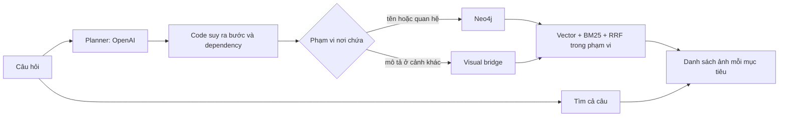

# Luồng tìm kiếm hiện tại

| Thành phần | Code |
|---|---|
| Prompt, gọi API | `planner/router.py` |
| Phân tích → kế hoạch | `planner/draft.py`, `planner/schemas.py` |
| Thực thi kế hoạch, visual bridge | `retrieval/executor.py` |
| Ghép danh sách | `retrieval/listing.py` |
| Vector, BM25, RRF | `retrieval/engine.py`, `retrieval/keyword.py` |

## Planner

Prompt `planner-draft-scope-v6`, GPT-5 mini. Model **không** trả loại câu, bước hoặc dependency; chỉ
điền `QueryDraft`: nội dung ảnh đích, nơi chứa, và mỗi điều kiện thuộc ảnh (`image`) hay thuộc nơi chứa.
`compile_plan` suy ra kế hoạch:

- Nơi chứa chưa có tên, có mô tả riêng: `resolve_entity` rồi `retrieve_images` (multi-hop).
- Nơi chứa có tên: trả ảnh trực tiếp; mô tả giữ ở `identity_text`, chỉ dùng khi graph không có tên đó.
- Một quan hệ trực tiếp với anchor có tên là bộ lọc của bước trả ảnh; từ hai quan hệ trở lên cần
  `resolve_entity`.
- Ảnh đích chính là nơi đó thì mọi mô tả là điều kiện ảnh. "Bên trong X" là cảnh khác của X.
- Cụm đứng trước nơi chứa trong câu không thể bổ nghĩa cho nơi đó.
- Tên riêng giữ nguyên cả cụm. "Nơi chứa" chỉ là chi tiết của mô tả thì bị bỏ; câu hỏi về kho ảnh
  ("có ảnh nào không") không phải mô tả.

`query_type`: single, multi-target, multi-hop hoặc unclear. Giới hạn 5 mục tiêu, 12 bước. Thiếu ngữ
cảnh thiết yếu ("ảnh vừa rồi") thì hỏi lại. Plan sai được ghi lỗi kèm `raw_output`, không đổi thành
route khác.

## Xác định nơi chứa

- **Tên/quan hệ:** tra Neo4j theo tên chuẩn hóa và alias tường minh. `LOCATED_IN` bắc cầu: nằm trong
  quận thì nằm trong tỉnh; bộ phận nằm nơi công trình nằm. Không thực thi Cypher do model sinh.
- **Visual bridge** (mô tả nhìn thấy ở cảnh khác):
  1. Graph giới hạn phạm vi, không lọc kind/category. Entity chưa có vị trí nào được giữ vì chưa biết.
  2. Tìm ảnh khớp mô tả trong phạm vi bằng vector/BM25/RRF.
  3. Xếp hạng entity theo ảnh điểm cao nhất. Nơi graph xác nhận thắng nếu kém điểm đầu không quá
     `BRIDGE_MARGIN` (0,1), rồi so các ảnh sau; bằng hoàn toàn là mơ hồ.
  4. Tìm ảnh đích trong entity đứng đầu, không tự mở rộng sang cha/con.
- Tên không có trong graph: giữ trong câu tìm, không lọc được, ghi `unmatched_names`; chỉ khi câu có mô
  tả nhận diện. Tên có trong graph thì không nới.
- Kết quả bridge có `verification_status=visual_bridge_unverified`; `trace` giữ ứng viên, ảnh bằng chứng
  và `graph_confirmed`.
- Chưa hỗ trợ: "cùng thành phố/tỉnh…", "cách …", "chủ đầu tư", bán kính. "Gần …" được coi là mô tả
  nhìn thấy.

## Danh sách kết quả

Kiểu Google Images: luôn trả danh sách, không từ chối. Mỗi mục tiêu một nhóm tối đa `LIST_SIZE` (20) ảnh;
số ảnh nêu trong câu không cắt danh sách.

| Trường hợp | Danh sách |
|---|---|
| Tên/quan hệ khớp graph | Ảnh của phạm vi trước, tìm cả câu lấp phần sau |
| Nơi suy đoán qua bridge | Xen kẽ ảnh của nơi đó với tìm cả câu, giữ hạng 1 |
| Nhiều nơi bằng điểm | Ảnh của tất cả, xen kẽ như trên |
| Không khớp, quan hệ chưa hỗ trợ, planner lỗi | Tìm cả câu, `status=fallback_results`, lý do ở `resolution_status` |
| Cần làm rõ | Hỏi lại, không tìm |

Multi-target dùng phần câu riêng của từng mục tiêu. Mỗi ảnh có `source` là `place` hoặc `query`. Ghép
bằng RRF và thêm nơi thứ 2–3 đã thử, không tốt hơn ([kết quả](../evaluation/results.md)).

## Giới hạn

- Điều kiện thị giác chỉ được xếp hạng, chưa kiểm chứng; chưa có reranker.
- Planner chiếm phần lớn độ trễ, chưa đạt mục tiêu p90 < 300 ms.
- Tên có thật nhưng không có trong kho, kèm mô tả, có thể nhận ảnh của nơi khác.
