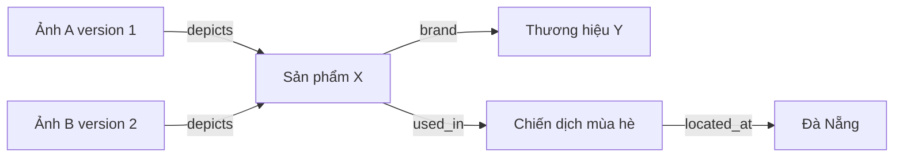
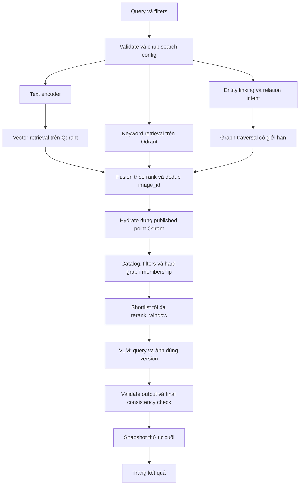

# Graph search và VLM reranking

Cập nhật 06/11/2026 theo C12: bổ sung graph search bên cạnh vector/keyword search và dùng VLM để rerank. Đây là phạm vi thiết kế hiện tại, chưa có implementation hoặc benchmark. Graph engine, checkpoint VLM, hosting và các giới hạn dưới đây là đề xuất cần đo, không phải công nghệ đã chốt.

## 1. Sơ đồ phân cấp kiến trúc

```mermaid
flowchart TD
    SYS[Hệ thống tìm kiếm ảnh]
    SYS --> ING[1. Nhập và xử lý dữ liệu]
    SYS --> DATA[2. Lưu trữ và chỉ mục]
    SYS --> RET[3. Retrieval]
    SYS --> RANK[4. Xếp hạng và trả kết quả]
    ING --> ENC[CLIP hoặc SigLIP 2: image encoder]
    ING --> BUILD[Chuẩn hóa entity và relation từ nguồn chuẩn]
    DATA --> OBJ[Object storage: ảnh, thumbnail, artifacts]
    DATA --> QD[Qdrant: vector và search metadata]
    DATA --> GRAPH[Graph projection: entity và relation]
    DATA --> DB[DB quan hệ: catalog, jobs, pointers, tài khoản]
    RET --> V[Vector search: ngữ nghĩa thị giác]
    RET --> K[Keyword search: tên, tag, mã]
    RET --> G[Graph search: quan hệ thực thể]
    RANK --> F[Fusion và dedup]
    RANK --> C[Kiểm chứng catalog, filters và graph constraints]
    RANK --> VLM[VLM rerank shortlist]
    RANK --> SNAP[Final check, snapshot và pagination]
```

Graph ở đây là graph thực thể/quan hệ nghiệp vụ, khác với cấu trúc HNSW bên trong vector index. VLM reranker là model riêng với encoder; thay VLM/prompt không bắt buộc tính lại embedding CLIP/SigLIP 2.

## 2. Dữ liệu graph và nguồn chuẩn

Ví dụ minh họa, không giả định lĩnh vực ảnh đã được chốt:

Query “ảnh giày đỏ của thương hiệu Y trong chiến dịch ở Đà Nẵng” có thể dùng vector cho nội dung thị giác, keyword cho tên, graph cho đường quan hệ. Nếu một quan hệ là điều kiện bắt buộc, mọi ảnh cuối cùng phải thỏa đường đi đó; fusion hoặc VLM không được ghi đè điều kiện này.

| Thành phần | Trường logic và quy tắc |
| --- | --- |
| Image node | image_id, content_version, graph_generation_id, projection_revision; liên kết về catalog, không chứa ảnh/vector |
| Entity | entity_id ổn định có namespace nguồn, entity_type, canonical_name, aliases, source_revision; không gộp thực thể chỉ vì trùng tên |
| Relation | relation_id, subject_id, predicate, object_id, source_revision, provenance, confidence nullable, verification_status; nếu gắn ảnh phải giữ content_version và projection_revision |
| Graph artifact | Snapshot bất biến các assertion theo image version hoặc shared entity/relation revision; schema/extractor revision, source references và hash |

Metadata nghiệp vụ có sẵn, manifest hoặc nguồn quản lý đã xác minh là đầu vào chính. Graph lưu tên/alias thực thể cho entity linking; không sao chép toàn bộ title/tags/license của Qdrant. Không suy ra chiến dịch, bản quyền hay thương hiệu chính thức chỉ từ vẻ ngoài ảnh. Trích quan hệ bằng VLM là pipeline enrichment riêng chưa được mặc định đưa vào C12; nếu bổ sung phải có đánh giá, provenance và quy tắc duyệt. Việc có VLM reranker không tự tạo graph.

Không có entity/relation hợp lệ là graph projection rỗng hợp lệ, khác với job graph chưa chạy hoặc bị lỗi. Độ phủ graph được báo riêng, không bịa cạnh để lấp dữ liệu thiếu.

## 3. Query planning và retrieval

Entity linker dùng dictionary/aliases và taxonomy có version làm điểm khởi đầu; không bắt buộc LLM query planner. Query plan chỉ chọn predicate/template cho phép và bind tham số, không thực thi graph query do người dùng/model sinh tùy ý. Ambiguity không giải được trả 422 INVALID_QUERY với hướng làm rõ; điều kiện graph bắt buộc không tìm thấy entity trả không có kết quả trong phạm vi, không bỏ điều kiện để chuyển thành vector-only. Query không có ý định quan hệ có thể skip graph theo routing rule đã version; đây không phải lỗi dependency hay degraded mode.

Graph có hai vai trò được ghi trong query plan:

- **Bổ sung ứng viên/tín hiệu:** traversal trả danh sách image_id/content_version, rank và bằng chứng đường đi; hợp nhất với vector/keyword bằng weighted RRF làm baseline. Graph rank thử theo số quan hệ đã xác minh khớp và độ dài đường đi tăng dần, tie-break image_id; không coi rank này là xác suất.
- **Điều kiện bắt buộc:** kiểm tra membership của từng candidate theo đầy đủ đường quan hệ. Tập ID lấy giới hạn từ graph để fusion không phải toàn bộ tập hợp lệ. Nếu prefilter bằng ID, chỉ dùng tập đầy đủ đã xác minh đủ nhỏ; với tập lớn dùng membership check theo batch và overfetch hữu hạn. Có thể trả ít kết quả khi hết budget, không bỏ constraint hoặc coi ID ngoài graph top-K là chắc chắn không hợp lệ.

Giới hạn ban đầu để thử: tối đa 2 hops, 1.000 entity được thăm, 200 graph candidates; pin traversal direction, allowed predicates, fan-out, timeout và ranking rule trong graph_config. Có cycle detection. Vượt giới hạn khi đánh giá hard membership mà chưa xác định được đúng/sai là lỗi có kiểm soát, không coi là false hoặc complete; xử lý theo mục 6. Báo candidate truncation trong telemetry. Các giá trị này cần thay bằng benchmark Q13/Q15.

Mỗi nhánh thử lấy tối đa 200 ứng viên; fusion và kiểm chứng giữ tối đa 200. Graph candidates phải hydrate metadata từ đúng published Qdrant point, sau đó áp dụng orientation/size/collection filters giống các nhánh khác. Loại ảnh deleted, version cũ hoặc graph projection không khớp pointer. Chỉ dùng bằng chứng quan hệ của revision đã công bố.

## 4. Hợp đồng VLM reranker

Đề xuất thử rerank_window=50, tối thiểu bằng limit request đã validate, tối đa không vượt fusion window=200. Nếu ít hơn thì dùng toàn bộ ảnh hợp lệ. Worker/API đọc rendition dành cho inference từ object storage bằng danh tính nội bộ; rendition có hash và gắn đúng content_version. Không dùng ảnh gốc URL công khai hoặc URL từ client. Kích thước ảnh, processor và quy tắc resize/crop được pin; thumbnail UI có thể thiếu chi tiết để rerank.

Input mỗi cặp gồm query gốc đã chuẩn hóa, candidate_id, content_version, ảnh và metadata/bằng chứng graph được cho phép. Phân biệt metadata xác minh với suy luận; VLM không có quyền thay đổi quan hệ nghiệp vụ. Query, chữ trong ảnh và metadata được coi là dữ liệu, không phải chỉ dẫn thay prompt; reranker không gọi tools hoặc ghi dữ liệu.

Output có schema `candidate_id`, `content_version`, `relevance_score` hữu hạn trong [0, 1]. Đây là score xếp hạng, chưa phải xác suất hiệu chỉnh. Chấm từng cặp độc lập hoặc microbatch rồi gom đủ shortlist; pin prompt, processor, decoding và model revision. Validator yêu cầu đúng tập ID/version đầu vào, không thiếu/trùng/thêm ID, không NaN/Inf hoặc score ngoài miền. Output sai làm cả lần rerank thất bại; không trộn các microbatch đã chấm với score fusion.

Sắp xếp theo relevance_score giảm dần; tie-break bằng fusion rank rồi image_id. Snapshot chỉ chứa shortlist đã rerank (ví dụ tối đa 50), không nối phần đuôi chưa chấm vào cùng danh sách. Giới hạn 200 trong API là trần lưu snapshot, không cam kết mỗi lượt có 200 kết quả. Phân trang dùng lại thứ tự đã lưu, không gọi VLM lại. Reranker không tìm thêm được ảnh ngoài candidate set.

Không cần xuất lời giải thích tự do hoặc chain-of-thought. Chỉ lưu diagnostics tối thiểu theo retention, không log ảnh/query riêng tùy ý. Nếu VLM hosted bên ngoài, phải chốt quyền xử lý ảnh, retention và credential references trong Q14 trước triển khai; không tự chọn nhà cung cấp.

## 5. Versioning, đồng bộ và công bố

Qdrant và graph là hai projection dẫn xuất. DB quan hệ vẫn là nguồn chuẩn image lifecycle; object storage giữ graph artifacts để rebuild. Graph engine chưa chốt; có thể dùng graph database riêng hoặc adapter trên DB phù hợp sau benchmark, không mặc định cài Neo4j. Mọi adapter phải đáp ứng hợp đồng version/read consistency dưới đây.

1. Lưu graph artifact bất biến, metadata snapshot và embedding artifact/reference; transaction catalog ghi desired_version, intents cho cả hai projection và outbox deliveries riêng theo target/generation.
2. Worker upsert Qdrant point và graph projection bất biến theo image_id/content_version/projection_revision; retry cùng ID phải cùng hash. Quan hệ shared entity có artifact/source revision riêng, không chỉ phụ thuộc một ảnh.
3. Xác minh đọc được cả hai projection; transaction công bố published_projections và published_graph_projections cùng current_version khi desired_version/lifecycle/lease còn đúng. Graph rỗng đã xác minh được tính là ready. Graph job lỗi không được giả thành graph rỗng để publish. Trong lúc chờ, version cũ hợp lệ tiếp tục phục vụ.
4. Mỗi lần công bố thay đổi image graph pointer hoặc shared entity/relation pointer tăng published graph_revision đơn điệu trong catalog. Worker xác minh mọi artifact trước bước này. Đọc graph dùng đúng tập revision đã công bố, không đọc write staging chưa có pointer.
5. Request chụp graph generation/revision rồi kiểm tra lại sau retrieval và sau VLM; nếu revision thay đổi, retry hữu hạn trong deadline hoặc trả lỗi, không trộn đường đi hai revision. Giải pháp này có thể tăng retry khi ghi liên tục; benchmark trước khi cân nhắc snapshot/MVCC của engine. Final catalog check sau inference chặn ảnh bị xóa/cập nhật giữa chừng.
6. Với hard graph constraint, session lưu graph revision; revision đổi trả 410 SEARCH_EXPIRED ở trang sau. Với graph chỉ boost điểm, giữ snapshot thứ tự cũ, tiếp tục recheck lifecycle/pointers từng trang. Không đổi thứ tự ngầm.

Delete commit tombstone ngay; purge mọi Qdrant point và graph image node/cạnh gắn ảnh ở mọi generation, kể cả staging. Không xóa shared entity còn được ảnh khác tham chiếu; giữ provenance nguồn shared relations. Không báo purge complete khi writer cũ còn có thể ghi trễ. Reconcile phát hiện graph orphan, thiếu projection, hash/version lệch, dangling edge và graph pointer chưa publish. Final checks vẫn bắt buộc dù graph payload có cờ active.

Active search config gắn encoder/vector generation, graph generation/schema/linker revision, fusion và reranker profile thành một cấu hình đọc. Đổi encoder tạo vector generation mới; đổi graph schema/linker tạo graph generation mới và backfill/catch-up; đổi VLM/prompt chỉ tạo search profile mới và quality gate, tái sử dụng vector/graph tương thích. Cutover cấu hình nguyên tử trong catalog; rollback chỉ khi các generation đích đã catch-up. Không có distributed transaction giữa các store.

## 6. Lỗi và suy giảm

Mặc định cấu hình đầy đủ là strict: dependency unavailable trả 503 SEARCH_UNAVAILABLE, hết deadline trả 504 SEARCH_TIMEOUT. Chỉ dùng fallback nếu failure_policy trong profile khai báo trước; response có degraded=true và degradation_reason, snapshot giữ nguyên trạng thái này cho mọi trang.

| Tình huống | Hành vi |
| --- | --- |
| Graph không có intent áp dụng | Skip theo routing rule, không degraded |
| Graph traversal hợp lệ không có kết quả | Nhánh graph rỗng; hard condition có thể dẫn đến kết quả rỗng hợp lệ |
| Graph lỗi/vượt budget, chỉ dùng boost | Strict fail; nếu profile cho phép thì dùng vector/keyword, reason=GRAPH_UNAVAILABLE hoặc GRAPH_BUDGET_EXCEEDED |
| Graph lỗi/vượt budget với hard condition | Luôn fail; không bỏ điều kiện bắt buộc |
| Graph revision thay đổi liên tục | Retry hữu hạn; hết budget trả 503 với reason nội bộ GRAPH_REVISION_CHANGED, không trả hỗn hợp revision |
| VLM timeout/invalid output/thiếu ảnh inference | Strict fail; nếu profile cho phép thì bỏ toàn bộ kết quả VLM, dùng thứ tự fusion của shortlist đã kiểm chứng, reason=RERANK_TIMEOUT/RERANK_INVALID_OUTPUT/RERANK_UNAVAILABLE |
| Graph và VLM cùng fallback | degradation_reason=MULTIPLE_COMPONENT_FAILURES; chi tiết từng lỗi lưu server-side theo request_id |
| Catalog hoặc Qdrant không đọc được | Fail; không có đường fallback giữ bảo đảm lifecycle/metadata |

Không fallback khi không thể kiểm chứng hard constraint hoặc image lifecycle. Không dùng lỗi dependency làm kết quả rỗng. Nhánh keyword và vector cũng có required/optional policy tường minh theo [thiết kế tìm kiếm](search-evaluation.md).

## 7. Đánh giá và điều kiện triển khai

So sánh trên cùng dataset/filters/query labels: keyword-only, vector-only, vector+keyword, thêm graph, thêm VLM và cấu hình đầy đủ. Ablation tách lợi ích graph khỏi VLM; nhóm query quan hệ phải có ground truth entity/path và nguồn xác minh. Báo candidate Success@K theo pooled labels trước rerank, nDCG@10/Precision@10 sau rerank, entity-linking accuracy, constraint violation rate, graph coverage và stale projection rejection. Không suy diễn recall toàn kho từ pool nhãn hạn chế.

Đo riêng entity linking/traversal, fusion/hydration, ảnh inference fetch, VLM, final checks và tổng API p50/p95/p99 ở tải mục tiêu; đo VRAM, bytes ảnh, inference cost/query, fallback/retry rate và import graph lag. Mục tiêu đề xuất p95 warm < 2 giây vẫn là mục tiêu toàn pipeline, chưa có bằng chứng đáp ứng; shortlist=50 và deadline thử dưới 5 giây cần benchmark rồi điều chỉnh/chốt Q15. Không loại thời gian VLM khỏi báo cáo để tuyên bố đạt SLO.

Integration tests khi triển khai: entity trùng tên/alias, cycle/fan-out budget, hard membership ngoài graph top-K, graph rỗng vs lỗi, lỗi partial write và crash trước publish, shared relation update, stale graph writer sau delete, graph đổi trong lúc VLM chạy/phân trang, output VLM thiếu/trùng/ngoài tập, timeout strict/fallback và snapshot không rerank lần hai. Mock inference cho tests thường xuyên; benchmark model thật tách riêng.
