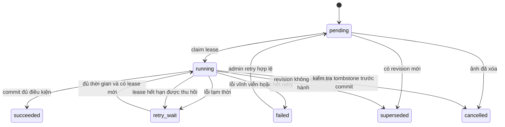

# Thiết kế pipeline nhập và cập nhật ảnh

Trạng thái: đề xuất cho kho riêng 100k–1M ảnh. Liên quan FR05, FR06, FR08 và NFR05.

Cập nhật 05/11/2026: Qdrant lưu vector và payload metadata; DB quan hệ giữ jobs, outbox và pointer công bố. Quy trình cross-store theo [thiết kế Qdrant](qdrant-design.md).

Cập nhật 06/11/2026: nhập liệu dựng cả Qdrant và graph projection; VLM rerank chạy online sau retrieval, không bắt buộc VLM caption/extraction toàn kho. Quy tắc graph artifacts, shared relations và publish ở [graph và reranking](graph-reranking-design.md).

## 1. Đầu vào và định danh

Nguồn riêng được đăng ký với collection, prefix/bucket được phép và credential reference do server quản lý. Import nhận manifest trong vùng nhập; không cho client chỉ định URL bất kỳ. Nếu nguồn đang là filesystem, cần adapter có root allowlist và kiểm soát symlink/path traversal trước khi bật.

Mỗi dòng JSONL biểu diễn một ảnh; ví dụ:

```json
{"source_item_key":"catalog/photo-001","input_revision":1,"object_key":"incoming/photo-001.jpg","metadata":{"title":"Không gian cà phê","tags":["nội thất"],"license":null}}
```

source_item_key ổn định, không phải checksum. input_revision là integer dương tăng đơn điệu cho từng source_item_key; cùng revision phải tham chiếu cùng nội dung và metadata. Adapter tạo revision nếu nguồn không có; cần thống nhất thứ tự phát sinh thay đổi, không dùng timestamp máy client làm bảo đảm duy nhất.

Manifest có thể thêm metadata.entities và metadata.relations theo schema/taxonomy đã chốt Q13, với source namespace, stable IDs và provenance; đây là trường đề xuất cần validate trước khi bật adapter, không nhận cạnh tự do không có schema. Không có graph facts tạo artifact graph rỗng hợp lệ. Shared entity/relation updates có event source revision riêng và tăng graph_revision khi publish, kể cả không đổi byte ảnh.

Parser đọc streaming; giới hạn đề xuất 10.000 dòng/10 MiB mỗi import. Lỗi JSON/schema từng dòng được đếm failed với line_number; nếu không thể đọc manifest thì import failed. Dòng lặp cùng key/revision được hợp nhất khi payload giống, payload khác là conflict. Object nguồn cần bất biến hoặc có object version/ETag kiểm tra trước và sau đọc; thay đổi trong lúc đọc không được công bố dưới cùng input_revision.

## 2. State machine



State diagram áp dụng cho job; job type import_item tổng hợp các child processing jobs; import_id là jobs.id của root type import, item_id là jobs.id của type import_item. Chỉ có một bảng jobs. Item có thể skipped khi cùng revision đã thành công và dữ liệu không đổi. Item thành công sau khi cả vector/graph active targets ready và images.current_version đã publish. MVP không nhập liệu song song với generation build: rebuild chặn/drain ghi trong maintenance, job rebuild có checkpoint riêng.

## 3. Các bước xử lý

1. Đăng ký identity và desired_version trong transaction; bỏ revision cũ hoặc conflict. Không tăng version khi replay cùng payload.
2. Claim job với lease_token duy nhất; transaction ngắn, không giữ khóa database trong lúc đọc ảnh/inference.
3. Đọc object có giới hạn, kiểm tra actual format, byte size và số pixel. Đề xuất pilot: JPEG/PNG/WebP tĩnh, ≤ 25 MiB, ≤ 40 megapixel; không tự chọn frame đầu của GIF/ảnh động.
4. Giải mã có giới hạn tài nguyên, áp dụng EXIF orientation nhất quán; không sửa object gốc. Tạo thumbnail không mang EXIF nhạy cảm; metadata hiển thị theo ảnh đã xoay.
5. Tính sha256 của byte gốc; tạo immutable object key, thumbnail và metadata snapshot theo version. MVP không chia sẻ object vật lý giữa các image records khác nhau để đơn giản hóa purge.
6. Dùng đúng model/processor; chạy microbatch có giới hạn VRAM/RAM; kiểm tra vector. Lưu artifact bền vững hoặc bảo đảm có thể tái dựng đúng cùng projection khi retry.
7. Dựng graph artifact bất biến từ entity/relation nguồn chuẩn, pin schema/linker/source revision; lưu artifact/hash. Transaction DB quan hệ ghi artifact references, image_versions.index_state entries và jobs type sync_vector/sync_graph riêng mỗi target, tạo cùng transaction; jobs thay outbox/delivery tables. Worker upsert point Qdrant và graph projection bất biến, xác minh cả hai đọc được; retry target lỗi mà không công bố một phần.
8. Transaction DB quan hệ so lease_token, desired_version, generation và lifecycle; nếu đúng và cả hai projection ready, xác nhận point/artifact references trong index_state rồi đổi images.current_version cùng tăng search_configs.graph_revision; hoàn tất publish_image/import_item jobs cùng transaction. Graph rỗng đã xác minh được tính ready; graph lỗi không được giả thành rỗng. Nếu sai, point chưa công bố được cleanup, không hiển thị cho người dùng.
9. Tăng tiến độ, ghi event an toàn; đối soát counts từ jobs type import_item trước khi kết thúc root import job, không tính processing children là ảnh riêng. Không giữ transaction SQL xuyên lệnh gọi Qdrant hoặc object storage.

Không tạo vector thay thế hoặc đánh dấu ready khi ảnh giải mã/model lỗi. Với cập nhật nội dung, bản current cũ vẫn phục vụ cho đến khi bản mới sẵn sàng, trừ khi ảnh đã tombstone.

## 4. Retry và chống xử lý lặp

Lỗi tạm thời: storage timeout, model service chưa sẵn sàng, deadlock hoặc kết nối database gián đoạn. Thử lại với exponential backoff và jitter, tối đa 5 attempts tự động làm cấu hình ban đầu. Invalid format, quá giới hạn hoặc payload conflict là lỗi vĩnh viễn, không retry tự động.

Lease đề xuất ban đầu 5 phút, heartbeat mỗi 60 giây; phải đo và điều chỉnh theo batch. Claim một lượng nhỏ đủ xử lý trong lease; không claim toàn bộ triệu ảnh. Worker dùng fencing token cho heartbeat và công bố pointer trong DB quan hệ; token cũ không thể công bố sau khi job được worker khác nhận. Lệnh Qdrant đã gửi có thể hoàn tất trễ; point theo revision bất biến và final catalog check ngăn nó ghi đè/hiển thị như phiên bản mới.

Nếu crash sau khi ghi object nhưng trước commit, lần chạy mới có thể dùng lại artifact xác minh được hoặc tạo lại cùng khóa xác định. Object mồ côi được dọn theo grace period, không dọn file đang được lease hợp lệ sử dụng.

## 5. Cập nhật và xóa

Revision mới tạo content version mới. Metadata-only update có thể tái sử dụng vector nếu byte hash, model và processor trùng; không đánh lại toàn bộ ảnh chỉ vì thay title. Kiểm tra lại mọi điều kiện trước publish.

Delete commit tombstone và tăng metadata_revision; job mới không được enqueue cho ảnh đó, job đang chạy phải thất bại kiểm tra công bố. Không hỗ trợ undelete ngầm qua import; muốn khôi phục cần luồng mới được xác nhận để tránh tác vụ cũ làm sống lại dữ liệu.

Purge job xóa point Qdrant và graph image node/cạnh gắn ảnh ở mọi generation theo image_id, gồm cả projection cũ/chưa công bố; không xóa shared entity còn tham chiếu; xóa object không còn tham chiếu và theo dõi lỗi. Tác vụ chạy lại an toàn; reconciliation dọn point do write cũ hoàn tất trễ. Không báo purge complete khi writer cũ chưa được giải quyết. Không xóa source object nếu nguồn đó không thuộc quyền quản lý vòng đời của hệ thống.

## 6. Backpressure và theo dõi

Giới hạn riêng số I/O workers, decode workers và inference microbatch. Theo dõi outbox lag riêng Qdrant/graph, độ phủ entity/relation, graph empty-vs-failed, shared-fact revisions, ảnh/giây end-to-end, bytes/giây, queue age, thời gian từng bước, lỗi theo loại, lease expiration và p95 search khi import hoạt động.

Khi API bị ảnh hưởng, giảm concurrency batch trước; không mở rộng worker vô hạn. Có thể dừng claim job mới, chờ tác vụ đang chạy commit/checkpoint rồi tiếp tục mà không reset import.

## 7. Kiểm thử bắt buộc khi có implementation

Replay import không tạo duplicate; hai worker claim không công bố cùng job; heartbeat/token cũ bị từ chối; crash ở từng ranh giới object/transaction có thể phục hồi; revision mới thắng revision cũ; delete trong lúc inference không bị hồi sinh; invalid/decompression-heavy image bị chặn; metadata-only update dùng lại đúng vector; counters khớp trạng thái item sau retry.

Bổ sung tests graph: replay cùng artifact/hash không tạo cạnh trùng; Qdrant thành công nhưng graph lỗi không publish version; graph rỗng hợp lệ được publish; crash giữa hai target phục hồi được; cập nhật metadata tái dựng quan hệ dù dùng lại vector; shared relation đổi tăng graph_revision; delete rồi stale graph write không hồi sinh ảnh; purge không xóa thực thể dùng chung còn được tham chiếu.

C13 parser/retry: source definitions là cấu hình versioned, pin ref/hash trong jobs và image_versions. Root import job giữ idempotency/request hash và parser checkpoint; import_item dedupe theo root/line để replay không tạo item trùng, lỗi dòng vẫn có item job dù chưa tạo image. Parent/dependencies có schema, không cycle; child failed vĩnh viễn phải cập nhật item/root progress. Retry item reset/enqueue đúng bước lỗi trong transaction và không reset target đã ready. Maintenance chặn root ghi mới, chỉ cho phép jobs thuộc tập drain đã ghi bền tiếp tục hoàn tất, rồi drain writers trước rebuild; request ghi bị chặn trả 503 MAINTENANCE_MODE và Retry-After. Khi xóa catalog, tạo purge job cùng transaction tombstone.

## 8. Nhập nguồn web địa danh

C15 bổ sung acquisition có kiểm soát trước import: admin chọn source/seed đã đăng ký → jobs crawl/crawl_item/fetch_media → lưu metadata/facts/source revisions/attribution → validate quyền/nguồn và image–place link → download giới hạn, hash/dedup → manifest bất biến → import pipeline như trên. Crawl root.result ghi import_id để truy tiến độ publish; downloaded không đồng nghĩa searchable. Giữ 9 bảng SQL. Single developer dùng một nguồn trước; Wikimedia Commons/Wikidata là đề xuất ở [MVP địa danh](landmark-mvp-plan.md).

Nguồn private không đổi contract manifest/object allowlist; source config web_import bổ sung API/media host/redirect/DNS allowlist, User-Agent/contact, rate/backoff và quota. Không nhận tùy ý URL từ user; fetch không được truy cập private/link-local/local services. Metadata nguồn HTML được sanitize; không coi HTML/prompt trong metadata là lệnh cho worker/VLM. Lưu snapshot nguyên bản có giới hạn và normalized metadata theo version ngoài Git.

Crawl/dịch/caption không được tự nhận diện địa danh hoặc suy license/quan hệ; liên kết entity phải có nguồn và verification state. title/description/tags có thể thiếu; giữ bản gốc/ngôn ngữ và provenance nếu chuẩn hóa tiếng Việt. Graph facts/aliases từ nguồn có revision và published manifest; crawl search query không cập nhật graph ngay trong request. Tests khi implementation gồm source timeout/429/redirect, thiếu attribution, image-place link sai, parser resume, duplicate file, deleted source replay, partial download và maintenance drain.
