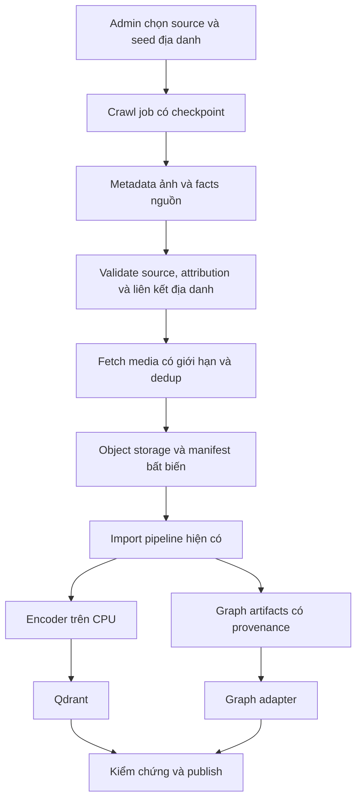

# Kế hoạch MVP địa danh và dữ liệu web

Cập nhật 06/11/2026. Đã xác nhận: tạm chọn địa danh để người dùng hình dung nơi đó; tìm tiếng Việt; một mục tiêu, nhiều mục tiêu trong một câu và multi-hop; cần bổ sung thu thập web vì chưa có dataset; một người phát triển bằng FastAPI/PostgreSQL; local có RAM hệ thống 16 GB, Intel Raptor Lake-P dùng RAM chia sẻ, không có VRAM chuyên dụng cố định; cho phép gửi ảnh tới API VLM ngoài. Chưa có code hoặc dữ liệu đã crawl. Nguồn/giới hạn/model/ngân sách dưới đây là đề xuất, không phải kết quả đo hoặc khoản chi được duyệt.

## 1. Ba kiểu truy vấn

| Kiểu | Ví dụ | Cách xử lý |
| --- | --- | --- |
| single | “Cho tôi 1 ảnh Hạ Long” | Một target; lấy đúng số ảnh yêu cầu nếu có ảnh hợp lệ |
| multi_target | “Tìm ảnh Hạ Long, ảnh Cát Bà” | Hai target riêng, retrieval/fusion/rerank theo target rồi trả hai nhóm; mặc định đề xuất 1 ảnh mỗi nhóm |
| multi_hop | “Tìm ảnh địa danh thuộc đơn vị hành chính thuộc vùng X” | Resolve entities và traversal quan hệ đã có nguồn; lấy ảnh của kết quả suy luận, giữ evidence/path |

Nhiều ảnh không tự đồng nghĩa nhiều hops. Multi-target là tách yêu cầu và bảo đảm độ phủ từng target; multi-hop là chuỗi quan hệ có bằng chứng. Ví dụ multi-hop dùng vùng X minh họa, không khẳng định địa giới thật. Cần query thật và labels để xác định bộ quan hệ đầu tiên.

Multi-target không gom cả câu thành một embedding rồi lấy top-2 vì có thể cả hai ảnh cùng thuộc một địa danh. Query planner giữ từng target_id và alias/entity resolve riêng; không tách mù theo mọi dấu phẩy hoặc từ “và”. Tên mơ hồ phải yêu cầu làm rõ bằng lỗi có cấu trúc, không đoán địa danh. Có thể bắt đầu bằng patterns/alias dictionary; LLM planner nếu thử là adapter riêng có schema và phải kiểm chứng bằng facts, không bắt buộc dùng LLM để sinh graph query.

Mỗi target dùng vector + keyword + graph khi áp dụng → hydrate/filter/correctness check → VLM rerank shortlist. Toàn request có candidate/traversal/API-call/deadline budget chung; target này không được lấn quota kết quả của target khác. Nhóm không có ảnh trả rỗng, không lấy ảnh của nhóm khác để bù. VLM không quyết định quan hệ hành chính bằng trí nhớ riêng.

## 2. Thu thập web để xây kho

Đề xuất adapter đầu tiên: Wikimedia Commons cho ảnh/metadata và Wikidata cho entity IDs/aliases/facts. Đây là lựa chọn khởi đầu để review, không khẳng định mọi ảnh/fact có đủ dữ liệu hoặc đều được nhận vào kho. [MediaWiki Imageinfo](https://www.mediawiki.org/wiki/API:Imageinfo) cung cấp thông tin file; [Wikidata data access](https://www.wikidata.org/wiki/Wikidata:Data_access) mô tả các cách lấy facts.



Crawl chạy nền trước khi ảnh searchable; search online không gọi crawler hoặc Wikidata trực tiếp. Mọi ảnh nhận vào trở thành catalog record trong kho do ứng dụng quản lý, giữ original source. API nhà cung cấp gọi trực tiếp mỗi lượt search và crawl toàn web vẫn ngoài phạm vi.

Source config versioned chứa domain/API/download-host allowlist, seed entity/category IDs, quotas, User-Agent/contact, rate/backoff, accept rules và secret references nếu có. Client admin gửi source_id/seed IDs có kiểm soát, không gửi URL bất kỳ. Fetch kiểm tra cả redirect và địa chỉ resolve, chặn loopback/private/link-local và endpoint nội bộ; giới hạn timeout/bytes/pixels/mime. Chính sách này áp dụng riêng crawler; import hiện tại vẫn chỉ nhận manifest/object trong vùng đã đăng ký.

Với Wikimedia, làm request tuần tự theo nguồn, gom items khi API hỗ trợ, cache/checkpoint và backoff theo [API etiquette](https://www.mediawiki.org/wiki/API:Etiquette). Nếu mở adapter HTML khác sau này, cấu hình chính sách truy cập/robots/terms theo nguồn; không vượt kiểm soát truy cập. Không bắt đầu bằng scraper trình duyệt hoặc danh sách website không giới hạn.

Lưu source page/media URL, external ID/version, author, license ID/URL, attribution, fetched_at, source revision/hash. Không suy ra quyền sử dụng từ việc tải được URL. Ảnh thiếu điều kiện nguồn/attribution hoặc liên kết địa danh không rõ bị tách khỏi tập công bố để review; [Commons reuse](https://commons.wikimedia.org/wiki/Commons:Reusing_content_outside_Wikimedia) yêu cầu xét thông tin từng file, không áp một license chung cho toàn Commons. Thumbnail public/detail/download đều cần thể hiện attribution phù hợp, không chỉ lưu nội bộ.

Quy mô đề xuất đầu: 20–30 địa danh, 20–50 ảnh/địa danh, tối đa 1.500 ảnh trong một đợt khám phá. Đây là budget dữ liệu, không bảo đảm nguồn có đủ ảnh hoặc ảnh truy vấn đã đúng entity. Chọn seed ở Việt Nam là đề xuất thử, không giới hạn địa lý sản phẩm đã chốt. Mục tiêu kiến trúc 100k–1M vẫn giữ nhưng không yêu cầu laptop nạp cả kho ngay.

## 3. Metadata địa danh

| Trường | Cách tạo đề xuất | Sử dụng |
| --- | --- | --- |
| title | Giữ title nguồn; thêm title_vi nếu có bản dịch/chuẩn hóa có provenance | Keyword và hiển thị |
| description | Giữ mô tả nguồn ở source_description; description_vi nullable, có provenance.kind/model/revision nếu dịch hoặc AI sinh | Keyword; description vector là thử nghiệm riêng, chưa mặc định |
| tags | Chuẩn hóa loại cảnh/đối tượng thấy được và tags nguồn; AI tags lưu provenance, không biến thành fact xác minh | Keyword/filters khi đủ độ tin cậy |
| place_ids | Entity IDs ổn định, aliases tiếng Việt/không dấu/tên nguồn; kiểm chứng từng liên kết ảnh–địa danh | Entity linking, graph và matching |
| place_type / admin_path | Từ facts có nguồn/revision; theo taxonomy đầu tiên sau kiểm kê | Graph và filters đã đặc tả |
| coordinates / captured_at | Nullable, giữ nguồn và phân biệt tọa độ địa danh với vị trí máy ảnh; không dùng fetched_at làm ngày chụp | Thông tin địa lý/thời gian nếu có |
| author / license / attribution / source URLs | Từ nguồn và kiểm chứng theo source acceptance rules | Hiển thị nguồn và quản lý dữ liệu |
| width / height / mime / checksum | Worker decode/hash | Filters kỹ thuật và dedup |

Metadata kỹ thuật và source identity bắt buộc cho ingest; title/description/tags có thể null/rỗng, không bịa để vượt validation. Liên kết place_ids đủ tin cậy là điều kiện đưa ảnh vào bộ benchmark địa danh đã xác minh; ảnh không rõ nơi không được gán seed entity chỉ vì crawl từ cùng category. Metadata provenance theo trường được lưu trong payload/snapshot, không thêm bảng SQL.

VLM nếu dùng để tạo description/tags chỉ mô tả thị giác như “mặt nước, núi đá, thuyền”; không tự đặt tên địa danh, địa giới, lịch sử hoặc license. Caption/enrichment toàn kho là job tùy chọn cần budget riêng, không bắt buộc để chạy VLM rerank. Tiếng Việt là ngôn ngữ truy vấn/UI; giữ nguyên văn bản nguồn và ngôn ngữ gốc để không mất tên riêng.

## 4. Graph đầu tiên và multi-hop

Đề xuất entities: Image, Place, AdministrativeArea, PlaceType. Relations: Image depicts Place; Place located_in AdministrativeArea; AdministrativeArea part_of AdministrativeArea; Place instance_of PlaceType. Mọi relation giữ source revision, evidence reference và thời điểm hiệu lực nếu nguồn cung cấp; không gán loại đơn vị hành chính theo tên hoặc hard-code địa giới hiện tại.

```text
Ảnh A → depicts → Địa danh B → located_in → Đơn vị C → part_of → Vùng D
```

Giới hạn ban đầu 2 cạnh địa lý/fact sau entity địa danh; cạnh ảnh–địa danh là bước lấy ảnh, không tính vào hop budget facts. Mapping này cần thống nhất với graph_config và evaluation, không trộn số hops toàn path với số bước suy luận. Thiếu cạnh/evidence thì query chưa có đáp án xác minh, không để VLM tự điền quan hệ. Dữ liệu liên kết wiki category hoặc place alias là tín hiệu cần kiểm chứng, không tự là bằng chứng ảnh chụp tại đó.

Với sample nhỏ, đề xuất graph adapter đọc immutable JSON artifacts và xây adjacency có giới hạn trong process; reuse published manifest/revision contract, không thêm SQL table hoặc một server graph riêng. Đo RAM và traversal trước khi scale; đây không phải engine production đã chốt cho 1M ảnh.

## 5. Local, model và chi phí

FastAPI + PostgreSQL đã chọn; Qdrant giữ vector/metadata; một codebase với API và worker riêng process. Graph adapter và lưu ảnh sau interface để đổi triển khai khi deploy. Local đề xuất filesystem ngoài Git làm object-storage adapter; giữ key/hash/immutability và đường đọc media qua API, không công khai thư mục ảnh gốc. S3-compatible storage/cloud/frontend vẫn chưa chốt.

RAM 16 GB là RAM hệ thống chia sẻ với GPU Intel, không có VRAM dedicated cố định; không suy ra CUDA hoặc dung lượng inference GPU từ con số này. Khởi đầu encoder CPU với một checkpoint nhỏ của CLIP/SigLIP 2 để benchmark batch nhỏ (1–4), một worker inference, không nạp cả hai model cùng lúc. Chọn checkpoint sau đo tiếng Việt/latency/memory. Intel acceleration chỉ nghiên cứu nếu có nhu cầu và hỗ trợ runtime đã kiểm chứng.

Đề xuất VLM qua API trước, dùng adapter trả score/schema; dòng Gemini Flash/Flash-Lite là một ứng viên cần benchmark, không khóa provider/model ID từ đề xuất này. Không dùng model sinh ảnh cho rerank. [Bảng giá nhà cung cấp](https://ai.google.dev/gemini-api/docs/pricing) là nguồn kiểm tra lại khi chọn endpoint; chưa xác nhận giá cố định hoặc quota cho tài khoản.

Thử rerank shortlist 5–10 ảnh cho query trả 1 ảnh/target; window thực tế luôn đủ số ảnh cần trả và nằm trong budget chung request. Đề xuất max 5 targets, 10 ảnh rerank mỗi target, tối đa 50 ảnh/request; concurrency API=1 trước khi đo. Không mặc định 50 ảnh cho mỗi nhóm. Multi-hop và multi-target cần báo riêng p95; mục tiêu 2 giây hiện tại chưa được chứng minh với CPU + API mạng.

Đề xuất budget thử API 10–20 USD cho đợt benchmark đầu, chưa phải dự toán tháng hay phê duyệt chi tiền. Không dùng free tier làm giả định capacity. Đo 100 request: input text+image tokens, output/reasoning tokens theo provider, retries và cost thực; suy ra cost/query rồi mới ước lượng theo số lượt/tháng. Trong ứng dụng có quota cứng theo ảnh/request và lượt gọi/ngày, timeout/retry hữu hạn, log usage; cảnh báo billing của provider không được coi là hard cap. Captioning/dịch/LLM planner nếu bật được đo và tính riêng. Không cam kết số query mua được khi chưa pin model/rendition/token usage.

## 6. Giữ 9 bảng và lộ trình

Không thêm bảng crawl/place/entity. Crawl dùng jobs types crawl/crawl_item/fetch_media, manifest/output artifacts rồi chuyển vào import jobs hiện có; facts/aliases nằm trong graph artifacts và Qdrant metadata. Crawl import là hai bước tách checkpoint: crawl root.result giữ import_id; counts crawl là discovered/accepted/downloaded/rejected, counts import vẫn từ import_item. Không dùng số downloaded thay số searchable.

Search_sessions thêm query_plan JSON chứa mode, targets/aliases/resolved entity IDs, requested counts và evidence refs; items có target_ids để snapshot giữ grouping. Định nghĩa contract ở [api-contract.md](api-contract.md). Evidence lưu tối thiểu theo retention, không ghi chain-of-thought. Giữ config/graph revision và final-check như trước.

Trình tự đề xuất cho một người: dựng scaffold FastAPI/PostgreSQL/Qdrant và tests fixtures → một source adapter + sample nhỏ → single target → multi-target → graph facts/multi-hop → VLM rerank/ablation toàn pipeline → load/restore/deploy. Graph và VLM vẫn thuộc phạm vi đầy đủ, chỉ chia thứ tự triển khai để kiểm chứng từng phần. Frontend chưa chốt; có thể dùng API docs/CLI trong thử nghiệm đầu.

Những gì còn cần chốt: seed địa danh/nguồn cụ thể, mapping facts/độ phủ, model và usage/cost benchmark, deadline, tải pilot, quality gate, media access/recovery/retention theo sổ quyết định. Không chờ các mục này để dựng scaffold và deterministic fixtures, nhưng không nhập toàn kho hoặc tuyên bố đạt semantic quality trước khi có dữ liệu/nhãn thật.
