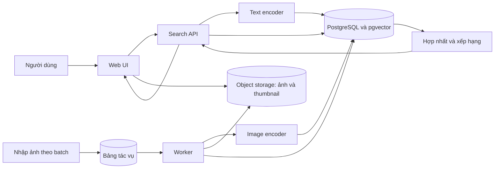

# Đề xuất hệ thống tìm kiếm ảnh

Ngày phân tích: 04/11/2026. Trạng thái: đề xuất, chưa chốt triển khai.

Đây là phân tích tổng quan. Thiết kế chi tiết và quy tắc nguồn chuẩn của từng phần được tập hợp tại [mục lục tài liệu](README.md).

## 1. Định hướng và các giả định

MVP cho phép người dùng nhập mô tả tự nhiên, chẳng hạn “quán cà phê có ánh sáng tự nhiên, nội thất gỗ, ảnh ngang”, và nhận danh sách ảnh phù hợp. Giai đoạn sau cho phép đưa ảnh vào để tìm ảnh tương tự.

Phạm vi đã được xác nhận: MVP tìm trong kho ảnh riêng, quy mô 100.000–1.000.000 ảnh. Nguồn ảnh bên ngoài là hướng mở rộng sau MVP. Xem [kế hoạch quy mô](scale-plan.md) cho sizing, benchmark và vận hành ở khoảng dữ liệu này.

Giả định còn cần xác nhận: ưu tiên truy vấn tiếng Việt, nhóm phát triển nhỏ, dữ liệu được phép sử dụng. Chưa biết lĩnh vực ảnh, metadata hiện có, QPS, yêu cầu sẵn sàng, ngân sách và tần suất cập nhật.

Các phương án nguồn dữ liệu và vai trò trong lộ trình:

| Phương án | Cách triển khai | Đánh đổi |
| --- | --- | --- |
| Kho ảnh riêng — MVP đã chốt | Nhập ảnh, tạo embedding và tự đánh chỉ mục | Kiểm soát tìm kiếm tốt; phải vận hành dữ liệu và pipeline |
| API nhà cung cấp — sau MVP | Gửi truy vấn, chuẩn hóa và hợp nhất kết quả trả về | Tăng độ phủ; phụ thuộc quota và điều kiện sử dụng |
| Kết hợp | Adapter từng nguồn và hợp nhất với kho riêng | Tăng độ phủ; xử lý trùng và xếp hạng phức tạp hơn |

Nguồn bên ngoài chưa nằm trong MVP. Khi bổ sung, cần phân biệt gọi API trực tiếp với nhập dữ liệu được cấp phép vào kho riêng; không giả định có thể lưu lại mọi ảnh từ API.

Khuyến nghị khởi đầu bằng một ứng dụng backend chia module và worker xử lý nền có thể tăng số process. Tách tài nguyên batch nhập ảnh khỏi tài nguyên phục vụ truy vấn. Chưa cần Kubernetes, Kafka hay nhiều microservice chỉ vì có một triệu ảnh.

## 2. Phạm vi MVP và tiêu chí nghiệm thu

Đề xuất đưa vào MVP:

- Nhập văn bản; xử lý Unicode và khoảng trắng; giới hạn độ dài theo giới hạn tokenizer của model đã chọn.
- Trả thumbnail, mô tả nếu có, nguồn ảnh và liên kết xem chi tiết; phân trang với số kết quả tối đa được kiểm soát.
- Bộ lọc dựa trên metadata đáng tin: bộ sưu tập, hướng ảnh, kích thước, loại ảnh hoặc quyền sử dụng khi dữ liệu có sẵn.
- Công cụ quản trị nhập ảnh theo batch, theo dõi trạng thái và chạy lại tác vụ lỗi.
- Ghi nhận phản hồi liên quan/không liên quan cùng cấu hình tìm kiếm để đánh giá.
- Trạng thái rõ ràng khi truy vấn sai, không có kết quả đủ phù hợp hoặc dịch vụ gặp lỗi.

Để sau MVP: tìm bằng ảnh, kết hợp ảnh và văn bản, cá nhân hóa, fine-tune, crawl web diện rộng, hội thoại nhiều lượt và reranker tốn tài nguyên.

Mục tiêu độ trễ đề xuất để đo thử: p95 dưới 2 giây cho API tìm kiếm đã warm, chưa gồm thời gian tải ảnh ở trình duyệt. Phải ghi rõ cấu hình máy, số ảnh, số người dùng đồng thời và QPS khi nghiệm thu. Đây là mục tiêu ban đầu, chưa phải cam kết hiệu năng.

Ngưỡng chất lượng cần được chốt sau khi có baseline trên dữ liệu thật. Không coi việc trả được 20 ảnh là bằng chứng tìm kiếm tốt.

## 3. Cơ chế tìm kiếm

Văn bản và ảnh cần được mã hóa bởi hai nhánh tương thích của cùng một mô hình đa phương thức để có thể so sánh trong cùng không gian vector. Tài liệu [Sentence Transformers về image search](https://www.sbert.net/examples/sentence_transformer/applications/image-search/README.html) minh họa cả tìm bằng văn bản và tìm ảnh tương tự theo cách này.

Phân biệt ba nguồn tín hiệu:

1. Embedding trực tiếp từ ảnh: phục vụ nội dung thị giác và tạo nền cho image-to-image.
2. Tiêu đề, tag, OCR, caption: giúp tìm tên riêng, mã sản phẩm hoặc chữ xuất hiện trong ảnh.
3. Metadata có cấu trúc: áp dụng ràng buộc chính xác như ảnh ngang, bộ sưu tập, quyền truy cập.

Không chỉ tạo caption rồi tìm trên caption: chi tiết bị bỏ sót khi mô tả sẽ khó được tìm lại. Caption và OCR có thể bổ sung sau khi phân tích lỗi chỉ ra nhu cầu.

Ví dụ: “giày đỏ mã AB123” cần cả tín hiệu hình ảnh và mã hàng trong metadata; “ảnh ngang” nên dựa vào width/height. Các yêu cầu phủ định, số lượng và quan hệ như “hai người, không có xe phía sau” cần bộ kiểm thử riêng; độ tương đồng vector không bảo đảm tuân thủ mọi ràng buộc.

## 4. Kiến trúc đề xuất cho kho ảnh riêng

Các khối là trách nhiệm logic, không bắt buộc mỗi khối là một dịch vụ. API và worker có thể dùng chung codebase, chạy thành hai process. Encoder có thể được nạp trong process; chỉ tách thành dịch vụ inference khi cần chia sẻ GPU hoặc scale độc lập.

| Thành phần | Lựa chọn đề xuất | Lý do |
| --- | --- | --- |
| Backend và worker | Python; FastAPI là một ứng viên | Thuận tiện tích hợp xử lý ảnh và mô hình |
| Metadata và vector | PostgreSQL + pgvector | Giảm số hệ thống phải vận hành |
| Ảnh gốc và thumbnail | Object storage tương thích S3 | Tách ảnh khỏi cơ sở dữ liệu truy vấn |
| Xử lý nền | Bảng jobs trong PostgreSQL, claim theo batch | Theo dõi tiến độ và phục hồi; chỉ thêm queue riêng khi đo được nhu cầu |
| Giao diện | React/TypeScript nếu phù hợp năng lực nhóm | Có thể thay bằng stack nhóm quen thuộc |

Đây là lựa chọn kiến trúc đề xuất, chưa phải stack đã được cài đặt. Khi viết code đầu tiên cần thêm manifest, lockfile, formatter, linter, framework test và hướng dẫn chạy chính xác.

[pgvector](https://github.com/pgvector/pgvector) hỗ trợ truy vấn chính xác và các chỉ mục gần đúng như HNSW. Với phạm vi đến một triệu ảnh, dùng HNSW làm ứng viên cho phục vụ truy vấn và exact search làm baseline kiểm tra recall trên một tập truy vấn. Kiểm tra truy vấn có bộ lọc vì tìm gần đúng kết hợp lọc có thể thiếu kết quả. Hiệu năng phải được đo trên cả dữ liệu 100.000 và 1.000.000 ảnh.

Cân nhắc Qdrant khi benchmark thực tế cho thấy cần scale truy vấn vector độc lập hoặc pipeline truy vấn nhiều nhánh phức tạp. Không chọn cơ sở dữ liệu chỉ dựa trên số ảnh; còn phụ thuộc số chiều vector, bộ lọc, RAM, QPS và mục tiêu recall.

## 5. Luồng nhập dữ liệu

1. Đăng ký nguồn và quyền truy cập; xác thực nội dung ảnh, kích thước và giới hạn tài nguyên khi giải mã.
2. Lưu ảnh gốc, tạo thumbnail, tính checksum và lấy width/height.
3. Tạo tác vụ với khóa chống xử lý lặp theo ảnh, phiên bản nội dung và phiên bản pipeline.
4. Worker chạy đúng processor của model, mã hóa ảnh và chuẩn hóa vector nếu cấu hình similarity yêu cầu.
5. Ghi embedding, phiên bản model và trạng thái ready. Chỉ ảnh sẵn sàng, còn hiệu lực và được phép xem mới vào kết quả.
6. Retry có giới hạn với lỗi tạm thời; lỗi vĩnh viễn được lưu để quản trị xử lý.

Checksum xử lý trùng byte; ảnh resize hoặc crop cần kiểm tra gần trùng riêng nếu chúng làm giảm chất lượng kết quả. Không tự động xóa mọi ảnh gần giống.

Worker cần claim job an toàn khi chạy đồng thời, có lease/timeout để phục hồi sau crash. Chạy lại cùng tác vụ không được tạo bản ghi ảnh trùng. Nếu dữ liệu thay đổi trong lúc xử lý, bỏ kết quả của phiên bản cũ.

## 6. Luồng tìm kiếm và xếp hạng

1. API xác thực người dùng và phạm vi được truy cập; kiểm tra truy vấn và filters.
2. Giữ truy vấn gốc, chuẩn hóa Unicode và khoảng trắng mà không xóa tùy tiện dấu tiếng Việt.
3. Text encoder tạo vector với model tương thích với chỉ mục ảnh.
4. Lấy ứng viên bằng vector, áp dụng phạm vi truy cập và bộ lọc trong truy vấn. Nếu có metadata văn bản hữu ích, chạy thêm nhánh từ khóa.
5. Hợp nhất hai danh sách bằng RRF làm baseline; không cộng trực tiếp các score khác thang đo. Áp dụng lại quyền truy cập ở mọi nhánh và khi lấy thông tin chi tiết.
6. Giảm kết quả trùng lặp, trả thumbnail và metadata; log thời gian từng bước cùng phiên bản cấu hình.

Ví dụ cấu hình để thử nghiệm: lấy 200 ứng viên mỗi nhánh, tạo snapshot tối đa 200 kết quả, mặc định trả 20 kết quả mỗi trang. Cần benchmark để điều chỉnh; hợp đồng chi tiết ở [API](api-contract.md), đây không phải thông số tối ưu đã được chứng minh.

[PostgreSQL Full Text Search](https://www.postgresql.org/docs/current/textsearch-intro.html) cung cấp cơ chế lập chỉ mục và tìm trên trường văn bản. Cần kiểm thử tokenization tiếng Việt và mã hàng; không mặc định cấu hình tiếng Anh sẽ phù hợp. [Qdrant Query API](https://qdrant.tech/documentation/hybrid-queries/) là tài liệu tham khảo cho fusion và tìm nhiều giai đoạn nếu sau này dùng Qdrant.

Cosine similarity không phải xác suất phù hợp. Khi dữ liệu không có ảnh đúng, nearest-neighbor vẫn trả ảnh gần nhất; cần hiệu chỉnh ngưỡng theo tập đánh giá hoặc thể hiện rõ mức phù hợp hạn chế. Không đặt một ngưỡng chung rồi dùng cho mọi model.

Không bắt buộc gọi LLM ở mỗi truy vấn. Trước tiên dùng embedding và filters rõ ràng trên UI. Chỉ thêm phân tích truy vấn bằng LLM nếu đo được lợi ích về chất lượng lớn hơn chi phí và độ trễ phát sinh.

## 7. Chọn model và hỗ trợ tiếng Việt

Thử ít nhất hai cấu hình trên cùng dữ liệu:

- CLIP làm baseline tham khảo, với checkpoint được ghi rõ.
- Một checkpoint SigLIP 2 phù hợp tài nguyên làm ứng viên đối chiếu. [Bài báo SigLIP 2](https://arxiv.org/abs/2502.14786) mô tả hướng mô hình đa ngôn ngữ; [model card của Google](https://huggingface.co/google/siglip2-base-patch16-224) có ví dụ sử dụng cho truy hồi ảnh–văn bản.

Đây là danh sách ứng viên benchmark, không khẳng định model nào tốt nhất cho tiếng Việt hoặc lĩnh vực cụ thể. Nếu thêm phương án dịch truy vấn sang tiếng Anh, đánh giá riêng tên địa phương, tên sản phẩm và truy vấn không dấu; lưu cả câu gốc và bản dịch để phân tích lỗi.

Khóa checkpoint/revision, processor, số chiều, normalization và distance metric. Hai vector có cùng số chiều vẫn có thể không tương thích. Khi đổi model, tạo chỉ mục phiên bản mới, tính lại embedding ảnh và chỉ chuyển traffic sau khi đánh giá; giữ khả năng rollback.

## 8. Dữ liệu và API sơ bộ

| Thực thể | Trường chính |
| --- | --- |
| images | id, collection_id, object_key, thumbnail_key, checksum, width, height, source, source_id, license, access_scope, content_version, status, deleted_at |
| image_metadata | image_id, title, tags, caption, ocr_text, provenance |
| image_embeddings | image_id, content_version, model_revision, processor_revision, dimension, normalization, distance_metric, embedding |
| ingestion_jobs | id, image_id, pipeline_version, status, attempt_count, lease_until, last_error |
| search_events | request_id, query theo chính sách lưu dữ liệu, filters, model_revision, ranking_version, result_ids, latency |
| feedback | request_id, image_id, relevance, timestamp |

Đây là mô hình logic; schema vật lý phải bảo đảm mỗi chỉ mục chỉ chứa vector tương thích. Phiên bản cũ cần được vô hiệu hóa khi ảnh sửa hoặc xóa. Không đặt credential hoặc signed URL dài hạn trong metadata.

Hợp đồng API dự kiến:

- `POST /v1/search`: query, filters, limit, cursor; trả request_id, items và next_cursor.
- `GET /v1/images/{id}`: metadata và URL xem ảnh theo quyền truy cập.
- `POST /v1/feedback`: ghi nhận đánh giá theo search_id và image_id; request_id dùng truy vết HTTP.
- `POST /v1/admin/imports`: tạo tác vụ nhập, trả job_id.
- `GET /v1/admin/imports/{id}`: xem tiến độ và lỗi.

Phân biệt lỗi đầu vào, hết thời gian và dependency unavailable với kết quả rỗng hợp lệ. Cursor gắn với truy vấn, filters, cấu hình và phạm vi người dùng; ảnh cập nhật trong khi phân trang cần có hành vi nhất quán được mô tả.

## 9. Đánh giá và kiểm thử

Tạo khoảng 100–200 truy vấn thật làm tập ban đầu; mở rộng theo độ đa dạng nghiệp vụ. Bao gồm truy vấn đơn giản, nhiều thuộc tính, tên riêng, mã hàng, tiếng Việt có/không dấu, phủ định, ràng buộc bộ lọc và trường hợp không có ảnh phù hợp.

Gán nhãn theo thang 0 = sai, 1 = liên quan một phần, 2 = phù hợp. Lấy pool ứng viên từ nhiều cấu hình, đánh giá độc lập khi có thể và xử lý bất đồng. Tách tập điều chỉnh khỏi tập nghiệm thu; tránh chọn ngưỡng trên chính tập báo cáo cuối.

| Chỉ số | Mục đích |
| --- | --- |
| Precision@10 | Tỷ lệ kết quả phù hợp trong 10 vị trí đầu, với ngưỡng nhãn được định nghĩa trước |
| nDCG@10 | Chất lượng thứ tự với mức liên quan phân cấp |
| Success@K | Tỷ lệ truy vấn có ít nhất một kết quả phù hợp trong K vị trí đầu |
| Recall@K của ANN so với exact | Đánh giá mất mát do chỉ mục gần đúng, tách khỏi chất lượng ngữ nghĩa |
| p50/p95, QPS, tỷ lệ lỗi | Hiệu năng trên tải và cấu hình đã ghi rõ |
| Thời gian nhập, tỷ lệ tác vụ lỗi | Khả năng vận hành dữ liệu |

Không báo semantic Recall@K nếu chưa có đủ nhãn về các ảnh liên quan trong kho. Không tính chỉ số độ liên quan thông thường cho truy vấn hoàn toàn không có đáp án; đánh giá khả năng nhận diện trường hợp đó riêng.

Khi triển khai, test tự động bằng fixtures và external-call mocks cho query handling, truy vấn rỗng/sai, không có kết quả, lỗi model/database/storage, lọc quyền truy cập, tác vụ chạy lại và dữ liệu bị xóa. Có integration test cho truy vấn vector, filters và tương thích phiên bản. Đo chất lượng truy hồi bằng benchmark riêng, không thay bằng unit test.

## 10. Vận hành và chi phí

Theo dõi riêng độ trễ encode, truy vấn database và lấy metadata; đo backlog, job failures, tỷ lệ lỗi và chất lượng mẫu sau mỗi lần đổi cấu hình. Khi thêm cache, khóa cache phải bao gồm query, filters, phạm vi truy cập và phiên bản index/model.

Ước lượng bộ nhớ vector thô: N × d × bytes mỗi phần tử. Với 768 chiều, float32, một vector mỗi ảnh: 100.000 ảnh cần khoảng 293 MiB; 1.000.000 ảnh cần khoảng 2,86 GiB. Chưa gồm HNSW, metadata, model, database overhead, bản sao và nhiều phiên bản vector; không dùng con số này làm tổng RAM triển khai. Chi tiết các giả định về dung lượng ảnh và thời gian nhập nằm trong [kế hoạch quy mô](scale-plan.md).

Tổng chi phí cần tính cả lưu ảnh gốc/thumbnail, egress, database, batch embedding, inference truy vấn, backup, giám sát và công vận hành. Quyết định CPU/GPU sau khi đo tốc độ nhập và p95 truy vấn trên máy mục tiêu. Không có báo giá cloud cố định khi chưa có dung lượng ảnh và lưu lượng.

Kho riêng cần kiểm soát quyền ở tìm kiếm và tải ảnh, có quy trình xóa ảnh/embedding/cache, và giới hạn thời gian lưu query log. Nếu hỗ trợ tải từ URL, cần kiểm soát SSRF. Khi thêm upload ảnh, giới hạn byte, số pixel và định dạng trước khi giải mã.

## 11. Mở rộng tìm bằng ảnh

Giữ ImageEncoder và VectorRetriever là hai module riêng. Ở giai đoạn mở rộng, nhận ảnh truy vấn, kiểm tra file, tạo embedding bằng nhánh image tương thích với chỉ mục và dùng lại retrieval/filters/xếp hạng. Vẫn cần đánh giá riêng chất lượng image-to-image.

Phải xác định “tương tự” nghĩa là cùng nội dung, cùng bố cục/phong cách hay đúng cùng một sản phẩm; mỗi nhu cầu có thể cần tín hiệu khác nhau. Tìm ảnh trùng hoặc đã chỉnh sửa không đồng nhất với tìm ảnh giống về ngữ nghĩa.

Với ảnh + văn bản, đánh giá chiến lược fusion hoặc model chuyên biệt; không mặc định cộng hai vector là hiểu được yêu cầu như “giống ảnh này nhưng màu xanh”. Ảnh truy vấn cần chính sách lưu và xóa riêng.

## 12. Lộ trình theo đầu ra

1. Giữ phạm vi kho riêng 100.000–1.000.000 ảnh; chốt người dùng, lĩnh vực, quyền sử dụng, QPS và ví dụ truy vấn; hoàn thành PRD ngắn cùng data inventory.
2. Làm thử nghiệm retrieval trên dữ liệu đại diện; so sánh model, tiếng Việt, vector-only và metadata-only; xác lập baseline chất lượng và hiệu năng.
3. Chốt architecture decision records cho model, storage, database, ingestion và tiêu chí nghiệm thu.
4. Xây MVP có import, UI/API tìm kiếm, filters, feedback và xử lý lỗi; triển khai thử với nhóm nhỏ.
5. Phân tích truy vấn thất bại; chỉ thêm hybrid, OCR/caption hoặc reranking khi dữ liệu đánh giá cho thấy cần thiết.
6. Mở rộng tìm bằng ảnh sau khi chất lượng và vận hành text-to-image đạt tiêu chí đã thống nhất.

Chưa ấn định số tuần khi chưa biết nhân lực và tình trạng dữ liệu. Mỗi bước nên có đầu ra review được và điều kiện chuyển bước.

## 13. Các tài liệu cần hoàn thiện tiếp

- PRD: đối tượng sử dụng, use cases, ngoài phạm vi và tiêu chí chấp nhận.
- Data inventory: nguồn, số lượng, dung lượng, metadata, quyền truy cập, tần suất cập nhật/xóa.
- Báo cáo benchmark: dữ liệu, nhãn, cấu hình, chỉ số theo nhóm truy vấn và phân tích lỗi.
- ADR và thiết kế kỹ thuật: lựa chọn đã chốt, phương án thay thế và lý do.
- API/schema contract: lỗi, phân trang, giới hạn đầu vào và versioning.
- Kế hoạch vận hành: SLO, backup/restore, reindex, rollback và dự toán theo tải.

Tài liệu này cung cấp bản đề xuất ban đầu cho các phần trên; chưa thay thế benchmark hay quyết định nghiệp vụ đã được xác nhận.
