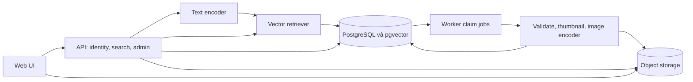

# Thiết kế hệ thống

Trạng thái: đề xuất. Phạm vi theo [PRD](prd.md), quyết định theo [ADR](decisions.md).

## 1. Thành phần và ranh giới

Backend theo module, cùng codebase; process API và worker tách biệt. Encoder có interface versioned và có thể chạy trong process trước, tách inference service khi tài nguyên yêu cầu. PostgreSQL quản lý metadata, jobs, search sessions và vector trong phương án mặc định. Object storage chứa ảnh và thumbnail, không chứa logic cấp quyền.

| Module | Trách nhiệm | Không chịu trách nhiệm |
| --- | --- | --- |
| Identity/authorization | Chuyển danh tính thành collection scopes | Suy đoán quyền từ query hoặc model |
| Search | Validate, encode, retrieve, rank, snapshot | Nhập ảnh hoặc fine-tune |
| Catalog | Metadata, content version, deletion | Tạo vector trực tiếp trong request tìm kiếm |
| Ingestion | Tiến độ, job lease, xử lý theo batch | Tiếp nhận truy vấn người dùng |
| Model registry | Profile model/processor/index tương thích | Tự đổi model mà không đánh giá |
| Feedback/evaluation | Thu tín hiệu và so sánh cấu hình | Tự đổi ranking từ mỗi click |

## 2. Luồng tìm kiếm

1. Xác thực, kiểm tra query và filter; xác định collections được phép. Nếu request chỉ định collection không có quyền, từ chối theo API contract.
2. Chụp retrieval profile đang hoạt động: model revision, processor revision, metric, index generation và ranking version.
3. Encode query; kiểm tra dimension và giá trị hữu hạn, dùng normalization theo profile.
4. Retrieve candidates trong đúng scope và trạng thái active/ready; bổ sung nhánh keyword nếu profile bật.
5. Fuse theo rank nếu có nhiều nhánh, giảm trùng, kiểm tra lại quyền và content version từ catalog.
6. Lưu snapshot thứ tự image_id/content_version có thời hạn, trả trang đầu và cursor.
7. Mỗi trang tiếp theo kiểm tra lại quyền, trạng thái và version; bỏ item không còn hợp lệ và bổ sung từ phần còn lại của snapshot.

Không giữ transaction xuyên nhiều request HTTP. Snapshot hữu hạn, không bảo đảm kết quả mới nhập xuất hiện trong phiên đang mở. Chi tiết phân trang ở [API contract](api-contract.md).

## 3. Luồng nhập ảnh

Admin tạo import từ manifest trong nguồn được phép → tạo import_items/jobs → worker claim → kiểm tra và lưu artifact → encode ảnh theo profile → commit vector và current_version có điều kiện → báo tiến độ. State machine và xử lý lỗi ở [ingestion-design.md](ingestion-design.md).

## 4. Nhất quán và các bất biến

- Chỉ tìm trên image active và version có vector ready trong generation đang đọc.
- Cập nhật nội dung tạo version mới; version đang phục vụ chỉ đổi sau khi dữ liệu mới sẵn sàng. Trong lúc xử lý, có thể tiếp tục trả version cũ còn hợp lệ.
- Metadata quyền và tombstone được kiểm tra theo trạng thái hiện tại, không chờ tái embedding. Quyền bị thu hồi không được cache như quyền vẫn còn.
- Worker chỉ công bố nếu desired_version, generation và lease token còn đúng; worker cũ không được ghi đè công bố mới.
- PostgreSQL transaction không bao trùm ghi object storage. Ghi object bất biến trước, commit tham chiếu sau; reconciliation dọn object mồ côi theo thời gian đệm.
- Khi vector nằm trong pgvector, cập nhật vector và visibility pointer dùng transaction. Với Qdrant, dùng outbox và reconciliation như [scale-plan.md](scale-plan.md); không giả định distributed transaction.

## 5. Index và cấu hình truy hồi

Mỗi generation dùng một không gian vector với dimension, model và metric cố định. Dữ liệu mới nhận diện theo image_id/content_version; không trộn vector hai model. HNSW là ứng viên online; đo recall và độ trễ dưới filters. Exact search là chuẩn so sánh ANN trong benchmark.

Với pgvector, thiết kế một bảng vector vật lý theo generation hoặc phương án tương đương cô lập query/index. Tên bảng được sinh từ registry nội bộ, không nhận identifier từ client. Việc giữ hai generation khi đổi model cần thêm dung lượng và catch-up thay đổi.

## 6. Lỗi, timeout và quá tải

Dependency lỗi hoặc encode timeout → lỗi rõ ràng, không trả danh sách rỗng. Nếu hybrid được bật, mặc định fail request khi nhánh bắt buộc lỗi; chỉ dùng chế độ suy giảm khi profile ghi rõ và response báo degraded=true cùng reason. Không chuyển model âm thầm vì embedding có thể không tương thích.

Giới hạn số request đang encode, hàng chờ và batch worker; trả 429 khi vượt quota hoặc admission limit, 503 khi dịch vụ chưa sẵn sàng. Tổng deadline tìm kiếm là cấu hình; khởi đầu thử dưới 5 giây để tạo khoảng đệm so với mục tiêu p95 2 giây, điều chỉnh sau đo tải.

API search không tự retry model/database vô hạn. Worker retry hữu hạn với backoff và jitter; task lỗi vĩnh viễn chuyển failed để review.

## 7. Deployment và mở rộng

Pilot có API, worker, PostgreSQL/pgvector và object storage; có thể bố trí trên ít máy nếu chấp nhận điểm lỗi đơn. Tách CPU/GPU batch khỏi online khi cạnh tranh tài nguyên. Scale API theo tải; worker theo backlog; database theo I/O, RAM và query plans thực đo.

Chỉ thêm cache khi có lợi ích đo được; key bao gồm query, filters, scope, model và generation. Final authorization luôn được thực thi. Chỉ thêm Qdrant khi benchmark đủ cơ sở; không triển khai hai vector store trong MVP mặc định.

## 8. Mở rộng đã dự phòng

- Tìm bằng ảnh: thêm endpoint nhận ảnh, dùng ImageEncoder tương thích và giữ retrieval pipeline; kiểm thử chất lượng riêng.
- Nguồn ngoài: connector nhập được cấp phép hoặc retriever API riêng; source namespaced và provenance có sẵn trong catalog.
- Nhiều nguồn: fusion theo thứ hạng, timeout từng nguồn và trạng thái suy giảm rõ; không so trực tiếp cosine nội bộ với score nhà cung cấp.
- OCR/caption: artifact có provenance, version riêng; không làm thay đổi ảnh gốc hay thay thế image embedding mặc định.
