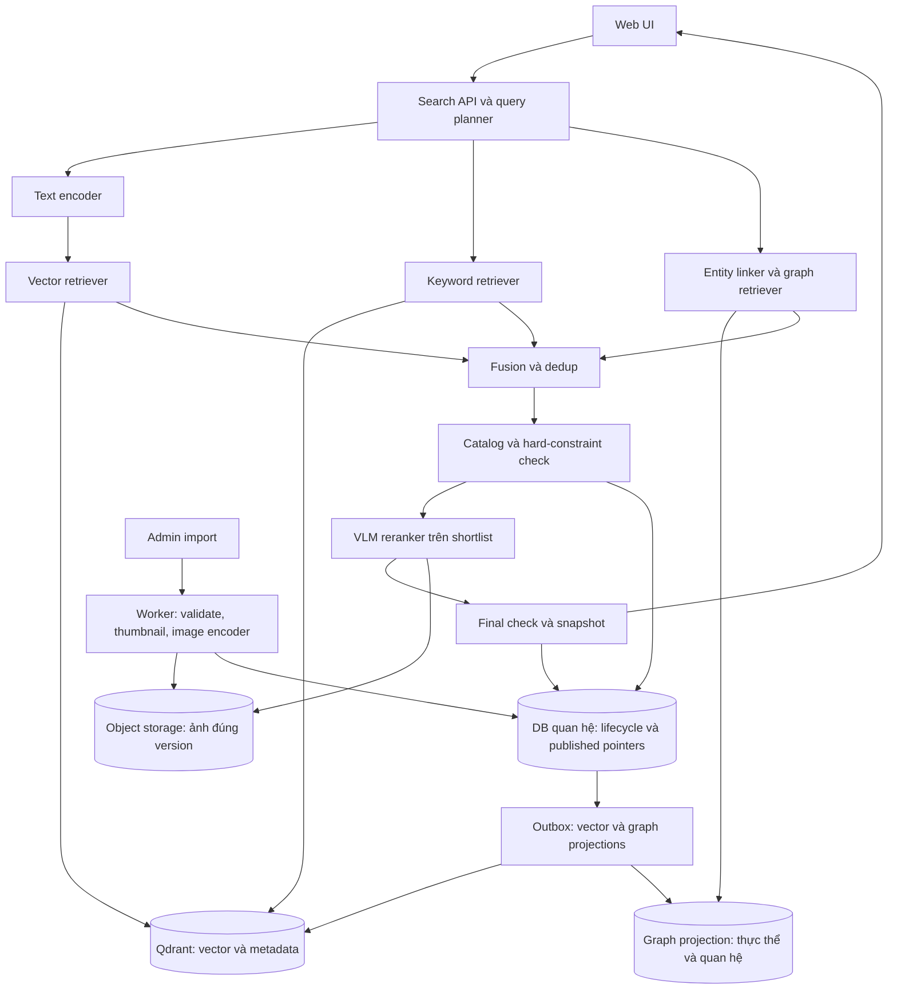

# Thiết kế hệ thống

Trạng thái: thiết kế cập nhật ngày 06/11/2026. Người dùng đã chọn Qdrant lưu vector và metadata tìm kiếm, tách khỏi database quan hệ. Phạm vi theo [PRD](prd.md), quyết định theo [ADR](decisions.md).

## 1. Thành phần và ranh giới

Backend theo module, cùng codebase; process API và worker tách biệt. Encoder có interface versioned và có thể chạy trong process trước, tách inference service khi tài nguyên yêu cầu. Qdrant lưu vector cùng payload metadata dùng cho tìm/lọc/hiển thị ảnh. DB quan hệ quản lý danh tính ảnh, lifecycle/version, users/roles/refresh token registry, jobs, outbox và search sessions; PostgreSQL là ứng viên cho vai trò này, chưa phải lựa chọn đã được người dùng chốt. Graph storage adapter giữ entity/aliases, relations và image projections có provenance/version; chưa chọn engine. Object storage chứa ảnh, thumbnail, graph artifacts và snapshot metadata bất biến để phục hồi. Chi tiết phân chia dữ liệu và đồng bộ ở [thiết kế Qdrant](qdrant-design.md).

| Module | Trách nhiệm | Không chịu trách nhiệm |
| --- | --- | --- |
| Auth/authorization | Login/logout/refresh, bearer access JWT và role user/admin; bảo vệ detail/download/admin | Giới hạn tập ảnh tìm kiếm theo user/collection |
| Search | Validate, encode, retrieve, rank, snapshot | Nhập ảnh hoặc fine-tune |
| Catalog | Identity, content version, deletion, con trỏ projection đã công bố | Giữ vector hoặc thay Qdrant phục vụ search metadata |
| Ingestion | Tiến độ, job lease, xử lý theo batch | Tiếp nhận truy vấn người dùng |
| Graph | Entity linking, traversal, trả image_id/version và bằng chứng quan hệ; graph projection đồng bộ từ nguồn chuẩn | Tự suy đoán quan hệ nghiệp vụ hoặc thay catalog |
| Reranking | VLM chấm query–ảnh trên shortlist, validate output và lưu config | Quét toàn kho hoặc tạo image_id mới |
| Model registry | Profile model/processor/index tương thích | Tự đổi model mà không đánh giá |
| Evaluation offline | Gán nhãn và so sánh cấu hình benchmark | Thu feedback người dùng trong MVP |

## 2. Luồng tìm kiếm

1. Search public: kiểm tra query/filter và owner_key của snapshot. Mặc định toàn kho đã công bố; collection filter chỉ dùng khi người dùng chọn. Không có ACL theo ảnh/collection.
2. Chụp active search config: encoder/profile, vector generation, graph generation/revision, entity-linking/schema revision, fusion và VLM model/processor/prompt revision cùng failure policy.
3. Entity linking và query planning phân biệt graph boost với hard relation constraints; encode query, kiểm tra dimension và giá trị hữu hạn, dùng normalization theo profile.
4. Chạy vector và keyword retrieval trên Qdrant; entity linker lập graph query có kiểm soát, graph retriever trả image_id/version. Query không có ý định quan hệ có thể skip graph theo quy tắc profile; điều kiện quan hệ bắt buộc dùng graph để kiểm chứng membership, không chỉ boost điểm.
5. Fuse theo rank nếu có nhiều nhánh, giảm trùng; batch-check lifecycle, content_version và point_id đã công bố từ catalog. Loại point chưa công bố hoặc đã cũ, kể cả payload còn báo active.
6. Hydrate graph candidates bằng published point Qdrant, áp dụng mọi filters và điều kiện graph bắt buộc. Chọn shortlist hữu hạn rồi VLM chấm query với ảnh đúng version; validate output, giữ tie-break ổn định. Final-check lifecycle/pointer và graph revision sau inference; lưu snapshot đã rerank có thời hạn rồi trả trang đầu. Metadata lấy từ point đã kiểm chứng. Chi tiết shortlist/fallback ở [thiết kế graph và rerank](graph-reranking-design.md).
7. Mỗi trang tiếp theo kiểm tra lại trạng thái và version; bỏ item không còn hợp lệ và bổ sung từ phần còn lại của snapshot. Không rerank lại. Với hard graph constraint, graph revision đổi làm snapshot hết hiệu lực và trả SEARCH_EXPIRED.

Không giữ transaction xuyên nhiều request HTTP. Snapshot hữu hạn, không bảo đảm kết quả mới nhập xuất hiện trong phiên đang mở. Chi tiết phân trang ở [API contract](api-contract.md).

Search response chỉ có thumbnail. GET detail và POST download xác thực access token; download cấp URL ảnh gốc ngắn hạn. Login/logout và quản trị tài khoản theo [auth-design.md](auth-design.md). Search sessions là snapshot phân trang, không phải login; không có auth_sessions. Refresh registry chỉ quản lý vòng đời token.

## 3. Luồng nhập ảnh

Admin tạo import từ manifest trong nguồn được phép → tạo import_items/jobs → worker claim → lưu ảnh, thumbnail và metadata snapshot → encode ảnh và dựng graph artifact từ thực thể/quan hệ có nguồn → ghi intent/outbox bền vững → upsert Qdrant và graph projection → xác nhận cả hai đã áp dụng/đọc được theo consistency đã chọn → transaction DB quan hệ công bố point_id và current_version có điều kiện → báo tiến độ. Nếu crash giữa các store, replay delivery riêng từng target từ outbox; chỉ publish khi cả Qdrant và graph sẵn sàng. State machine ở [ingestion-design.md](ingestion-design.md).

## 4. Nhất quán và các bất biến

- Chỉ tìm trên image active và version có vector ready trong generation đang đọc.
- Cập nhật nội dung tạo version mới; version đang phục vụ chỉ đổi sau khi dữ liệu mới sẵn sàng. Trong lúc xử lý, có thể tiếp tục trả version cũ còn hợp lệ.
- Tombstone được kiểm tra theo trạng thái hiện tại, không chờ Qdrant sync. Search/thumbnail public; detail/download yêu cầu access token hợp lệ và trạng thái thu hồi; admin thao tác cần role. Không có image ACL hay collection grants.
- Worker chỉ công bố nếu desired_version, generation và lease token còn đúng; worker cũ không được ghi đè công bố mới.
- PostgreSQL transaction không bao trùm ghi object storage. Ghi object bất biến trước, commit tham chiếu sau; reconciliation dọn object mồ côi theo thời gian đệm.
- Graph projection là chỉ mục dẫn xuất riêng, không phải đồ thị HNSW của ANN. Graph và Qdrant cùng gắn image_id/content_version; công bố version mới khi cả hai projection bắt buộc sẵn sàng. Xem [graph consistency](graph-reranking-design.md).
- DB quan hệ, graph store và Qdrant không dùng chung transaction. Outbox, idempotent upsert, versioned point và reconciliation là thành phần bắt buộc. Lease/fencing trong DB quan hệ chỉ bảo vệ công bố pointer, không tự hủy write Qdrant đã gửi.

## 5. Index và cấu hình truy hồi

Mỗi generation dùng một không gian vector với dimension, model và metric cố định. Dữ liệu mới nhận diện theo image_id/content_version; không trộn vector hai model. HNSW là ứng viên online; đo recall và độ trễ dưới filters. Exact search là chuẩn so sánh ANN trong benchmark.

Mỗi generation ánh xạ một Qdrant collection vật lý, tên lấy từ registry nội bộ, không nhận identifier từ client. Business collection dùng để phân loại được lưu ở payload collection_id; không tạo Qdrant collection cho từng thư mục nghiệp vụ. API chụp tên collection vật lý cùng profile để tránh đổi index và encoder lệch nhau. Việc giữ hai generation khi đổi model cần thêm dung lượng và catch-up thay đổi.

## 6. Lỗi, timeout và quá tải

Dependency lỗi hoặc encode timeout → lỗi rõ ràng, không trả danh sách rỗng. Cấu hình đầy đủ gồm vector, keyword, graph khi query cần quan hệ, và VLM rerank. Mặc định fail request khi nhánh bắt buộc hoặc VLM lỗi; chỉ dùng chế độ suy giảm khi profile ghi rõ và response báo degraded=true cùng reason. Không chuyển model âm thầm vì embedding có thể không tương thích.

Giới hạn số request đang encode, hàng chờ và batch worker; trả 429 khi vượt quota hoặc admission limit, 503 khi dịch vụ chưa sẵn sàng. Tổng deadline tìm kiếm là cấu hình; khởi đầu thử dưới 5 giây để tạo khoảng đệm so với mục tiêu p95 2 giây, điều chỉnh sau đo tải.

API search không tự retry model/database vô hạn. Worker retry hữu hạn với backoff và jitter; task lỗi vĩnh viễn chuyển failed để review.

## 7. Deployment và mở rộng

Pilot có API, worker, DB quan hệ, Qdrant, graph storage adapter và VLM inference cùng object storage; graph engine/hosting VLM chưa chốt; có thể bố trí trên ít máy nếu chấp nhận điểm lỗi đơn. Tách CPU/GPU batch khỏi online khi cạnh tranh tài nguyên. Scale Qdrant theo tải vector/payload, DB quan hệ theo catalog/jobs và worker theo backlog; đo tài nguyên từng hệ riêng.

Chỉ thêm cache khi có lợi ích đo được; key bao gồm query, filters, encoder/vector generation, graph generation/revision, entity-linker, fusion và VLM model/processor/prompt revision; không có user scope làm thay đổi tập ảnh. Trạng thái/pointer luôn kiểm tra trước response; auth áp dụng cho detail/download/admin. Qdrant là vector store đã chọn; benchmark dùng để chọn cấu hình, payload indexes và topology, không để chọn lại pgvector.

## 8. Mở rộng đã dự phòng

- Tìm bằng ảnh: thêm endpoint nhận ảnh, dùng ImageEncoder tương thích và giữ retrieval pipeline; kiểm thử chất lượng riêng.
- Nguồn ngoài: connector nhập được cấp phép hoặc retriever API riêng; source namespaced và provenance có sẵn trong catalog.
- Nhiều nguồn: fusion theo thứ hạng, timeout từng nguồn và trạng thái suy giảm rõ; không so trực tiếp cosine nội bộ với score nhà cung cấp.
- OCR/caption: artifact có provenance, version riêng; không làm thay đổi ảnh gốc hay thay thế image embedding mặc định.
