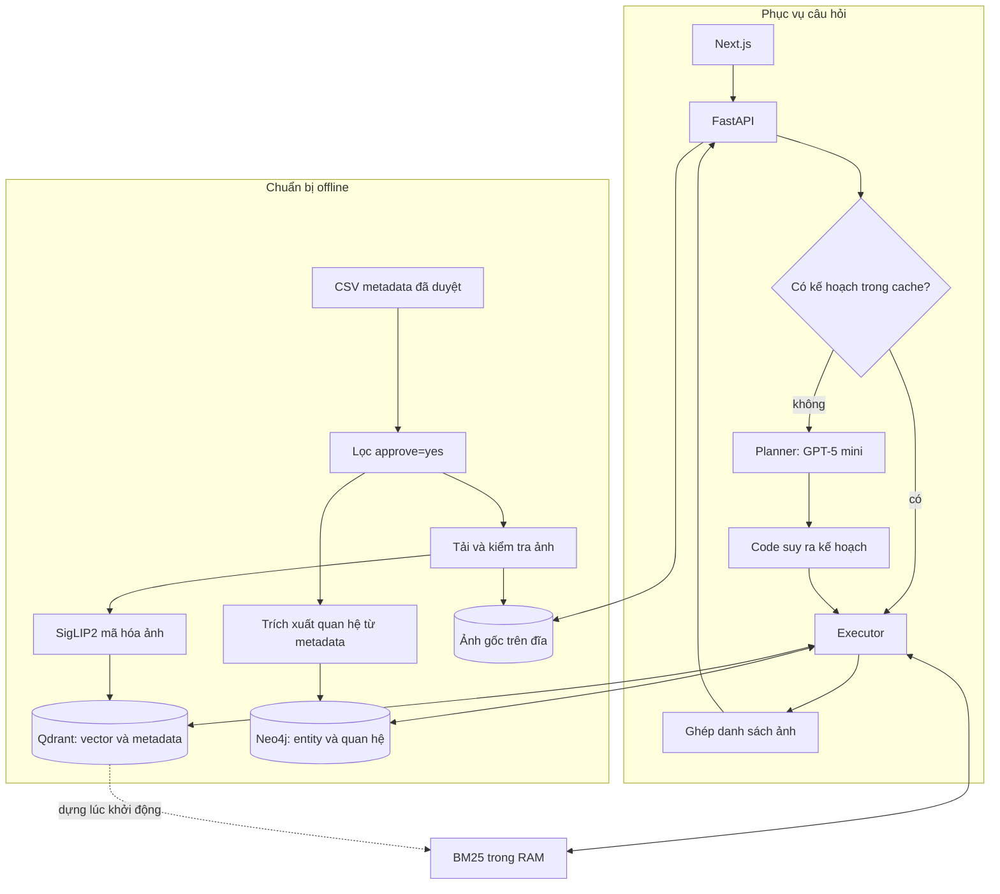
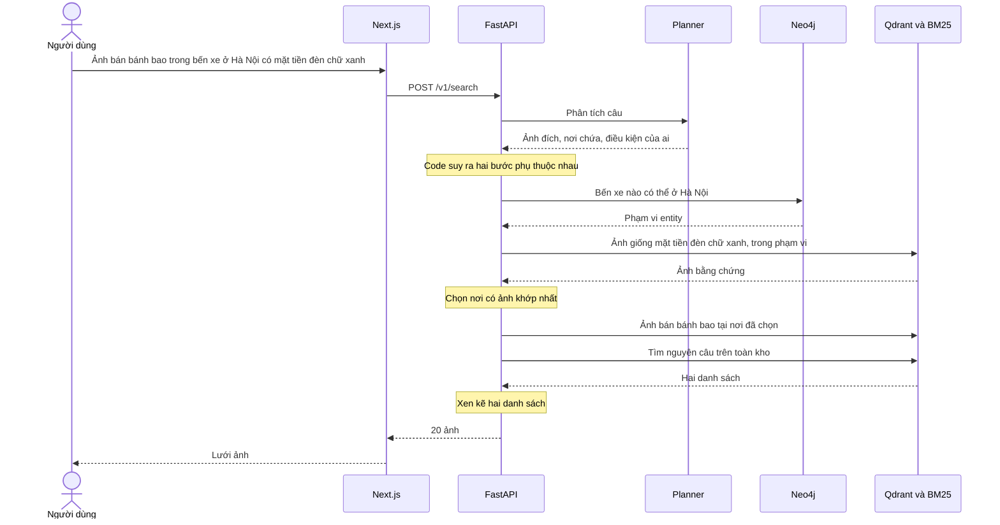
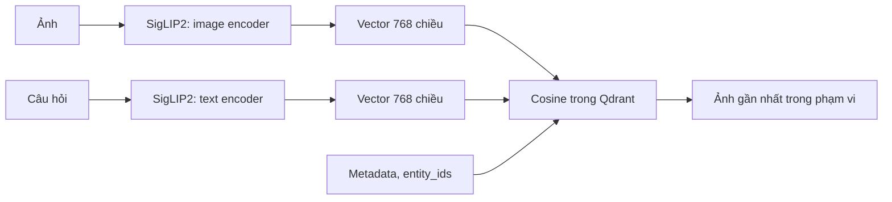
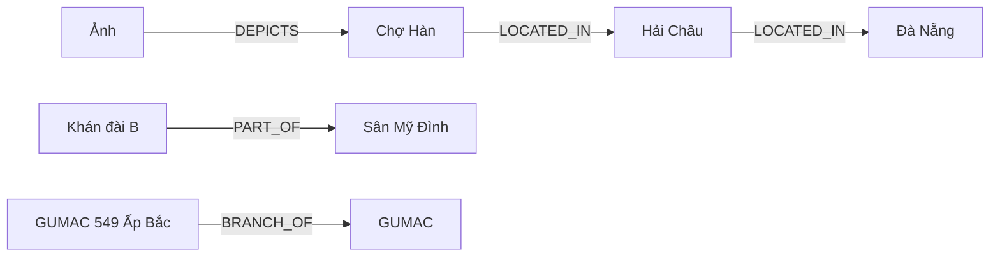
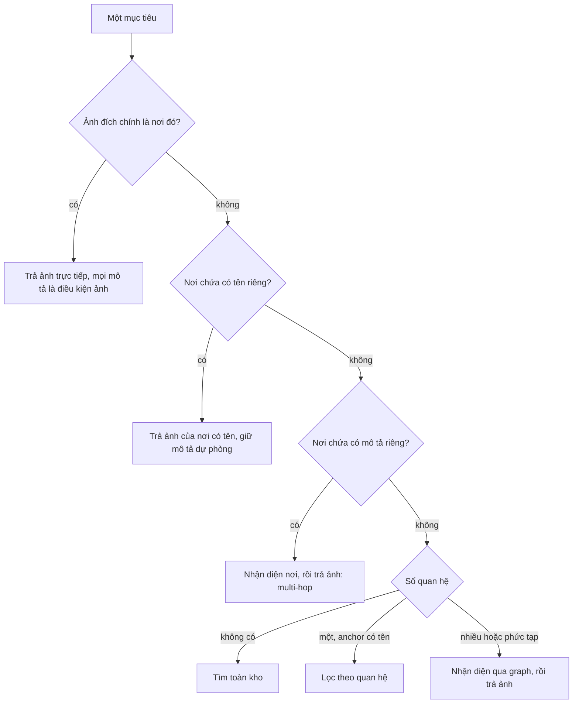
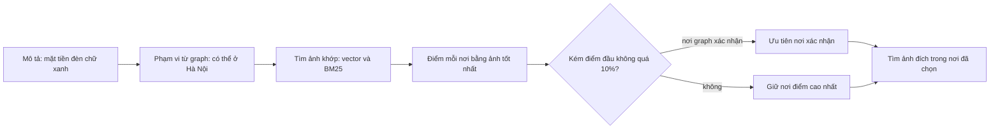
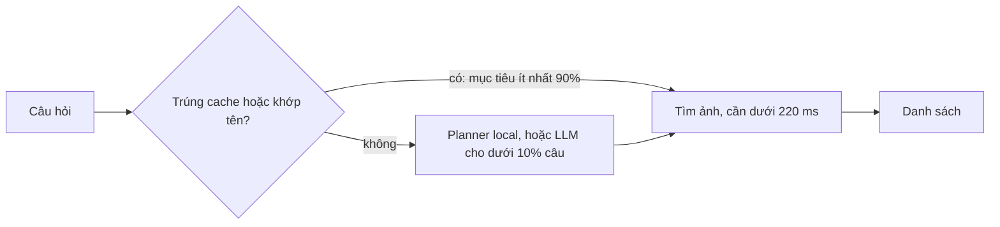

# Báo cáo kỹ thuật: hệ thống tìm ảnh tiếng Việt

Cập nhật 25/11/2026, nhánh `feat/improve-planner`. Tài liệu mô tả hệ thống **đang chạy** từ dữ liệu đến giao
diện: mỗi bước làm gì, dùng kỹ thuật gì, vì sao chọn, còn lỗi và hạn chế nào, nguyên nhân và hướng cải thiện.
Phần mới chỉ có thiết kế được ghi rõ là chưa triển khai.

Cách đọc phần "Vì sao chọn":

- **[Chốt]**: quyết định của chủ dự án, ghi trong [decisions.md](planning/decisions.md).
- **[Đo]**: chọn theo kết quả đo trên dữ liệu dự án.
- **[Kỹ thuật]**: lý do kỹ thuật của người triển khai, chưa có phép đo so sánh với phương án khác.

Mục lục: [1. Tổng quan](#1-tổng-quan) · [2. Dữ liệu](#2-dữ-liệu-đầu-vào) · [3. Tải ảnh](#3-tải-và-kiểm-tra-ảnh) ·
[4. Embedding và Qdrant](#4-embedding-ảnh-và-qdrant) · [5. Graph](#5-graph-quan-hệ-neo4j) ·
[6. BM25](#6-tìm-theo-từ-khóa-bm25) · [7. Planner](#7-planner-hiểu-câu-hỏi) · [8. Suy ra kế hoạch](#8-suy-ra-kế-hoạch-bằng-code) ·
[9. Cache](#9-cache-kế-hoạch) · [10. Phạm vi nơi chứa](#10-xác-định-nơi-chứa-qua-graph) · [11. Visual bridge](#11-visual-bridge) ·
[12. Hybrid](#12-tìm-hybrid-và-rrf) · [13. Danh sách](#13-ghép-danh-sách-kết-quả) · [14. API](#14-backend-api) ·
[15. Frontend](#15-frontend) · [16. Đánh giá](#16-đánh-giá-chất-lượng) · [17. Độ trễ](#17-độ-trễ-toàn-hệ-thống) ·
[18. Vận hành](#18-vận-hành-bảo-mật-kiểm-thử) · [19. Tổng hợp vấn đề](#19-tổng-hợp-vấn-đề-và-thứ-tự-cải-thiện) · [20. Thuật ngữ](#20-thuật-ngữ)

---

## 1. Tổng quan

### 1.1. Bài toán

Người dùng gõ một câu tiếng Việt, hệ thống trả danh sách ảnh trong kho riêng, theo kiểu công cụ tìm ảnh: luôn có
kết quả, sắp theo mức phù hợp. Có ba loại câu:

| Loại | Ví dụ | Điểm khó |
|---|---|---|
| Single | "Ảnh Chợ Hàn Đà Nẵng" | Nhận đúng tên |
| Multi-target | "1 ảnh chợ nổi Cái Răng và 1 ảnh đền ở Tuyên Quang" | Tách mục tiêu, không trộn kết quả |
| Multi-hop | "Ảnh nhân viên bán bánh bao trong bến xe ở Hà Nội có mặt tiền bật đèn chữ xanh" | Nơi chứa không có tên; phải nhận ra qua **một ảnh khác** rồi mới tìm ảnh cần |

### 1.2. Quy mô hiện tại

| Hạng mục | Giá trị |
|---|---:|
| Record được duyệt (`approve=yes`) | 2.062 |
| Nơi/đối tượng (entity nguồn) | 185, trong đó 183 có ảnh |
| Ảnh duy nhất tải được | 1.886 |
| Entity trong graph | 319 (168 place, 108 area, 21 brand, 21 part, 1 other) |
| Quan hệ trong graph | 301 (220 LOCATED_IN, 61 BRANCH_OF, 20 PART_OF) |
| Liên kết ảnh–entity (DEPICTS) | 1.932 |
| Máy đo | Intel Core 7 240H, 16 luồng, RAM 16 GB, không GPU rời |

PRD đặt quy mô mục tiêu 100 nghìn đến 1 triệu ảnh. **Chưa có phép đo nào ở quy mô đó.**

### 1.3. Sơ đồ kiến trúc



### 1.4. Luồng một câu multi-hop



### 1.5. Công nghệ

| Lớp | Công nghệ (phiên bản) | Vai trò |
|---|---|---|
| Ngôn ngữ | Python 3.12, TypeScript 6.0.3 | Backend, frontend |
| API | FastAPI 0.162, Uvicorn 0.54, Pydantic 2.14 | HTTP, kiểm tra dữ liệu |
| Vector DB | Qdrant 1.13.6 (client 1.20) | Vector ảnh, metadata, lọc |
| Graph DB | Neo4j Community 5.26.33 (driver 6.4) | Entity, quan hệ |
| Embedding | SigLIP 2 base patch16 224, PyTorch 2.15 CPU, Transformers 4.57 | Ảnh và chữ chung không gian 768 chiều |
| Từ khóa | BM25 tự cài bằng NumPy | Khớp chữ trên metadata |
| LLM | OpenAI `gpt-5-mini-2025-08-07`, Responses API | Phân tích câu hỏi |
| Giao diện | Next.js 16.4, React 19.3, Tailwind 4.3, TanStack Query 5 | Màn hình tìm ảnh |
| Công cụ | uv, Ruff, Pytest, Docker Compose, Node 24.22.2 | Cài đặt, kiểm tra |
| Scaffold | PostgreSQL 17.6, SQLAlchemy, Alembic | Chưa dùng trong luồng tìm kiếm |

---

## 2. Dữ liệu đầu vào

**Cách làm.** Đọc CSV, chỉ nhận dòng có `approve` đúng bằng `yes`; giữ nguyên tên nơi (`entity_name`), nhãn
(`leaf_label`), mô tả (`mo_ta`), tiêu đề và URL trang, kèm `record_id` để truy vết. Code: `baseline/records.py`.

**Vì sao chọn**

- Tin metadata `yes`, không xác minh thêm nguồn ngoài **[Chốt C21]**: tập trung vào chất lượng tìm kiếm trước.
- Giữ nguyên từng record, không trộn caption **[Kỹ thuật]**: 74 ảnh gắn nhiều nơi; trộn sẽ gán nhầm mô tả.

| Vấn đề còn lại | Nguyên nhân | Đề xuất |
|---|---|---|
| Tên lẫn nơi chốn, bộ phận và sự kiện ("Sân Lạch Tray trận trẻ", "Khán đài B sân Mỹ Đình") | CSV không có cột loại hay ID chuẩn | Thêm trường loại và "thuộc nơi nào" ở nguồn; hoặc bảng ánh xạ được duyệt |
| Một nơi thật bị tách nhiều entity (ba entity Bến xe Miền Tây, ba cho sân Mỹ Đình) | Mỗi từ khóa thu thập thành một entity | Bảng gộp entity có người duyệt; tìm theo nhóm thay vì một ID |
| Không có tọa độ, ID địa giới, thương hiệu | Nguồn không cung cấp | Bổ sung ở nguồn; chưa cho phép lấy từ ngoài |
| Nội dung ảnh rộng hơn caption | Caption một câu, do người viết | Sinh caption bổ sung bằng model, lưu tách khỏi metadata gốc (cần duyệt vì trái C21) |
| Kho nhỏ, lệch về khu đô thị, sân vận động, bến xe | Một phần của bộ thu thập | Mở rộng nguồn khi chất lượng ổn |

---

## 3. Tải và kiểm tra ảnh

**Cách làm.** Tải từng URL, kiểm tra giải mã được, tối đa 10 MiB và 40 triệu điểm ảnh, đặt tên bằng SHA-256 của
bytes. Có log để chạy tiếp. Chỉ kết nối tới IP công khai **đã kiểm tra**, kể cả sau redirect. Code:
`baseline/download.py`.

**Vì sao chọn**

- SHA-256 làm ID **[Kỹ thuật]**: ổn định, tự loại bản trùng tuyệt đối, phát hiện file hỏng.
- Ghim IP khi kết nối **[Kỹ thuật]**: URL lấy từ ngoài, cần chặn truy cập mạng nội bộ (SSRF).
- Lưu ảnh trên đĩa, chỉ giữ vector ở Qdrant **[Chốt C06]**.

| Vấn đề còn lại | Nguyên nhân | Đề xuất |
|---|---|---|
| 65 record không tải được, 2 nơi không có ảnh nào | Link chết, chặn bot | Tải lại định kỳ; báo danh sách để thay link |
| Ảnh **gần trùng**: 77 nhóm, 161 ảnh, dư 84 bản. Trên v3, 10/32 danh sách có lặp, trung bình 0,44 ảnh mỗi danh sách | SHA-256 chỉ bắt bản giống từng byte; báo chí nén lại cùng một ảnh | Băm cảm nhận (dHash/pHash), gộp khi hiển thị, giữ mọi nguồn |
| Đường dẫn ảnh tuyệt đối trong metadata | Lưu `local_path` đầy đủ | Lưu đường dẫn tương đối, ghép gốc khi đọc |
| Chưa có quy trình thêm/xóa ảnh | Mới là pipeline một lần | Theo [thiết kế nhập dữ liệu](design/ingestion-design.md), chưa triển khai |

Mức gần trùng đo bằng dHash 64 bit, khoảng cách không quá 4; là ước lượng, chưa kiểm tra bằng mắt từng nhóm.

---

## 4. Embedding ảnh và Qdrant

**Cách làm.** SigLIP 2 mã hóa ảnh thành vector 768 chiều, chuẩn hóa L2, lưu vào Qdrant cùng metadata. Câu hỏi được mã
hóa bằng **cùng model**, nên ảnh và chữ so sánh trực tiếp bằng cosine. Model, revision, bộ tiền xử lý, danh sách ảnh và
phiên bản thư viện được ghi hash; khởi động thấy lệch là dừng. Code: `embedding/`, `adapters/qdrant/`.



**Vì sao chọn**

- **SigLIP 2 base** **[Kỹ thuật]**: model ảnh–văn bản đa ngôn ngữ, chạy được trên CPU. Đây là ứng viên khởi đầu, **chưa
  so sánh với model khác** trên dữ liệu dự án.
- **Qdrant** **[Chốt C06]**: lọc metadata cùng lúc với tìm vector, tách khỏi DB quan hệ. pgvector từng được cân nhắc
  và đã bị loại.
- **Tìm chính xác (`exact=True`)** **[Kỹ thuật]**: với 1.886 ảnh chỉ mất khoảng 10 ms mỗi lần, không cần đánh đổi độ đúng.
- **Không lưu vector ra file** **[Chốt]**: một nguồn duy nhất, tránh lệch.

| Vấn đề còn lại | Nguyên nhân | Đề xuất |
|---|---|---|
| Vector một mình yếu: v2 test single Recall@10 0,115 | Model nhận cảnh vật chứ không biết tên riêng Việt Nam; nhiều nơi trông giống nhau | Không dùng riêng; so sánh model lớn hơn hoặc mạnh tiếng Việt trên bộ mới |
| Mã hóa chữ chiếm khoảng 180–200 ms mỗi câu, **phần lớn thời gian tìm ảnh** | PyTorch CPU, mọi câu đều đệm tới 64 token | ONNX Runtime hoặc OpenVINO, lượng tử hóa INT8, cache vector câu trong RAM; phải kiểm tra vector tương đương |
| Câu dài hơn **64 token**: 6/432 câu đo bị vượt | Giới hạn của text encoder | Tách câu dài thành nhiều truy vấn rồi gộp |
| Một bước kế hoạch vượt 64 token làm cả câu lỗi 503 | `search_list` báo lỗi thay vì lùi về từ khóa | Dùng BM25 cho riêng bước đó (sửa nhỏ, nên làm sớm) |
| Không có ngưỡng "không liên quan" | Điểm cosine thấp và sát nhau (0,13–0,20 cho ảnh đúng) | Theo C27 không cần từ chối; reranker giúp thứ tự tốt hơn |
| Chưa biết hành vi ở 100 nghìn–1 triệu ảnh | Chưa có dữ liệu | Bật HNSW, đo độ đúng so với tìm chính xác |
| Nâng phiên bản thư viện là phải lập lại index | Kiểm tra phiên bản quá chặt | Chỉ khóa phần ảnh hưởng vector; kiểm bằng ảnh mẫu |

---

## 5. Graph quan hệ Neo4j

**Cách làm.** Node `Image` và `Entity`; cạnh `DEPICTS` (ảnh chụp nơi nào) và ba quan hệ `LOCATED_IN` (nằm ở),
`PART_OF` (bộ phận của), `BRANCH_OF` (chi nhánh của). Quan hệ được trích trực tiếp từ metadata, lưu kèm hash, nhập trong
một giao dịch. Code: `graph/`, `adapters/neo4j/`.



**Vì sao chọn**

- **Neo4j** **[Chốt C20]**: câu multi-hop cần đi theo quan hệ; Cypher diễn đạt đường đi nhiều cạnh gọn hơn SQL.
- **Chỉ ba quan hệ** **[Chốt]**: metadata chỉ thể hiện chắc ba loại này.
- **Bỏ node nguồn/trang/nhãn** **[Chốt C21]**: bản cũ có 5.611 node chủ yếu để truy vết, không giúp trả lời câu hỏi.
- **Không gọi API khi trích quan hệ** **[Chốt C23]**: tiết kiệm chi phí.
- **Cypher cố định có tham số** **[Kỹ thuật]**: không chạy truy vấn do người dùng hay model sinh ra.

| Vấn đề còn lại | Nguyên nhân | Đề xuất |
|---|---|---|
| 31/167 nơi có ảnh **chưa có vị trí** (ví dụ Mỹ Đình Pearl, Hàng Đẫy) | Chỉ rà tên và câu thể hiện quan hệ, chưa rà mọi caption | Rà lại metadata của đúng 31 nơi |
| Tên thường gọi không có trong graph: "Sài Gòn" | Không có bí danh, không được thêm kiến thức ngoài | Bảng bí danh địa danh do người duyệt |
| Thiếu quan hệ: gần, cùng thành phố, ga thuộc tuyến | Ngoài schema | Mở schema khi có dữ liệu; "cùng thành phố" có thể suy từ `LOCATED_IN` |
| 40 ghi chú chưa giải quyết | Metadata mơ hồ | Duyệt tay |
| Một nơi nhiều node | Kế thừa từ dữ liệu nguồn | Gộp có kiểm soát, giữ ID nguồn |
| Trích thủ công không mở rộng được | 185 nhóm làm tay | Trích bằng LLM có duyệt khi tăng dữ liệu (cần chốt lại C23) |
| Neo4j có thể quá nặng cho 319 node | Kho nhỏ, mỗi câu 4–7 lượt gọi mạng, 22–73 ms | Giữ Neo4j làm nguồn chuẩn, nạp graph nhỏ vào RAM khi khởi động |

---

## 6. Tìm theo từ khóa BM25

**Cách làm.** Mỗi ảnh là một văn bản gồm tên nơi, nhãn, tiêu đề trang, mô tả. Chuẩn hóa chữ thường, **bỏ dấu**, tách từ
theo khoảng trắng; `k1=1,2`, `b=0,75`. Dựng trong RAM từ payload Qdrant. Code: `retrieval/keyword.py`.

**Vì sao chọn**

- Cần khớp **tên riêng**, điều vector làm kém **[Đo]**: v2 test single Recall@10 0,800 so với 0,115 của vector.
- Tự cài bằng NumPy **[Kỹ thuật]**: kho nhỏ, khoảng 3 ms mỗi lần, không thêm dịch vụ tìm kiếm.
- Bỏ dấu **[Kỹ thuật]**: người dùng hay gõ không dấu.

| Vấn đề còn lại | Nguyên nhân | Đề xuất |
|---|---|---|
| Không hiểu đồng nghĩa ("sở thú" và "thảo cầm viên") | Khớp chữ thuần túy | Bảng đồng nghĩa được duyệt; vector đã bù một phần |
| Bỏ dấu gây nhầm ("cửa hang", "cửa hàng") | Hai từ thành một | Chấm thêm bản có dấu, cộng điểm khi khớp đủ dấu |
| Không tách từ ghép tiếng Việt | Tách theo khoảng trắng | Thử bộ tách từ hoặc cặp từ liền kề, đo trên bộ mới |
| Chỉ biết điều có trong metadata | Không nhìn ảnh | Đã kết hợp vector; caption sinh thêm (cần duyệt) |
| Dựng lại mỗi lần khởi động, quét toàn kho | Chấp nhận được ở 1.886 ảnh | Dùng chỉ mục thưa của Qdrant khi tăng quy mô |

---

## 7. Planner: hiểu câu hỏi

**Cách làm.** Gửi câu hỏi và prompt `planner-draft-scope-v6` (khoảng 3.400 token) cho GPT-5 mini, mức suy luận `low`, bắt
buộc trả JSON đúng schema. Model **không** quyết định loại câu hay các bước; nó chỉ trả lời: ảnh cần thấy gì, nơi chứa là
gì, có tên riêng không, và **mỗi điều kiện thuộc ảnh hay thuộc nơi chứa**. Code: `planner/router.py`, `planner/draft.py`.

```json
{"targets": [{
  "image_subject": "nhân viên bán bánh bao",
  "entities": [{"id": "e1", "mention": "bến xe", "proper_name": null, "relation_groups": ["LOCATED_IN Hà Nội"]}],
  "conditions": [{"text": "mặt tiền bật đèn chữ xanh", "owner": "e1"}]
}]}
```

(Rút gọn để minh họa.)

**Vì sao chọn**

- **LLM** **[Kỹ thuật]**: câu tiếng Việt tự do, nhiều cách diễn đạt; chưa có dữ liệu để huấn luyện model riêng.
- **GPT-5 mini, gọi OpenAI trực tiếp** **[Chốt C22]**.
- **Chỉ hỏi vai của từng cụm** **[Đo, Chốt C25]**: bản cũ để model tự chọn loại câu chỉ đúng 11/18 câu multi-hop dev; bản này
  15/18. Câu hỏi nhỏ và cục bộ dễ trả lời đúng hơn một quyết định tổng thể.
- **Suy luận `low`** **[Đo]**: ở mức mặc định, 3/36 câu dùng hết 4.096 token mà chưa trả kết quả.
- **JSON có schema** **[Kỹ thuật]**: không phải đoán định dạng; sai là báo lỗi.

**Chất lượng đã đo** (mỗi câu một lượt, trừ khi ghi khác)

| Tập | Đúng route |
|---|---:|
| 20 câu multi-hop dev (bỏ 2 câu nhãn nghi vấn) | 15/18 |
| Multi-hop test v2 | 17/23 |
| Multi-hop v3 | 24/24 câu dương, 8/8 câu về nơi không có trong kho |
| Single và multi-target v2 | 80/80 |
| Cặp câu gần giống: nhận nhầm single thành multi-hop | 2/16 |

Rà 234 lượt đã lưu: 0 tên bịa, 1 kế hoạch sai cấu trúc; từ bị bỏ chủ yếu là lời dẫn. Lỗi chính là **gán vai**:

| Lỗi còn lại | Số câu đã biết | Nguyên nhân | Đề xuất |
|---|---:|---|---|
| "Loại + địa danh" bị coi là tên riêng ("khu chợ Nha Trang") | 7 | Câu mơ hồ thật; model **không biết kho có tên gì** | Đối chiếu tên với graph bằng code sau khi model trả lời |
| Tên bị tách hoặc tuyến thành nơi riêng | 2 | Như trên | Khớp cụm tên dài nhất có trong kho |
| Mô tả của nơi chứa bị gán cho ảnh (q0310) | 2 | Model xét khả năng cùng khung hình thay vì ngữ pháp | Kiểm tra vị trí cụm trong câu bằng code |
| Nhận nhầm thành multi-hop ("tượng trên đỉnh đập") | 2 | Vị trí của ảnh bị hiểu thành đặc điểm nơi chứa | Quy tắc "X trên/cạnh/trước nơi" |
| Kế hoạch sai cấu trúc (q0303) | 1 | Model xếp sai thứ tự entity | Thử lại một lần kèm lý do lỗi |
| Kết quả dao động giữa các lượt | 31/36 qua hai lượt của bản trước | Model không tất định | Chuyển thêm luật sang code; không tăng thêm luật prompt |

**Hạn chế**

- **Chậm:** p50 10,7 giây, p90 16,4 giây (233 lượt). Thời gian ≈ 3,2 giây + 12 ms mỗi token sinh; trung vị 637 token, phần
  lớn là suy luận ẩn (ước lượng từ độ dài JSON). Mục tiêu p90 300 ms **không thể đạt** khi câu phải chờ LLM qua mạng.
- **Phụ thuộc dịch vụ ngoài:** mất mạng hoặc hết quota thì chỉ còn tìm cả câu.
- **Chi phí** ước tính 0,0011–0,0024 USD mỗi câu theo các lượt đã chạy; chưa đối soát hóa đơn.
- Prompt đã qua nhiều bản và chỉnh theo lỗi đã xem, nên có nguy cơ khớp quá với bộ cũ.

---

## 8. Suy ra kế hoạch bằng code

**Cách làm.** `compile_plan` biến phân tích thành các bước:



Các luật khác: cụm đứng **trước** nơi chứa không thể mô tả nơi đó (bổ ngữ tiếng Việt đứng sau danh từ); "bên trong X" là
cảnh khác của X; bỏ cụm hỏi về kho ("có ảnh nào không"); bù phần ngoặc bị cắt của tên.

**Vì sao chọn**

- Cùng một phân tích luôn cho cùng một kế hoạch, kiểm thử được bằng unit test, sửa không tốn API **[Đo, C25]**.
- Loại câu và các bước không thể mâu thuẫn nhau, vì cùng suy ra từ một nguồn **[Kỹ thuật]**.

| Vấn đề còn lại | Nguyên nhân | Đề xuất |
|---|---|---|
| Luật dựa trên chuỗi và biểu thức chính quy, có thể sai với cách nói lạ | Không có bộ phân tích cú pháp | Thêm test từ câu thật; thử phân tích phụ thuộc tiếng Việt |
| Tìm vị trí cụm theo lần xuất hiện đầu; câu không dấu mà model thêm dấu thì bỏ qua luật | So chuỗi nguyên văn | So trên dạng bỏ dấu, dùng vị trí gần nhất |
| Phủ định ("không có người") chỉ giữ trong kế hoạch, không loại ảnh | Chưa có bộ kiểm điều kiện | Reranker hoặc model hỏi đáp ảnh |
| Giới hạn 5 mục tiêu, 4 entity, 3 cạnh | Giữ kế hoạch hữu hạn | Đủ cho dữ liệu hiện tại |

---

## 9. Cache kế hoạch

**Cách làm.** LRU trong RAM, tối đa 1.000 kế hoạch; khóa gồm câu chuẩn hóa, prompt, model, mức suy luận. Câu trùng đang chạy
dùng chung một lượt gọi. Code: `planner/cache.py`.

**Vì sao chọn:** câu lặp lại từ 15,8 giây còn p50/p90 200/239 ms **[Đo, một câu single]**. Chỉ lưu kế hoạch để ảnh mới vẫn được tìm
thấy; để trong RAM vì không cần thêm hệ lưu trữ **[Kỹ thuật]**. Phân biệt chữ hoa vì prompt dựa vào chữ hoa để nhận tên.

| Vấn đề còn lại | Nguyên nhân | Đề xuất |
|---|---|---|
| Chỉ giúp câu giống hệt | So khớp chuỗi | Đường nhanh khớp tên; planner local |
| Mất khi khởi động lại, không chia sẻ giữa tiến trình | RAM | Lưu PostgreSQL khi có website |
| Kế hoạch sai được dùng lại | Không biết đúng sai | Nút báo sai để xóa khóa; hạn dùng |

---

## 10. Xác định nơi chứa qua graph

**Cách làm.** Tên được chuẩn hóa rồi tra Neo4j; điều kiện quan hệ chạy bằng Cypher mẫu. `LOCATED_IN` **bắc cầu**: nằm trong quận thì
nằm trong tỉnh, bộ phận nằm nơi công trình nằm. Tập ảnh hợp lệ được lọc **trước** khi lấy top-K. Code:
`retrieval/executor.py`, `adapters/neo4j/store.py`.

**Vì sao chọn**

- Lọc trước top-K **[Kỹ thuật]**: lọc sau có thể mất ảnh đúng nằm ngoài top-K.
- Bắc cầu **[Đo]**: trước đó Chợ Hàn → Hải Châu → Đà Nẵng bị coi là không ở Đà Nẵng. Trên 15 câu dev, lọc cứng kiểu cũ (không bắc
  cầu, có lọc loại) chỉ giữ đúng nơi ở 8 câu; phạm vi mới giữ cả 15.

| Vấn đề còn lại | Nguyên nhân | Đề xuất |
|---|---|---|
| Tên phải khớp gần nguyên văn | Tra chính xác sau chuẩn hóa | Tìm mờ, bảng bí danh, gợi ý tên gần |
| Nhiều nơi cùng tên thì không chọn được | Không có ngữ cảnh | Đã có danh sách cả câu thay thế; thêm gợi ý chọn nơi |
| Chỉ lấy ảnh gắn trực tiếp, không lấy ảnh bộ phận | Tránh mở rộng sai | Cho phép mở rộng cha/con khi ít ảnh, xếp sau |
| Lọc loại (`category`) còn cứng ở câu không có mô tả | Planner đặt tên loại khác metadata | Coi loại là tín hiệu cộng điểm |

---

## 11. Visual bridge

**Cách làm.** Nhận ra nơi chưa có tên qua ảnh khác:



Nơi chưa có thông tin vị trí **không bị loại**. Tên không có trong graph trở thành mô tả mềm nếu câu có mô tả nhận diện. Kết quả
ghi `visual_bridge_unverified`, kèm ảnh bằng chứng.

**Vì sao chọn**

- Graph không lưu đặc điểm nhìn thấy, còn tìm một lần bằng cả câu trộn hai cảnh với nhau **[Chốt C26]**.
- Chấm nơi bằng **ảnh tốt nhất** **[Đo]**: đúng hạng 1 ở 15/15 câu dev, so với 12/15 khi cộng ba ảnh.
- Giữ nơi thiếu vị trí **[Đo]**: thiếu thông tin không có nghĩa là ở nơi khác.
- Không cần model hay API mới **[Kỹ thuật]**.

| Vấn đề còn lại | Nguyên nhân | Đề xuất |
|---|---|---|
| v3: ảnh đầu đúng nơi 17/24 | Nhiều khu đô thị, sân, bến xe trông giống nhau; mô tả chung chung | Reranker trên ảnh bằng chứng; kết hợp nhiều đặc điểm |
| Biên 10% làm sai q13 của v3 | Graph thiếu vị trí nên nơi đúng không được xác nhận | Bổ sung vị trí rồi đo lại biên trên bộ mới |
| Một nơi nhiều entity làm chia điểm và ảnh (sân Mỹ Đình) | Dữ liệu nguồn | Gộp nhóm entity |
| Tên có thật nhưng không có trong kho có thể nhận nơi khác | Không từ chối theo C27 | Giao diện đã ghi "gần đúng" ở câu không xác định được nơi; chưa ghi cho nơi suy đoán |
| "Gần X" bị coi là đặc điểm nhìn thấy | Không có quan hệ khoảng cách | Cần tọa độ |
| Chỉ một tầng nhận diện bằng ảnh được kiểm chứng | Ít câu nhiều tầng trong bộ đo | Thêm câu kiểm thử |

---

## 12. Tìm hybrid và RRF

**Cách làm.** Trong cùng phạm vi, lấy tối đa 100 ảnh từ vector và 100 từ BM25, gộp bằng
`điểm = 1/(60 + hạng_vector) + 1/(60 + hạng_BM25)`. Code: `retrieval/engine.py`.

Nhánh thử nghiệm `IMAGE_SEARCH_RETRIEVAL_TEXT_VECTORS=true` thêm hạng text vào công thức trên
với cùng trọng số. Text là `entity_name. mo_ta`, mỗi record một vector SigLIP2 trong collection
Qdrant riêng; lấy điểm cao nhất theo ảnh và chỉ tính record thuộc phạm vi nơi đang tìm. Dùng lại
vector câu hỏi, không thêm lượt encode. Mặc định tắt; xem [kết quả A/B](evaluation/results.md).

**Vì sao chọn**

- Hai nhánh bù nhau **[Đo]**: với 25 câu đi qua visual bridge, hybrid trúng 25/25, BM25 22/25, vector 16/25.
- RRF dùng **thứ hạng**, không cần đưa cosine và BM25 về cùng thang **[Kỹ thuật]**.
- Trọng số 1:1 **[Chốt]**: bản có trọng số đã bị bỏ để không chỉnh theo bộ cũ.

| Vấn đề còn lại | Nguyên nhân | Đề xuất |
|---|---|---|
| Ở câu nêu tên, hybrid kém BM25 khi tìm cả câu (v2 single 0,587 so với 0,800) | Vector kéo ảnh sai lên | Đã giảm nhờ lọc theo nơi; có thể dùng trọng số theo loại câu, cần bộ mới |
| RRF hay **hòa điểm** khi hai nhánh đổi hạng cho nhau | Bản chất công thức | Đã có quy tắc phá hòa ở visual bridge |
| Điểm không phản ánh mức phù hợp thật | Chỉ dựa trên hạng | Reranker |
| Đúng nơi nhưng ảnh xếp thấp (q08, q11 của v3) | Không model nào nhìn đồng thời câu và ảnh | **Reranker ảnh–văn bản** trên 20–50 ảnh đầu; chưa triển khai, sẽ tăng độ trễ |

---

## 13. Ghép danh sách kết quả

**Cách làm.** Mỗi mục tiêu một danh sách tối đa 20 ảnh. Code: `retrieval/listing.py`.

| Tình huống | Danh sách |
|---|---|
| Tên hoặc quan hệ khớp graph | Ảnh của nơi đó trước, tìm cả câu lấp phần sau |
| Nơi suy đoán qua visual bridge | Xen kẽ ảnh của nơi đó với tìm cả câu |
| Nhiều nơi bằng điểm | Ảnh của tất cả, xen kẽ |
| Không khớp, quan hệ chưa hỗ trợ, planner lỗi | Tìm cả câu, đánh dấu gần đúng |
| Thiếu ngữ cảnh ("ảnh vừa rồi") | Hỏi lại |

**Vì sao chọn**

- Luôn trả danh sách, không từ chối **[Chốt C27]**.
- **Xen kẽ** thay vì RRF hai danh sách **[Đo trên v3]**: hạng 1 giữ 11/24 (RRF còn 7), top 10 đạt 19/24. Thêm nơi thứ 2–3 không hơn.

| Vấn đề còn lại | Nguyên nhân | Đề xuất |
|---|---|---|
| Multi-hop test v2 giảm ở top 10 (23/23 còn 21/23) | Nửa danh sách dành cho tìm cả câu | Tỷ lệ xen kẽ theo độ tin cậy của nơi |
| Ảnh sai nơi xen vào khi nơi đã đúng | Không biết chắc nơi đúng | Như trên |
| Ảnh gần trùng lặp lại | Xem mục 3 | Gộp khi hiển thị |
| Chỉ 20 ảnh, không xem thêm | Chưa có phân trang | Trả nhiều hơn hoặc con trỏ trang |
| Kết quả hiện ra chỉ sau khi planner xong | Một lượt trả lời | Trả ngay tìm cả câu (phần tìm ảnh khoảng 0,1 giây), cập nhật sau |

---

## 14. Backend API

**Cách làm.** FastAPI một tiến trình. `POST /v1/search`, `GET /v1/images/{id}` và `/thumbnail` (tối đa 640×480, tạo khi cần, ghi file tạm rồi đổi
tên), `POST /v1/playground/run`, `/health/*`. Code: `search.py`, `playground.py`, `api/v1/`.

**Vì sao chọn**

- **FastAPI** **[Chốt C16]**: cùng Python với model, kiểm tra dữ liệu bằng Pydantic.
- **Một dịch vụ dùng chung** cho màn hình tìm ảnh và playground **[Kỹ thuật]**: nạp model một lần, kết quả nhất quán.
- **Nạp model ở lượt đầu** **[Kỹ thuật]**: API khởi động nhanh, chạy được khi chưa có dịch vụ.
- **Khóa quanh encoder và engine** **[Kỹ thuật]**: an toàn, đơn giản cho demo.
- **Chỉ phục vụ ID ảnh trong kho, lỗi trả 503 không kèm chi tiết** **[Kỹ thuật]**: không lộ đường dẫn, địa chỉ hay khóa.

| Vấn đề còn lại | Nguyên nhân | Đề xuất |
|---|---|---|
| 4 người cùng hỏi: p90 839 ms dù trúng cache | Khóa toàn cục, encoder chạy lần lượt | Gộp lô mã hóa, thu hẹp khóa quanh encoder, nhiều tiến trình |
| Lượt đầu chậm thêm khoảng 9 giây | Engine 1,4 giây, encoder 7,2 giây | Nạp nền lúc khởi động |
| Index và metadata được đọc hai lần khi nạp | Engine và encoder cùng gọi `load_index` | Dùng chung một lần nạp |
| `/health/ready` đòi PostgreSQL nhưng không kiểm tra Neo4j, encoder | Thừa kế từ scaffold | Kiểm đúng thành phần đang dùng |
| Chưa có đăng nhập, giới hạn tần suất, hạn mức chi phí | Phạm vi demo (C28) | **Bắt buộc** trước khi mở ra mạng: mỗi câu mới tốn tiền |
| Hủy ở trình duyệt không dừng lượt gọi planner | Gọi đồng bộ | Chấp nhận ở demo; kết quả vẫn vào cache |
| Ảnh thu nhỏ không có giới hạn dung lượng hay dọn dẹp | Đơn giản hóa | Dọn theo dung lượng khi kho tăng |

---

## 15. Frontend

**Cách làm.** `/` là màn hình tìm ảnh: ô tìm kiếm, lưới giữ tỷ lệ, panel chi tiết, phím ← → Esc, câu nằm trong URL. `/playground` xem từng bước của
pipeline. Next chuyển tiếp `/v1/*` tới backend. Code: `frontend/src/features/`.

**Vì sao chọn**

- **Next.js, TypeScript, Tailwind, shadcn/ui, TanStack Query** **[Chốt C19]**, giao diện lấy ý tưởng Google Images **[Chốt C27, C28]**.
- **Proxy cùng origin** **[Kỹ thuật]**: không cần CORS, không lộ địa chỉ backend.
- **Lưu kết quả câu cũ trong trình duyệt** **[Kỹ thuật]**: quay lại không gọi API.
- **Lưới bằng flexbox** **[Kỹ thuật]**: không thêm thư viện, trình duyệt tự dàn hàng.

| Vấn đề còn lại | Nguyên nhân | Đề xuất |
|---|---|---|
| Chờ 10–15 giây với câu mới, chỉ có khung chờ | Đợi planner | Hiện kết quả tìm cả câu trước |
| Không có test tự động | Chưa làm | Playwright cho luồng chính |
| Chưa thử Firefox, Safari, trình đọc màn hình thật | Mới kiểm bằng Chrome | Thử tay, sửa theo kết quả |
| Không có bộ lọc, phân trang, "xem thêm" | Phạm vi demo | Làm cùng API phân trang |
| Không báo nơi nào là suy đoán | API demo không trả mức tin cậy từng ảnh | Thêm trường và nhãn nhỏ |
| `next-env.d.ts` đổi khi chạy dev rồi build | Next tự sinh | Không commit thay đổi đó |

---

## 16. Đánh giá chất lượng

**Cách làm.** Chấm theo đáp án **đã biết**: Recall@10, nDCG@10, đủ mục tiêu, vị trí ảnh đúng đầu tiên; trung bình theo họ ý định. Công cụ:
`scripts/evaluate_retrieval.py`, `scripts/evaluate_planner_routes.py`. Chi tiết: [benchmark](evaluation/benchmarks.md),
[kết quả](evaluation/results.md).

**Vì sao chọn:** không thể gán nhãn mọi ảnh cho mọi câu, nên chỉ kết luận trên ảnh đã biết và không báo precision **[Kỹ thuật]**. Tách
canonical/robustness và gộp biến thể cùng ý định để một câu viết nhiều cách không được tính nhiều lần.

| Bộ, chế độ danh sách, hybrid | Kết quả chính |
|---|---|
| v1 test (28 câu dương) | Recall@10: single 0,757; multi-target 0,602; multi-hop 0,833 |
| v2 test mẫu | Recall@10: single (18) 0,792; multi-target (12) 0,727; multi-hop (23) 0,913 |
| v3 multi-hop (24) | Ảnh đích hạng 1: 11/24; top 10: 19/24; top 20: 21/24 |

| Vấn đề còn lại | Nguyên nhân | Đề xuất |
|---|---|---|
| **Không còn bộ kiểm chứng sạch** | v1–v3 đều đã được xem để sửa hoặc chọn phương án | Bộ mới khoảng 60 câu, **người khác duyệt**, khóa trước khi chạy |
| v2 sinh từ metadata, thuận lợi cho BM25 | Câu tự tạo | Viết từ ảnh hoặc lấy câu người dùng thật |
| v3 nhỏ, một người viết, chỉ multi-hop | Nhân lực | Như trên; 24 câu nên chênh 2 câu chưa có ý nghĩa |
| Ảnh đúng chưa gán nhãn bị tính là trượt | Chỉ biết một phần đáp án | Gán nhãn gộp từ top nhiều phương pháp |
| Mỗi câu một lượt planner | Chi phí | Ba lượt cho bộ chính thức |
| Nhãn q0300, q0320 chưa chốt | Bridge và đích cùng đối tượng | Chủ dự án quyết định |
| PRD chưa có ngưỡng nghiệm thu chất lượng | Câu hỏi Q08 còn mở | Chốt sau khi có bộ mới |

---

## 17. Độ trễ toàn hệ thống

Mục tiêu đã chốt: **p90 toàn pipeline ≤ 300 ms**. Việc tối ưu đang tạm gác (C28).

| Phần | p50 | p90 | Ghi chú |
|---|---:|---:|---|
| Planner | 10.700 ms | 16.400 ms | 233 lượt; không có khi trúng cache |
| Tìm ảnh, single/multi-target (23 câu v1) | 198 ms | 330 ms | Đo riêng ngày 25/11/2026 |
| Tìm ảnh, multi-hop (32 câu v3) | 367 ms | 472 ms | Như trên |

Thời gian trung bình mỗi câu trong phần tìm ảnh:

| Thành phần | Single/multi-target | Multi-hop |
|---|---:|---:|
| Mã hóa chữ (SigLIP2, CPU) | 181 ms | 202 ms |
| Neo4j | 22 ms (4,2 lượt) | 73 ms (6,6 lượt) |
| Qdrant tìm vector | 27 ms (2,8 lượt) | 33 ms (3,0 lượt) |
| Qdrant lọc phạm vi | 8 ms | 30 ms |
| BM25 | 8 ms | 12 ms |



Sơ đồ trên là **đề xuất**, chưa triển khai (trừ cache).

| Nguyên nhân | Đề xuất | Dự kiến |
|---|---|---|
| LLM qua mạng, suy luận ẩn | Đường nhanh khớp tên, planner local, LLM chỉ dự phòng | Điều kiện bắt buộc để đạt 300 ms |
| Encoder CPU | ONNX/OpenVINO, INT8, bỏ đệm thừa, cache vector câu | Chưa đo |
| Nhiều lượt gọi Neo4j tuần tự | Nạp graph vào RAM, gộp truy vấn | Chưa đo |
| Tìm theo phạm vi và tìm cả câu chạy lần lượt | Chạy song song | Chưa đo |

---

## 18. Vận hành, bảo mật, kiểm thử

**Đang có.** Docker Compose cho Qdrant, Neo4j, PostgreSQL; chỉ mở trên localhost; dữ liệu ở volume. `uv.lock` và `package-lock.json` khóa phiên bản.
222 unit test đạt (11 test tích hợp bỏ qua theo mặc định). Khóa API chỉ ở `.env` phía backend; test kiểm tra không lộ khóa và đường dẫn. Cypher có tham
số, không chạy truy vấn do model sinh; chỉ dẫn lạ trong câu hỏi không đổi được schema đầu ra.

**Vì sao chọn:** một người phát triển, chạy local trước **[Chốt C16, C17]**; PostgreSQL và migration giữ cho giai đoạn website.

| Vấn đề còn lại | Nguyên nhân | Đề xuất |
|---|---|---|
| Không có CI | Chưa làm | GitHub Actions: ruff, pytest, lint và build frontend |
| Không đo đếm khi chạy (lỗi, độ trễ, chi phí) | Mới có log | Log có cấu trúc, đếm lượt gọi và token |
| Không sao lưu Qdrant/Neo4j | Dựng lại được từ nguồn | Snapshot khi dữ liệu thay đổi thường xuyên |
| PostgreSQL, worker, 9 bảng chưa dùng | Làm trước cho website | Giữ hoặc gỡ: chờ quyết định |
| Bộ đánh giá, graph, ảnh chỉ ở một máy | `var/` ngoài Git | Sao lưu riêng; mất máy là mất bộ v3 và graph thủ công |
| Câu hỏi được gửi tới OpenAI | Planner dùng API | Ghi rõ cho người dùng; planner local nếu cần riêng tư |
| Bản quyền ảnh chưa kiểm kê | Ảnh lấy từ báo, trang thương mại | Kiểm tra quyền trước khi công khai |

---

## 19. Tổng hợp vấn đề và thứ tự cải thiện

Mức độ: **Cao** là ảnh hưởng trực tiếp tới kết quả hoặc chặn mục tiêu đã chốt.

| # | Vấn đề | Mức | Nguyên nhân gốc | Cải thiện | Công | API |
|---|---|---|---|---|---|---|
| 1 | Không có bộ kiểm chứng sạch | Cao | Đã dùng v1–v3 để sửa | Bộ mới có người duyệt | Vừa | Ít |
| 2 | Planner chậm, không đạt 300 ms | Cao | LLM qua mạng | Đường nhanh, planner local | Lớn | Có |
| 3 | Planner gán vai sai | Cao | Không biết tên trong kho; câu mơ hồ | Đối chiếu tên, luật ngữ pháp bằng code | Vừa | Không |
| 4 | Chọn sai nơi ở multi-hop | Cao | Nơi giống nhau, graph thiếu vị trí, entity tách | Bổ sung graph, gộp entity, reranker | Vừa–lớn | Tùy |
| 5 | Ảnh đúng xếp hạng thấp | Cao | Không có model nhìn cả câu và ảnh | Reranker | Lớn | Tùy |
| 6 | Bước quá 64 token gây lỗi 503 | Vừa | Báo lỗi thay vì lùi về BM25 | Sửa nhỏ | Nhỏ | Không |
| 7 | Kế hoạch sai cấu trúc bị bỏ | Vừa | Không thử lại | Thử lại một lần | Nhỏ | Khi lỗi |
| 8 | Ảnh gần trùng | Vừa | Chỉ khử trùng theo byte | Băm cảm nhận, gộp hiển thị | Nhỏ | Không |
| 9 | Chờ lâu mới thấy ảnh | Vừa | Trả một lần | Hiện tìm cả câu trước | Vừa | Không |
| 10 | Encoder chiếm phần lớn thời gian tìm | Vừa | PyTorch CPU | ONNX/OpenVINO, cache vector | Vừa | Không |
| 11 | Nhiều người dùng bị xếp hàng | Vừa | Khóa toàn cục | Gộp lô, thu hẹp khóa | Vừa | Không |
| 12 | Chưa có đăng nhập, giới hạn chi phí | Cao nếu công khai | Phạm vi demo | Làm trước khi mở mạng | Lớn | Không |
| 13 | Dữ liệu chỉ ở một máy | Vừa | Ngoài Git | Sao lưu | Nhỏ | Không |
| 14 | Chưa đo quy mô lớn | Vừa | Chưa có dữ liệu | Thử 100 nghìn ảnh, HNSW | Lớn | Không |

**Thứ tự đề xuất**

1. Sửa nhỏ, chắc chắn có lợi: #6, #7, #8, #13.
2. #3 bằng output đã lưu, đồng thời soạn bộ mới cho #1.
3. Bổ sung graph và gộp entity (#4), hiện kết quả sớm (#9).
4. Đo trên bộ mới rồi quyết định reranker (#5).
5. Quay lại độ trễ: #10, #11, rồi #2.
6. #12 trước khi đưa ra ngoài mạng nội bộ; #14 khi có dữ liệu.

**Quyết định còn chờ:** nhãn q0300/q0320; giữ hay gỡ PostgreSQL; ngưỡng chất lượng nghiệm thu; có nới C21/C23 để sinh caption và trích quan hệ
bằng model hay không.

---

## 20. Thuật ngữ

| Thuật ngữ | Nghĩa |
|---|---|
| Entity | Nơi hoặc đối tượng có tên trong kho, ví dụ Chợ Hàn |
| Nơi chứa | Địa điểm/công trình mà ảnh cần tìm thuộc về |
| Embedding, vector | Dãy số biểu diễn ảnh hoặc câu để so độ giống |
| BM25 | Cách chấm điểm khớp từ khóa |
| RRF | Gộp hai bảng xếp hạng theo thứ hạng |
| Multi-hop | Câu cần tìm thông tin trung gian trước khi tìm ảnh |
| Visual bridge | Nhận ra nơi chưa có tên qua ảnh khác của nơi đó |
| Route | Loại câu suy ra: single, multi-target, multi-hop, unclear |
| Recall@10 | Tỷ lệ ảnh đúng đã biết nằm trong 10 ảnh đầu |
| nDCG@10 | Chất lượng thứ tự trong 10 ảnh đầu |
| p50, p90 | 50%, 90% số lượt có thời gian không vượt giá trị này |
| Holdout | Bộ kiểm chứng chưa dùng để chỉnh hệ thống |
| Reranker | Model chấm lại một danh sách ngắn để xếp thứ tự tốt hơn |
